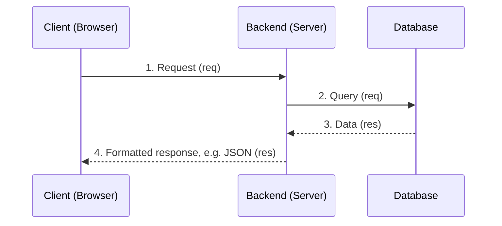

# 🧠 Client–Server Architecture

## 🔹 What it is

Client–Server Architecture is a design model where **two parties communicate**:

- **Client**: the user or application that **requests** data or services (browser, mobile app, another service).
- **Server (Backend)**: the system that **processes** the request, does the needed work, and **sends back a response**.

---

## ⚙️ How it works (Flow)

1. **Client → Backend**
   - The client sends a request (`req`) to the backend.
   - Example: a browser asking a web server for user data.
2. **Backend → Database**
   - The backend receives the request and may need data.
   - It then acts as a **client itself** to another service, usually a database.
   - It sends a request (`req`) to the database.
3. **Database → Backend**
   - The database runs the query and sends back a response (`res`) with the data.
4. **Backend → Client**
   - The backend processes the data, formats it (e.g. JSON), and sends the response (`res`) to the client.

---

## 🔁 Key Points

- The **client never talks to the database directly**. All communication goes through the backend.
- The backend plays **two roles**:
  - a **server** for the client, and
  - a **client** for other services (databases, external APIs, etc.).
- This structure improves **security**, **scalability**, and **separation of concerns**.

> 💬 "Client" and "server" are **roles**, not machines. The same backend is a server to the browser and a client to the database.

---

## 💡 Example

When you open a webpage:

1. Your browser (client) sends a request to the backend: `GET /users`.
2. The backend queries the database for users.
3. The database returns the user data.
4. The backend sends the formatted response back to the browser to display.

---

## 🍀 Benefits

| Benefit | Why it matters |
| --- | --- |
| **Centralized business logic** | All rules live on the backend, in one place, not spread across clients. |
| **Independent scaling** | Backend and database can be scaled separately, based on load. |
| **Security** | The database is hidden from direct access; only the backend can reach it. |
| **Modularity** | Each part (client, backend, database) can be replaced or upgraded on its own. |
