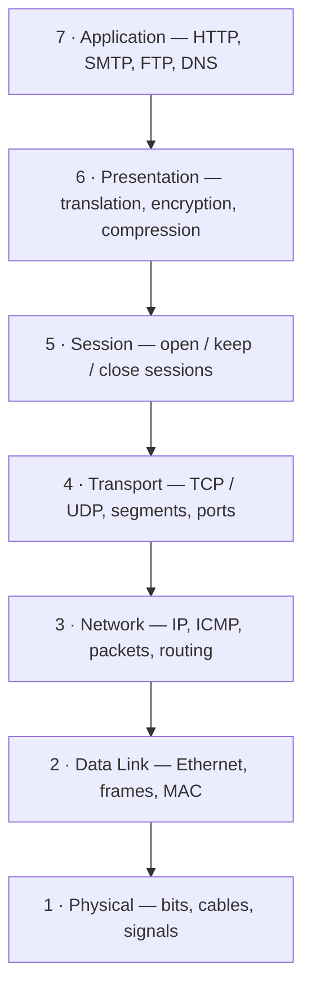

# 🧱 OSI Model

The **OSI (Open Systems Interconnection) model** splits network communication into **7 layers**. Each layer has one job and only talks to the layer directly above and below it.

- **Sending:** data travels **down** the stack (Layer 7 → Layer 1).
- **Receiving:** data travels **up** the stack (Layer 1 → Layer 7).

---

## Layer 7: Application Layer

The layer **closest to the end user**.

- ⚠️ The apps themselves (Chrome, MS Word, Outlook) are **not** part of this layer.
- It is made up of the **protocols** those apps use to do their job and show data to the user.

| Protocol | Used for |
| --- | --- |
| **HTTP / HTTPS** | Web browsing |
| **SMTP** | Sending email |
| **FTP** | File transfer |
| **DNS** | Turning domain names into IP addresses |

---

## Layer 6: Presentation Layer

Gets data into a **format the application layer can use**. It does three things:

1. **Translation**
   - Converts raw binary (0s and 1s) into a readable format.
   - If two devices use different encodings, this layer translates so the receiving app understands the data.
2. **Encryption / Decryption**
   - On the sender's side, it **encrypts** data; on the receiver's side, it **decrypts** it.
   - So the application layer always gets plain (unencrypted) data.
   - Example: browsers and servers using **TLS** (the successor to SSL).
3. **Compression**
   - Shrinks data coming from Layer 7 before passing it to Layer 5.
   - Example: a 30 MB file compressed to 10 MB before sending.
   - Makes transfer faster and more efficient, which matters most for large video and audio files.

---

## Layer 5: Session Layer

Manages **sessions**, meaning connections between two or more devices.

- Decides **when a session opens and closes**.
- Uses the ports chosen at Layer 4 and **keeps the session open** long enough for all data to transfer, then **closes** it.
- Handles **authentication** (e.g. username/password login) and **logout**, which ends the session.

---

## Layer 4: Transport Layer

Moves data between devices using **TCP** or **UDP**.

### Segmentation and reassembly

- Data that is too big for one packet is split into smaller pieces called **segments** before going down to Layer 3.
- Each segment gets a **sequence number**, so the receiver can put them back **in the right order**.
- The receiving device reassembles the segments at this layer.

### Flow control

- Sends data at a rate that suits **both** sender and receiver, so a fast sender doesn't overwhelm a slow receiver.
- The slower receiver acknowledges what it got: *"I've received these segments, send the next ones."*

### Error control

- Checks the **checksum** in each packet to make sure the received data is **complete and correct**.

### Ports

Layer 4 picks the **port** used for each kind of communication:

| Port | Used by |
| --- | --- |
| **53** | DNS |
| **80** | HTTP |
| **443** | HTTPS |

> 💡 Port 53 is open on almost every system, firewall and client, because nearly everything needs DNS.

---

## Layer 3: Network Layer

This is where **routing between different networks** happens.

- **Sending device:** breaks the segments from Layer 4 into **packets** and addresses them with **IP addresses**.
- **In transit:** picks the **most efficient path** to get the packets to their destination.
- **Receiving device:** reassembles the packets.

| Protocol | Role |
| --- | --- |
| **IP (IPv4 / IPv6)** | Addressing and delivery; carries most internet traffic |
| **ICMP** | Error and diagnostic messages (used by `ping` and `traceroute`) |

> 💡 If both devices are on the **same network** (e.g. an office LAN), no routing is needed, so Layer 3 does little work.

---

## Layer 2: Data Link Layer

Handles data transfer between devices on the **same network**, also called **node-to-node** transfer.

- The most common protocol here is **Ethernet**.
- Breaks packets from Layer 3 into even smaller pieces called **frames**.
- Addressing changes: a packet uses an **IP address**, a frame uses a **MAC (Media Access Control) address**.

### Two sublayers

| Sublayer | Role |
| --- | --- |
| **LLC (Logical Link Control)** | The "brain" of Layer 2: handles synchronization, flow control and error control. Sits on top and connects the upper layers to the MAC sublayer. |
| **MAC (Media Access Control)** | Where protocols like Ethernet work; uses MAC addresses and controls access to the physical medium. |

---

## Layer 1: Physical Layer

The **hardware** that carries data across the network.

- Includes **cables, fibre optics, hubs, repeaters**, and network cards.
- Deals in **bits** (1s and 0s).
- Converts bits into **electrical, radio or optical signals** to send them, and back again to receive them.

> ⚠️ Your source lists network **switches** here, but switches work with MAC addresses and frames, so they are **Layer 2** devices. **Routers** are Layer 3 devices.

---

## 📌 Do all 7 layers always get used?

No. **Routers and switches in the middle of the network** only look at the lower layers (Layers 1–3), so for them only those layers matter. The **end devices** (your laptop and the server) use the full stack, because the upper layers are what deliver data to the application.

---

## 🗂️ Quick Summary

| # | Layer | Data unit | Addressing / Key protocols | Example devices |
| --- | --- | --- | --- | --- |
| 7 | Application | Data | HTTP, SMTP, FTP, DNS | — |
| 6 | Presentation | Data | TLS, encoding, compression | — |
| 5 | Session | Data | Session setup / teardown | — |
| 4 | Transport | Segment | TCP, UDP, **ports** | — |
| 3 | Network | Packet | IP, ICMP, **IP address** | Router |
| 2 | Data Link | Frame | Ethernet, **MAC address** | Switch |
| 1 | Physical | Bits | Signals | Cable, hub, repeater |

> 🧠 Mnemonic (Layer 7 → 1): **A**ll **P**eople **S**eem **T**o **N**eed **D**ata **P**rocessing.
