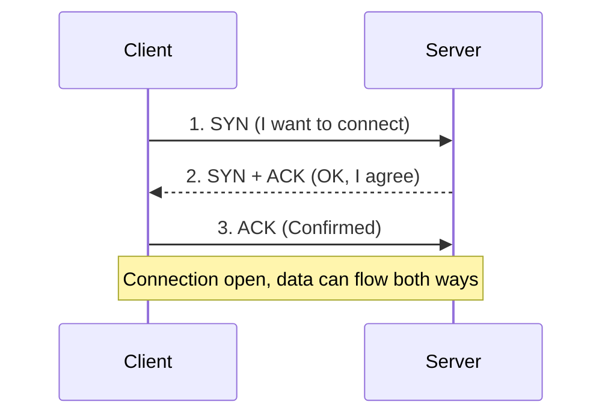
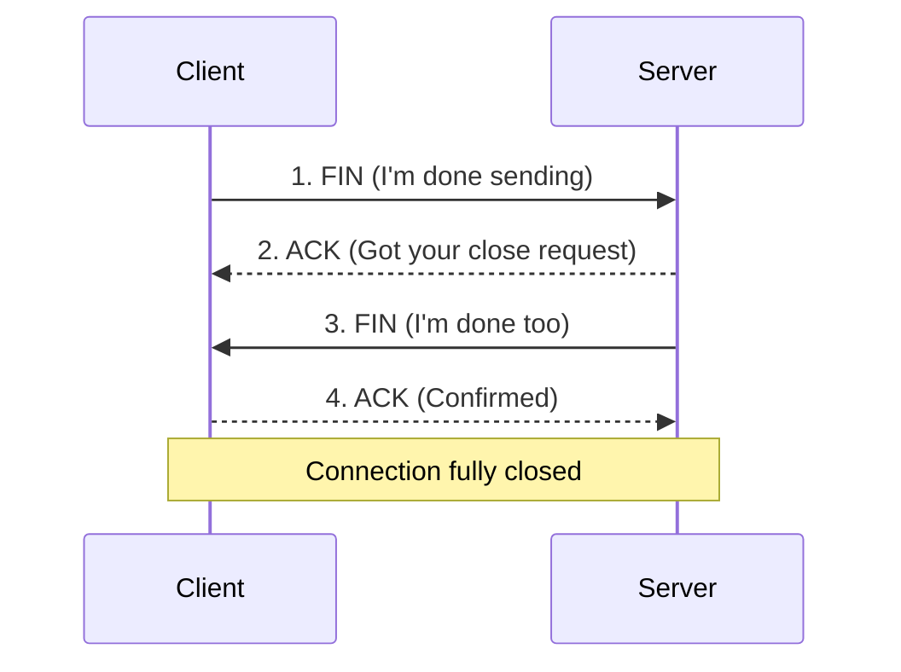
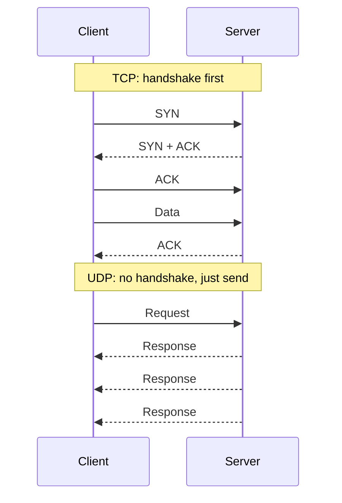

# 🔌 TCP / UDP

- [Part 1: TCP (Transmission Control Protocol)](#part-1-tcp-transmission-control-protocol)
- [Part 2: UDP (User Datagram Protocol)](#part-2-udp-user-datagram-protocol)

---

# Part 1: TCP (Transmission Control Protocol)

## 🧠 What is TCP?

**TCP** is a **Transport Layer (Layer 4)** protocol in the OSI model.

- One of the core protocols of the internet.
- Gives **reliable, ordered, error-checked** delivery of data between two devices.
- Unlike UDP, TCP doesn't just fire packets blindly. It:
  - **sets up a connection** first,
  - **checks** that data was received, and
  - **resends** anything that got lost.

> 👉 *"TCP doesn't just throw data over the network. It makes sure the other side actually got it, and in the right order."*

---

## 🌐 Where TCP is Used (in System Design)

Almost every system where **consistency and reliability** matter is built on TCP.

When a user sends a request to your backend (e.g. a `POST` to an API), it travels over **HTTP**, and HTTP runs on **TCP**.

| Area | Examples |
| --- | --- |
| Web servers | HTTP/1.1, HTTP/2, HTTPS |
| Databases | MySQL, PostgreSQL, MongoDB |
| Other protocols | SSH, FTP, SMTP |
| Infra | Load balancers, service-to-service calls in microservices |

All of these rely on TCP because they:

- need **guaranteed delivery**,
- need data **in order**, and
- **can't afford** missing or corrupted data.

> 💡 In backend systems, **TCP is the default transport** for most application protocols.

---

## ⚖️ TCP vs UDP: The Trade-off

| | **TCP** | **UDP** |
| --- | --- | --- |
| Connection | **Connection-oriented**: sets up a connection before sending | **Connectionless**: just sends, doesn't check if it arrived |
| Reliability | Reliable | Unreliable |
| Speed | Slower (setup + checks) | Faster |
| Use when | Every byte must arrive correctly | Low latency matters more than perfect delivery |

In system design, this is a trade-off between:

- **Reliability vs Speed**
- **Consistency vs Latency**

So:

- ✅ **TCP**: APIs, databases, financial transactions.
- ⚡ **UDP**: games, video calls, live streaming.

---

## 🤝 TCP 3-Way Handshake (Connection Setup)

TCP doesn't send data straight away. It first makes sure **both sides are ready**.

1. **SYN** (synchronize): the client asks the server to connect.
2. **SYN + ACK** (acknowledge): the server acknowledges and agrees.
3. **ACK**: the client confirms. The connection is now open.

### 🏗️ System design relevance

- Every new TCP connection costs **one round trip (RTT)** before any data is sent. With HTTPS, the **TLS handshake** adds more round trips on top.
- To avoid paying this on every request, systems use:
  - **Connection pooling** (e.g. for databases)
  - **Keep-alive connections** (in HTTP)

---

## 👋 TCP 4-Way Handshake (Connection Termination)

When one side wants to end the session, TCP uses **4 steps**. Either side can start it; here the client does:

1. Client sends **FIN**: it wants to close.
2. Server sends **ACK**: acknowledges the close request.
3. Server sends its own **FIN**: closes its side.
4. Client sends **ACK**: confirms. The connection is fully closed.

> 💬 Why 4 steps and not 3? After step 2 the server may still have data left to send, so it closes its side (step 3) only when it's done.

### 🎯 Why it matters

- Makes sure **no data is lost** before closing.
- Prevents **half-open connections**, which can cause **memory leaks** or **socket exhaustion** in backend systems.

---

## 💡 Important TCP Features (and Why They Matter)

| Feature | What it does | Why it matters in system design |
| --- | --- | --- |
| **Reliable delivery** | Uses acknowledgements and resends lost packets | Critical for API calls and database writes |
| **Ordered delivery** | Uses sequence numbers to put data back in the order it was sent, even if packets arrive out of order | Needed for structured data like JSON, files, SQL queries |
| **Flow control** | Slows the sender so a slow receiver isn't overwhelmed | Prevents server overload at scale |
| **Congestion control** | Detects network congestion and lowers the sending rate | Protects overall network health under heavy traffic |
| **Error detection** | Uses checksums to detect corrupted data | Keeps data correct over unreliable networks |

> All of this makes TCP **heavyweight but trustworthy**, ideal for reliable backend communication.

---

## 🔐 TCP in Real-World Backend Systems

Large distributed systems optimize TCP usage with:

| Technique | What it does |
| --- | --- |
| **Connection pooling** | Reuses existing TCP connections (e.g. Node.js HTTP agent pooling, DB connection pools) |
| **Keep-alive headers** | Keeps the same TCP socket open for multiple requests |
| **TLS over TCP** | Secure data transport (HTTPS) |
| **gRPC / HTTP/2 multiplexing** | Many request streams over **one** TCP connection |
| **Load balancers (L4 / L7)** | Manage thousands of TCP connections efficiently |

These reduce **connection latency** and improve **scalability**.

---

## 🧠 System Design View: When to Pick TCP or UDP

When designing a distributed or microservice-based system:

- **Choose TCP** if reliability, ordering or data integrity is **non-negotiable**.
  - API servers, databases, message queues.
- **Choose UDP** if **low latency** matters more than guaranteed delivery.
  - Live media, gaming servers, IoT telemetry.

### Hybrid approach

- **QUIC** (used by **HTTP/3**) runs on **UDP** but adds TCP-like reliability on top, so you get UDP's speed with TCP's reliability.

---

## 💬 Interview Takeaway

> *"TCP is a transport-layer, connection-oriented protocol that gives reliable, ordered delivery. It uses a 3-way handshake to open a connection and a 4-way handshake to close it. Most backend systems use it where reliability matters, like HTTP, databases and APIs.*
>
> *The trade-off is speed. TCP is slower because of connection setup and congestion control, while UDP is faster but unreliable."*

---

# Part 2: UDP (User Datagram Protocol)

## 🧠 What is UDP?

**UDP** is also a **Transport Layer (Layer 4)** protocol, just like TCP.

But unlike TCP, UDP is:

- **connectionless**,
- **unreliable**: it doesn't guarantee **delivery**, **order**, or **error correction**.

Sounds bad? Not really. It's built for **speed and low latency**, not guaranteed reliability.

> 👉 *"Just send the data and don't wait to check if it arrived. Keep moving fast."*

### TCP vs UDP communication

---

## ⚙️ How UDP Works

1. **No connection setup**: no 3-way handshake.
2. The sender packs data into **datagrams** (packets) and adds a **small header** (source and destination port).
3. It fires them across the network.
4. If the receiver is **listening on that port**, it gets the packet and processes it. Otherwise, the packet is **gone forever**.

- ❌ No acknowledgement.
- ❌ No retransmission.
- ✅ Pure **fire-and-forget**.

> 📹 Typical use case: **video conferencing**.

---

## 🌐 Where UDP is Used (System Design Perspective)

UDP fits systems where:

- **Speed > Reliability**
- **Real-time delivery** matters more than perfect delivery

Losing a few packets is fine, **as long as latency stays low**.

| Use case | Examples |
| --- | --- |
| Live streaming | YouTube Live, Twitch |
| Video conferencing | Zoom, Google Meet |
| Online gaming | Multiplayer FPS games, where reaction time is critical |
| Voice over IP (VoIP) | Calls over the internet |
| DNS lookups | Resolving domain names |
| IoT telemetry | Sensor data from devices |

> 💡 In backend architecture, UDP is chosen for **real-time, stateless, fire-and-forget** systems.

> ⚠️ Some live streaming (e.g. HLS / DASH video on YouTube or Twitch to viewers) actually runs over **HTTP on TCP**. UDP is used more for **ultra-low-latency** parts, like the uploader's stream or WebRTC-based live video.

---

## 🚀 Key Characteristics of UDP

| Characteristic | Meaning |
| --- | --- |
| **Connectionless** | No handshake or session. The sender doesn't even know if the receiver is there. |
| **No guaranteed delivery** | Packets can be lost or dropped, with no retry. |
| **No ordering** | Packets can arrive out of order; the **application** must reorder them, if it cares. |
| **Lightweight** | Smaller header, less metadata, no connection state, so it's very fast. |
| **Low latency** | No setup, no acknowledgements, no congestion control. |

That's why UDP is perfect where **every millisecond counts**: gaming, voice, video.

---

## ⚖️ System Design Trade-offs (Compared to TCP)

Every protocol choice is a **trade-off**:

- **TCP** focuses on **reliability and order**, great for APIs and databases.
- **UDP** focuses on **speed and freshness**, great for real-time and streaming.

When building a large system:

- ✅ **TCP** for things that must be **100% correct** (user transactions, HTTP APIs).
- ⚡ **UDP** for things that must be **fast** and can **tolerate some data loss** (live audio).

> 🎧 Example: in **Zoom calls**, if one voice packet is lost, it's **skipped**, not waited for. Waiting would add delay, and stale audio is useless anyway.

---

## 🧩 Why UDP is Important in System Design

UDP is simple, but it's the **foundation for modern, high-performance networking**. Many advanced protocols are built **on top of UDP** to balance speed and reliability:

| Protocol | Built on UDP for |
| --- | --- |
| **QUIC** | Used in **HTTP/3**. Google designed it to bring TCP-like reliability on top of UDP. |
| **RTP** (Real-time Transport Protocol) | Media streaming, voice and video calls |
| **DNS** | Fast domain lookups, since requests and responses are small |

> 💡 DNS **falls back to TCP** when a response is too large for one UDP packet, and for zone transfers between DNS servers.

In distributed systems, UDP is often the **base layer** for real-time protocols that add **their own reliability** on top.

---

## 🔍 UDP Header (Just to Know)

The UDP header is only **8 bytes**, with 4 fields of 2 bytes each:

| Field | Purpose |
| --- | --- |
| **Source port** | Port of the sender |
| **Destination port** | Port of the receiver |
| **Length** | Size of header + data |
| **Checksum** | Basic error detection (optional in IPv4, required in IPv6) |

That's it: **no sequence number, no acknowledgement**. This simplicity is what makes it so fast.

> 📏 For comparison, a TCP header is **at least 20 bytes**.

---

## 🏗️ Backend + System Design Relevance

**Example 1: real-time analytics service**

- It receives events from **millions of devices per second** (e.g. a telemetry pipeline).
- With TCP, every device would need a handshake, which is a **huge overhead**.
- With UDP, devices send **fire-and-forget** packets. Even if 0.1% are lost, that's acceptable.

**Example 2: game backend**

- TCP's retransmission can cause **lag spikes**: one lost packet holds up everything behind it.
- With UDP, players get **position updates instantly**. If one update is lost, the **next one replaces it** anyway.

> 🧠 **UDP = real-time + scalable + stateless.**

---

## ⚠️ Downsides of UDP

- **No built-in reliability**: you build your own error handling if you need it.
- **No congestion control**: careless use can **flood the network**.
- Packets can be **lost, duplicated, or arrive out of order**.
- **Firewalls block it more often**, since there's no connection to track.

That's why engineers use UDP **carefully**, in **specific, controlled** scenarios where its strengths outweigh its weaknesses.

---

## 💬 Interview Takeaway

> *"UDP is a transport-layer, connectionless protocol designed for low-latency data transfer. It doesn't guarantee delivery or order, but it's extremely fast and lightweight. It's used in real-time systems like video calls, gaming, and live streaming.*
>
> *In system design, UDP is preferred when we can tolerate some data loss but not delay, for example VoIP or live dashboards. TCP ensures reliability, UDP ensures speed."*

---

## 🚀 Bonus System Design Insight

Modern internet performance improvements are being **built on top of UDP**:

- **HTTP/3** uses **QUIC**, which runs over UDP, combining UDP's speed with reliability built in the application layer.
- **WebRTC** (peer-to-peer video calls) also uses UDP internally.

> So even though UDP is decades old, it's the **backbone of modern real-time systems**.
