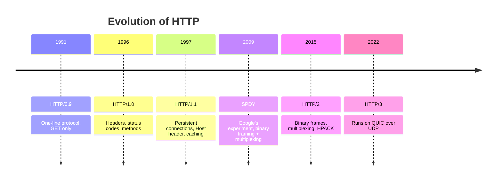
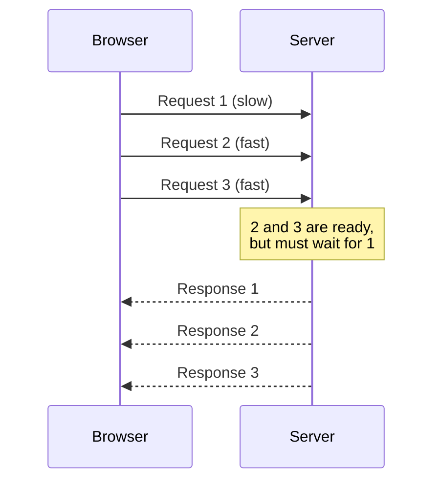
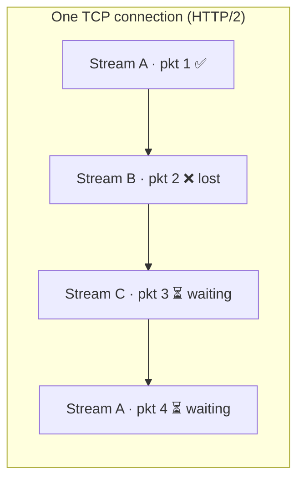

# 🌍 HTTP — The Basics

> 📖 Reference: [MDN Web Docs: Evolution of HTTP](https://developer.mozilla.org/en-US/docs/Web/HTTP/Basics_of_HTTP/Evolution_of_HTTP)

## 🗺️ Timeline at a glance

---

## 🧠 Chapter 1: The Birth of HTTP (a.k.a. "The Simpler Times")

In the early 90s the web was a sleepy village: just text, one request at a time.

**HTTP/0.9** was a **tiny, one-line protocol**:

- Client: *"Hey, give me that HTML file!"*
- Server: *"Sure, here you go."*

| Feature | HTTP/0.9 |
| --- | --- |
| Connections | **One request = one TCP connection** |
| Methods | Only `GET` |
| Headers / status codes / metadata | ❌ None, just raw HTML output |

It was fast *for that era*, but soon the web got greedy 😏. People wanted **images, CSS, scripts, APIs**, and HTTP/0.9 suddenly looked like a flip phone in a smartphone world.

---

## ⚙️ Chapter 2: HTTP/1.0 — "We Need More Features!"

As websites grew, **HTTP/1.0** arrived (mid-90s). It introduced the basic **HTTP semantics** we still use today:

- **Methods**: `GET`, `POST`, `HEAD`
- **Status codes**: `200`, `404`, etc.

### 🧩 Key additions

- **Headers**: `Content-Type`, `Content-Length`, etc.
- **Versioning**: `HTTP/1.0` sent with each request
- **MIME types**: so it could send more than HTML (images, CSS, etc.)
- **Response metadata** and **caching hints**

### 👇 But one *huge problem* remained

**Every request opened and closed a new TCP connection.**

> 😩 *"Want to load 10 images? Open 10 connections, do 10 handshakes, and go through 10 slow starts."*

(**Slow start** = TCP begins every new connection sending slowly and only speeds up over time, so short-lived connections never reach full speed.)

---

## 🎊 Chapter 3: HTTP/1.1 — "Persistent Connections and Problems"

Engineers said, *"We can fix that!"* **HTTP/1.1** came in **1997** with some new powers.

### 🔑 New powers unlocked

| Feature | What it does |
| --- | --- |
| **Persistent (Keep-Alive) connections** | One TCP connection for many requests |
| **Chunked transfer encoding** | Send the response in chunks (useful for streaming) |
| **`Host` header** | Many websites can live on **one IP** |
| **Caching controls** | `Cache-Control`, `ETag`, `If-Modified-Since` |

Everything looked perfect… until **pipelining** entered the chat.

### 🚧 Pipelining and Head-of-Line (HOL) blocking

- HTTP/1.1 allowed **multiple requests "in flight"** on one connection.
- But **responses still had to come back in order**.
- So **one slow response blocked everything behind it**. This is called **Head-of-Line (HOL) blocking** 😅.

### 🩹 The workaround

- Browsers mostly **turned pipelining off**.
- Instead they opened **up to 6 parallel TCP connections per origin** to hide the latency.
- But that **wasted bandwidth and CPU**. The web needed a smarter approach.

---

## 🚀 Chapter 4: Enter SPDY (Google's Secret Sauce)

Around **2009**, Google said:

> *"We need a faster web. Let's build our own protocol!"* ⚡

They created **SPDY** (pronounced "speedy"), a prototype that introduced:

- **Binary framing**
- **Multiplexing**: many requests over one connection
- **Header compression**

It was like HTTP on steroids 💪, and it worked so well that it **inspired the official standard: HTTP/2**.

---

## 💡 Chapter 5: HTTP/2 — The Big Makeover (2015)

HTTP/2's idea:

> *"Keep the old HTTP behaviour, but change how data travels."*

Methods, status codes and headers stay the same; only the way they're sent over the wire changes.

### Core upgrades

| Upgrade | What it does |
| --- | --- |
| 📦 **Binary framing** | No more plain text; uses compact binary **frames** |
| 🔀 **Multiplexing** | **One TCP connection, many independent streams** |
| 🗜️ **HPACK header compression** | Compresses headers that repeat across requests |
| ↕️ **Stream prioritization** | Tells the server which resources matter most |
| 🎁 **Server Push** | Sends assets *before* the client asks (cool in theory, messy in practice) |

> ⚠️ Server Push was rarely used well, and **Chrome removed support for it in 2022**. Use `<link rel="preload">` or **103 Early Hints** instead.

### ✅ Result

- HTTP/2 solved **application-level HOL blocking**: a slow response no longer blocks the others.
- Many streams flow together, like cars in different lanes on one highway 🛣️.

But a hidden villain was lurking underneath: **TCP itself** 😈.

---

## 🪤 Chapter 6: The TCP Head-of-Line Trap

**TCP guarantees in-order delivery.** If one packet goes missing, **everything after it waits**, even data that belongs to a different, unrelated stream.

So with HTTP/2's multiplexing:

- **One lost TCP packet → all streams freeze** 🥶
- This is **TCP-level Head-of-Line blocking**.

| | Where the blocking happens | Fixed by |
| --- | --- | --- |
| **HTTP/1.1 HOL** | Application level: responses must come back in order | HTTP/2 multiplexing |
| **TCP HOL** | Transport level: lost packet holds up all later bytes | HTTP/3 + QUIC |

On modern, **lossy mobile networks**, this was unacceptable. It was time for a radical new transport that wasn't bound by TCP's rules.

---

## 🧬 Chapter 7: QUIC & HTTP/3 — The Next Evolution

Google, once again:

> *"If TCP can't keep up, let's build our own transport, on top of UDP."* ⚙️

So **QUIC** was born, and with it, **HTTP/3**.

- **QUIC** originally stood for **Quick UDP Internet Connections**. (The IETF standard version just uses "QUIC" as a name, not an acronym.)
- QUIC was standardized in **2021** (RFC 9000), and HTTP/3 in **2022** (RFC 9114).

Think of it as:

> 🍰 *"TCP + TLS + Multiplexing + Mobility, all baked into one delicious UDP cake."*

| Ingredient | What QUIC gives you |
| --- | --- |
| **TCP-like reliability** | Retransmission and ordering, but **per stream**, so one lost packet only stalls its own stream |
| **TLS 1.3 built in** | Encryption is mandatory and combined with connection setup (fewer round trips) |
| **Multiplexing** | Independent streams, with **no TCP-level HOL blocking** |
| **Mobility** | Connections use a **connection ID**, not the IP + port, so they survive switching from Wi-Fi to mobile data |
