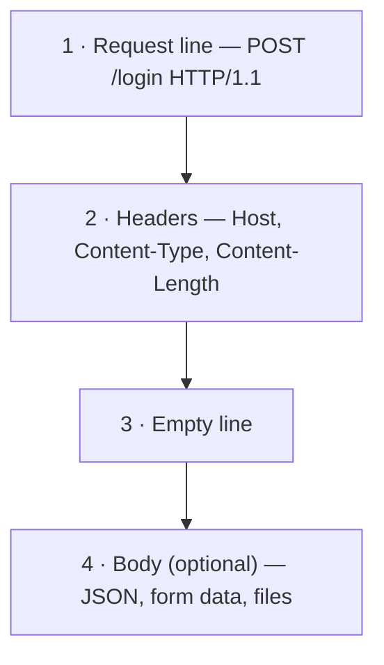
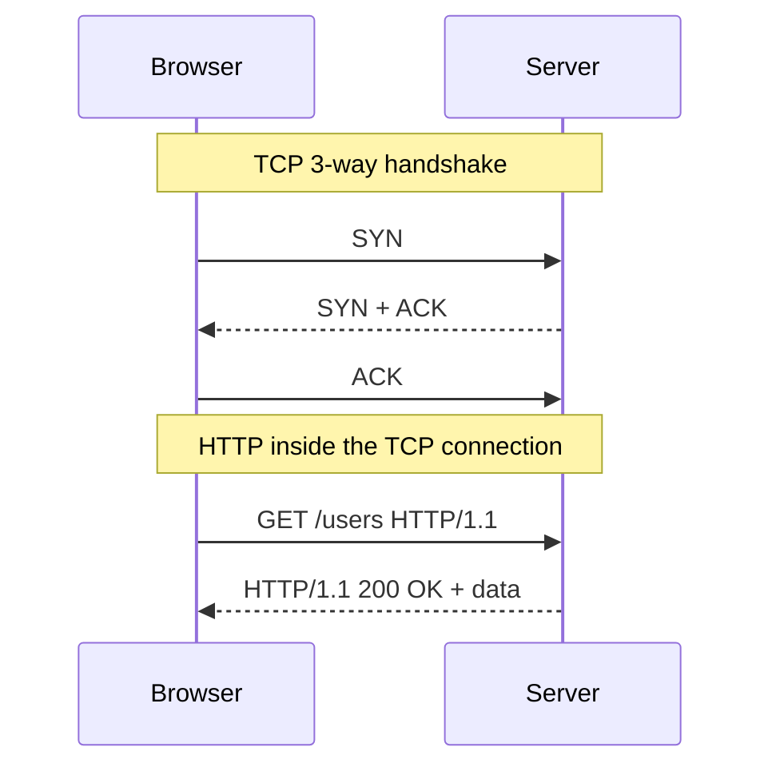

# 🤝 Understanding Protocols & HTTP

## 🧠 1. What is a Protocol?

A **protocol** is a **set of rules**, a common language, that two machines agree on so they can communicate meaningfully.

> 👥 Two people who speak the same language can exchange ideas.
> 💻 Likewise, two computers that understand the same protocol can exchange data.

Without a protocol, even machines that are physically connected (cable, Wi-Fi, etc.) **wouldn't understand each other's messages**.

### 🧩 Examples

- If you send `add 2 3`, **both client and server must agree** it means *"add the numbers 2 and 3"*.
- On the internet, **HTTP** (Hypertext Transfer Protocol) is the most common protocol for web communication.

### A protocol defines

1. The **structure** of a message (what fields it has)
2. The **meaning** of those fields
3. The **sequence** in which messages are exchanged

---

## 🔗 2. Protocols as the Foundation of Network Communication

Every piece of data on the internet (a web page, an email, an API response) **follows some protocol**.

| Layer | Protocol(s) | Defines |
| --- | --- | --- |
| **Transport** | TCP / UDP | **How** data is sent (reliable or unreliable) |
| **Application** | HTTP / HTTPS | **What** is sent (the message content) |
| **Application** | DNS, FTP, SMTP, WebSocket, gRPC | Specific types of communication |

> 🏗️ **System design view:** protocols = **contracts between communicating services**. Without them, microservices, databases and browsers couldn't understand each other.

---

## ⚙️ 3. HTTP — The Protocol That Powers the Web

**HTTP** is a standard **application-level protocol** that defines how clients and servers talk over **TCP connections**.

- It's what your **browser** uses to talk to a web server.
- It's what **APIs** use to talk between microservices.

```http
GET /users HTTP/1.1
Host: devsync.in
Content-Type: application/json
```

Even this small request follows the HTTP format:

| Part | Meaning |
| --- | --- |
| `GET` | **Method**: what action |
| `/users` | **Path**: which resource |
| `HTTP/1.1` | **Version** |
| Headers | **Metadata**: extra info about the request |

---

## 🧩 4. HTTP Request Structure (In Depth)

An HTTP request has a **strict, predictable format**:



1. **Request line**: the method (`GET`, `POST`, `PUT`, `DELETE`), the path/URL, and the protocol version.

   ```http
   POST /login HTTP/1.1
   ```

2. **Headers**: key-value pairs with metadata about the request.

   ```http
   Host: devsync.in
   Content-Type: application/json
   Content-Length: 49
   ```

3. **Empty line**: separates the headers from the body.
4. **Body (optional)**: the data, e.g. JSON, form fields or files (for `POST` / `PUT`).

   ```json
   {"email": "test@devsync.in", "password": "12345"}
   ```

> 💡 Each line actually ends with `\r\n` (CRLF), and the empty line is just a lone `\r\n`. That's how the server knows where the headers end.

The server understands this message **not because it's smart**, but because **both sides follow the same agreed-upon format** (the HTTP specification).

---

## 🧠 5. How HTTP Works on Top of TCP

Under the hood, HTTP messages are **sent over TCP connections**.

TCP handles:

- Breaking messages into **packets**
- Making sure they arrive **in order**
- **Retransmitting** lost packets

So when your browser sends an HTTP request:



> 🏗️ **System design insight:**
> - **TCP = reliable delivery**
> - **HTTP = meaningful format**
>
> Together they give web communication both **reliability** and **structure**.

---

## ⚡ 6. Why Headers Matter (Real Backend Insight)

Headers are **not optional metadata**; they are **instructions for the server**.

| Header | What it tells the server |
| --- | --- |
| **`Host`** | Which website you want. **Mandatory in HTTP/1.1**, and important when many sites share one IP. |
| **`Content-Type`** | How to read the body (JSON, form data, plain text, etc.) |
| **`Content-Length`** | How many bytes to read for the body. Without it (or chunked encoding), the server wouldn't know where the body ends. |
| **`User-Agent`** | Who the client is (browser, mobile app, etc.) |
| **`Accept`** | Which content types the client can handle (e.g. `application/json`) |

If any of these are **missing or malformed**, the request can **hang, fail, or be misread**.

> 💡 Frameworks like **Express.js, Flask, or Django** use these headers to **parse request bodies automatically**.

---

## 🔍 7. Raw TCP Communication — Seeing HTTP "Under the Hood"

You can open a **raw TCP connection** (e.g. with a small Go server, or tools like `telnet` / `nc`) and **type an HTTP request by hand**:

```http
GET / HTTP/1.1
Host: localhost:8080

```

This raw text is **exactly what your browser sends** behind the scenes.

Understanding how raw TCP text becomes HTTP helps you:

- **Debug** backend issues (e.g. malformed headers)
- Understand **latency** and **connection behaviour**
- Build **custom servers or clients** that follow HTTP rules

> 🧩 **System design tip:** in distributed systems, teams sometimes build **custom lightweight protocols** for internal service-to-service communication (as gRPC does). But **both sides must follow the same rules**, just like with HTTP.

---

## 🛠️ 8. Custom Protocols — Beyond HTTP

HTTP isn't the only way for two services to talk. You can **define your own protocol**, as long as both client and server understand it.

```text
ADD 2 3
RESULT 5
```

If both ends agree this is the valid format, **this is a protocol**.

### In real life

| System | Protocol |
| --- | --- |
| **PostgreSQL** | Its own binary wire protocol for database drivers |
| **Redis** | **RESP**, a simple text-based protocol |
| **gRPC** | Its own message framing (Protocol Buffers) on top of **HTTP/2** |
| **MQTT, Kafka** | Each defines its own communication rules |

> 💡 Once you understand HTTP, it becomes much easier to **design or read any protocol**.

---

## ⚡ 9. Evolution of HTTP — HTTP/1.1 → HTTP/2 → HTTP/3

> Full story: [HTTP — The Basics](03-http-basics.md)

| Version | Key points |
| --- | --- |
| **HTTP/1.1** | Persistent connections: **one TCP connection, but one request-response at a time** on it. Suffers from **head-of-line blocking**, so browsers open several connections. |
| **HTTP/2** | **Multiplexing**: many requests over **one TCP connection**. Adds **header compression** (HPACK). |
| **HTTP/3** | Built on **QUIC**, which runs over **UDP**. Faster connection setup, lower latency, better for modern web and real-time apps. |

The evolution of HTTP reflects the growing need for **scalability, performance and security** on the modern internet.

---

## 💡 10. The Big Picture (System Design Insight)

Understanding protocols gives you **control and clarity** when building or debugging systems.

- Everything from **browser → backend → database** runs on protocols.
- Whether it's TCP, HTTP or a custom binary format, it's all **structured message exchange**.
- If you understand the **format and flow**, you can debug or build at **any layer**.

> 🔑 **The key realization:**
> A protocol is not magic. It's just an **agreed-upon structure of text or bytes**.
> **You can create your own.**

That's the foundation of networking, APIs, and distributed systems.

---

## 🔑 Final Takeaway

- **Protocols** = communication languages for machines.
- **TCP ensures delivery; HTTP defines meaning.**
- **Headers are instructions**, not decoration.
- You can build **your own protocol** if both ends follow the same format.
- Understanding **raw TCP → HTTP** shows you what frameworks hide from you.
- HTTP's evolution (**1.1 → 2 → 3**) is the story of improving **speed, security, and concurrency**.
