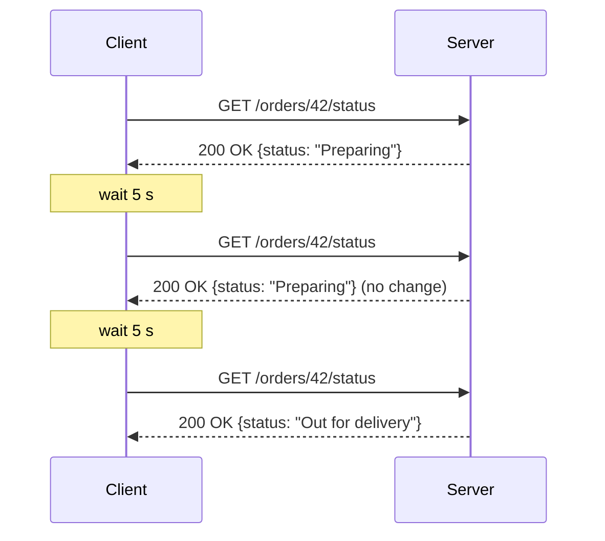

# 🔁 Short Polling

> 📚 Real-time communication series: **Short Polling** → [Long Polling](02-long-polling.md) → [WebSockets](03-websockets.md) → [Server-Sent Events](04-server-sent-events.md)

---

## 🧠 1. What is Short Polling?

**Short polling** is the simplest way to get "near real-time" updates over plain HTTP.

- The client asks the server **again and again, on a fixed interval** (e.g. every 5 seconds): *"Anything new?"*
- The server **answers immediately**, with or without new data.
- Each poll is a **normal, independent HTTP request**.

> 👉 *"Are we there yet? Are we there yet? Are we there yet?"*: a kid in the back seat of a car.

HTTP is **request-response**: the server can't talk unless the client asks first. Short polling works around this by simply **asking often**.

---

## ⚙️ 2. How It Works



1. Client sends a request.
2. Server checks its data and **responds right away**.
3. Client waits for the **polling interval**.
4. Repeat.

> ⚠️ Most responses carry **no new data**. They are wasted work for the client, the network and the server.

---

## 💻 3. Code Example (C#)

### Server: a normal ASP.NET Core endpoint

Nothing special on the server. Short polling is just a regular `GET` endpoint.

```csharp
var builder = WebApplication.CreateBuilder(args);
builder.Services.AddSingleton<OrderStore>();
var app = builder.Build();

app.MapGet("/api/orders/{id:int}/status", (int id, OrderStore store) =>
    store.TryGet(id, out var order)
        ? Results.Ok(new { order.Id, order.Status, order.UpdatedAt })
        : Results.NotFound());

app.Run();
```

### Client: poll on a timer

```csharp
using System.Net.Http.Json;

using var http = new HttpClient { BaseAddress = new Uri("https://localhost:5001") };
using var timer = new PeriodicTimer(TimeSpan.FromSeconds(5));

while (await timer.WaitForNextTickAsync())
{
    var order = await http.GetFromJsonAsync<OrderStatus>("/api/orders/42/status");
    Console.WriteLine($"Status: {order?.Status}");

    if (order?.Status == "Delivered") break; // stop polling when done
}

record OrderStatus(int Id, string Status, DateTime UpdatedAt);
```

> 💡 Reuse **one `HttpClient`** (or `IHttpClientFactory`). With keep-alive, every poll reuses the same TCP/TLS connection instead of paying a new handshake each time.

---

## ⏱️ 4. Choosing the Polling Interval

The interval is the **one knob** you have, and it's a direct trade-off:

| Interval | Freshness | Server load |
| --- | --- | --- |
| **Short** (1 s) | Updates seen quickly | Very high: many empty requests |
| **Long** (30 s) | Updates can be up to 30 s late | Low |

- **Worst-case latency ≈ the polling interval** (plus one round trip).
- **Average latency ≈ half the interval.**

### 🧮 Quick math

- **1,000,000** clients polling every **5 s** = **200,000 requests/second**.
- If data changes once a minute, **~92% of those requests return nothing new** (11 of every 12).

> ⚠️ This is why short polling **doesn't scale well** for large, frequently-connected user bases.

---

## 🛠️ 5. Making Short Polling Cheaper

| Technique | How it helps |
| --- | --- |
| **Conditional requests** (`ETag` + `If-None-Match`) | Server replies `304 Not Modified` with **no body** when nothing changed |
| **"Since" cursor** (`?since=1714000000`) | Server returns only **new** items, not the whole list |
| **Caching** (CDN / Redis) | Polls hit a cache instead of the database |
| **Adaptive interval / backoff** | Poll slower when idle, or when the tab is hidden; faster when active |
| **Jitter** | Add a random offset so millions of clients don't poll at the **same second** |
| **Stop condition** | Stop polling once the job is finished |

A conditional poll on the wire:

```http
GET /api/orders/42/status HTTP/1.1
Host: shop.example.com
If-None-Match: "v7"

HTTP/1.1 304 Not Modified
ETag: "v7"
```

> 💡 A `304` still costs a request and a server lookup, but it saves **bandwidth** and serialization work.

---

## ✅❌ 6. Pros and Cons

| ✅ Pros | ❌ Cons |
| --- | --- |
| **Dead simple**: plain HTTP, any client, any server | **Wasteful**: most requests return nothing |
| Works through **every proxy, firewall and load balancer** | **Latency** is tied to the interval |
| **Stateless** server: easy to scale horizontally | **High load** at scale (requests, DB queries, logs) |
| Easy to **cache**, retry and debug | Hard to get "instant" updates without hammering the server |

---

## 🏗️ 7. System Design View

### When to use it

- Updates are **infrequent** or **not time-critical** (seconds of delay is fine).
- **Small number of clients**, or short-lived polling sessions.
- You need something that **works everywhere** with zero new infrastructure.

### Real examples

- Checking the status of a **background job** (report export, video encoding).
- **Payment status** page after a redirect.
- Simple **admin dashboards** that refresh every 30 to 60 seconds.

### Scaling concerns

- Load grows with **clients × poll frequency**, not with **actual changes**.
- Put polls behind a **cache**, so they don't hit the database every time.
- Use **rate limiting** to protect against clients that poll too aggressively.

> 💡 If you find yourself lowering the interval to 1 second to make it "feel real-time", it's time to look at [Long Polling](02-long-polling.md), [WebSockets](03-websockets.md) or [SSE](04-server-sent-events.md).

---

## 💬 Interview Takeaway

> *"Short polling means the client sends a normal HTTP request on a fixed interval and the server responds immediately, whether or not there's new data. It's simple, stateless and works everywhere, but it wastes requests and its latency is bounded by the polling interval.*
>
> *I'd use it for low-frequency updates like job status checks. For high-frequency or large-scale real-time features, I'd move to long polling, SSE or WebSockets."*

---

## 🔑 Final Takeaway

- **Short polling** = "ask every N seconds", server **answers immediately**.
- **Latency ≈ interval**; **load ≈ clients ÷ interval**.
- Most responses are **empty**, which is the core inefficiency.
- Make it cheaper with **ETags, cursors, caching, backoff and jitter**.
- Great for **simple, infrequent** updates; a poor fit for chat, games or live feeds.
- Next step: [Long Polling](02-long-polling.md), which lets the server **hold** the request until there's something to say.
