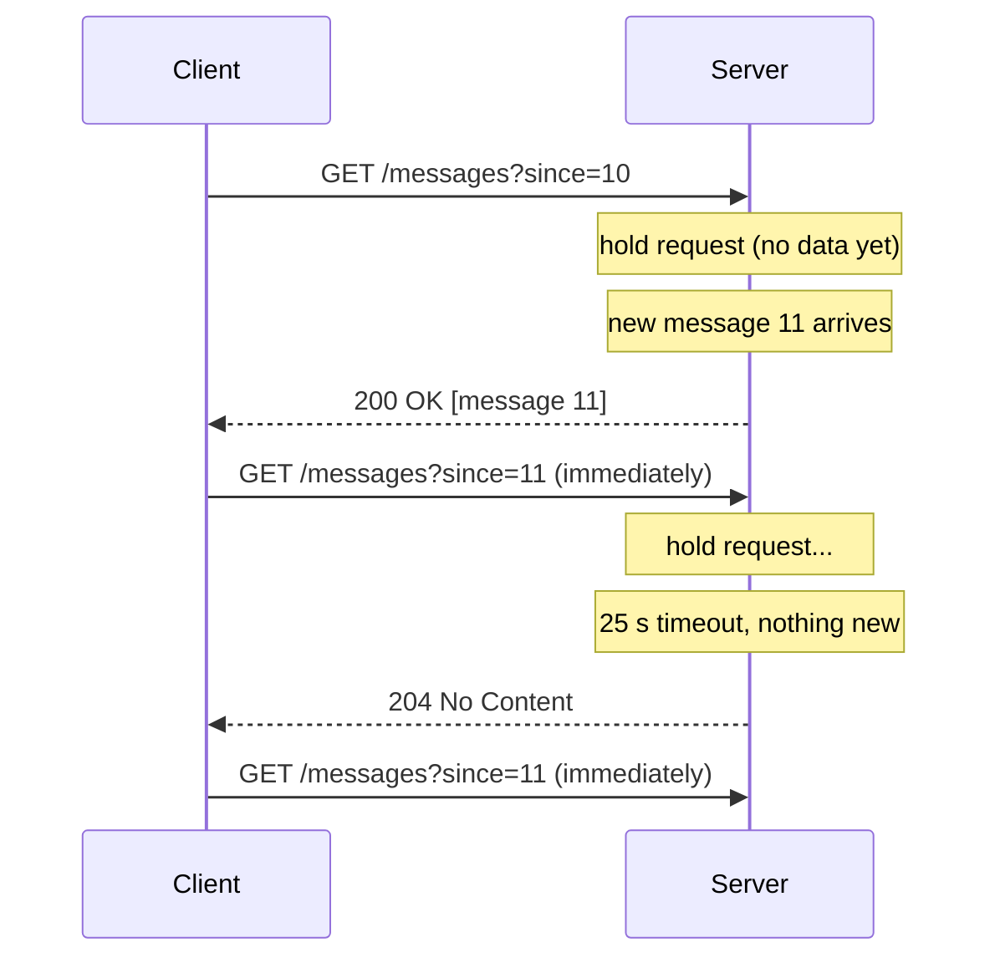
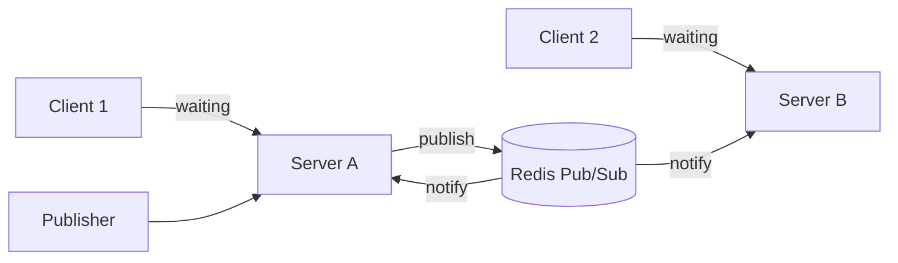

# ⏳ Long Polling

> 📚 Real-time communication series: [Short Polling](01-short-polling.md) → **Long Polling** → [WebSockets](03-websockets.md) → [Server-Sent Events](04-server-sent-events.md)

---

## 🧠 1. What is Long Polling?

**Long polling** is an improved version of [short polling](01-short-polling.md).

- The client sends a request: *"Tell me when something new happens."*
- The server **does not answer right away**. It **holds the request open** until:
  - **new data arrives** → respond with the data, or
  - a **timeout** is reached (e.g. 25 s) → respond with "nothing new".
- As soon as the client gets a response, it **immediately sends the next request**.

> 👉 *"Don't call me every 5 seconds. Call once, and I'll answer when I actually have news."*

The result: updates arrive **almost instantly**, with far fewer **empty** responses than short polling.

---

## ⚙️ 2. How It Works



1. Client sends a request with a **cursor** (`since=10`: the last thing it has seen).
2. If the server already has newer data, it **returns it straight away**.
3. Otherwise it **waits** for new data or the timeout.
4. Client processes the response and **reconnects at once**.

> 💡 The **cursor** matters. Data can arrive in the gap between one response and the next request. Asking for "everything after #11" means nothing is lost in that gap.

---

## 💻 3. Code Example (C#)

### Server: hold the request until data or timeout

A tiny in-memory store that lets waiting requests "sleep" until a new message is added:

```csharp
public record Message(long Id, string Text);

public sealed class MessageStore
{
    private readonly List<Message> _messages = new();
    private readonly object _lock = new();
    private TaskCompletionSource _signal = new(TaskCreationOptions.RunContinuationsAsynchronously);

    public void Add(string text)
    {
        TaskCompletionSource toRelease;
        lock (_lock)
        {
            _messages.Add(new Message(_messages.Count + 1, text));
            toRelease = _signal;                       // wake everyone waiting now
            _signal = new(TaskCreationOptions.RunContinuationsAsynchronously);
        }
        toRelease.TrySetResult();
    }

    public async Task<IReadOnlyList<Message>> WaitForNewAsync(long since, TimeSpan timeout, CancellationToken ct)
    {
        Task wait;
        lock (_lock)
        {
            var ready = _messages.Where(m => m.Id > since).ToList();
            if (ready.Count > 0) return ready;         // data already there: answer now
            wait = _signal.Task;
        }

        try { await wait.WaitAsync(timeout, ct); }
        catch (TimeoutException) { return []; }        // nothing new in time

        lock (_lock) return _messages.Where(m => m.Id > since).ToList();
    }
}
```

The endpoints:

```csharp
builder.Services.AddSingleton<MessageStore>();
var app = builder.Build();

app.MapGet("/api/messages", async (long since, MessageStore store, CancellationToken ct) =>
{
    var messages = await store.WaitForNewAsync(since, TimeSpan.FromSeconds(25), ct);
    return messages.Count == 0 ? Results.NoContent() : Results.Ok(messages);
});

app.MapPost("/api/messages", (string text, MessageStore store) =>
{
    store.Add(text);
    return Results.Accepted();
});
```

> 💡 The `await` **doesn't block a thread**. While waiting, the request is just a small object in memory. That's what makes long polling feasible in ASP.NET Core.

### Client: reconnect in a loop

```csharp
using System.Net;
using System.Net.Http.Json;

using var http = new HttpClient
{
    BaseAddress = new Uri("https://localhost:5001"),
    Timeout = TimeSpan.FromSeconds(40)       // must be longer than the server hold time
};

long lastId = 0;
while (true)
{
    try
    {
        var response = await http.GetAsync($"/api/messages?since={lastId}");
        if (response.StatusCode == HttpStatusCode.NoContent) continue; // timeout, ask again

        var messages = await response.Content.ReadFromJsonAsync<List<Message>>() ?? [];
        foreach (var m in messages) Console.WriteLine(m.Text);
        if (messages.Count > 0) lastId = messages[^1].Id;
    }
    catch (HttpRequestException)
    {
        await Task.Delay(TimeSpan.FromSeconds(2)); // back off on errors, don't hammer the server
    }
}

record Message(long Id, string Text);
```

---

## ⏱️ 4. Timeouts: The Tricky Part

Every hop between client and server has its own **idle timeout**:

| Hop | Typical concern |
| --- | --- |
| **Client** (`HttpClient.Timeout`, default 100 s) | Must be **longer** than the server hold time |
| **Load balancer / reverse proxy** | Many default to around **60 s** idle (e.g. AWS ALB), and kill quiet requests |
| **Corporate proxies / mobile networks** | May cut long idle requests unpredictably |

> ⚠️ Rule of thumb: keep the server hold time **below every timeout on the path** (e.g. **20 to 30 s**), and always handle a dropped request by simply **reconnecting**.

---

## ✅❌ 5. Pros and Cons

| ✅ Pros | ❌ Cons |
| --- | --- |
| **Near-instant** delivery, much better than short polling | Each open request **holds server resources** (memory, a socket) |
| Far fewer **empty responses** | **Still one HTTP request per message batch** (headers each time) |
| Plain HTTP: works through **proxies and firewalls** | **Timeouts** at every hop must be tuned |
| Good **fallback** when WebSockets are blocked | **Server → client only**; sending still needs separate requests |
| | Ordering, duplicates and gaps need a **cursor** to handle correctly |

---

## 🏗️ 6. System Design View

### When to use it

- You need **low-latency** updates but **can't use WebSockets** (old clients, strict proxies).
- Updates are **bursty** or moderate: chat notifications, inbox updates.
- As a **fallback transport**. Libraries like **SignalR** fall back to long polling when WebSockets and SSE aren't available.

### Scaling concerns

- **Concurrent open requests** = number of connected clients. Plan for **memory and sockets**, not just requests per second.
- **Multiple servers**: a message published on server A must wake a request waiting on server B.
  - Use a **pub/sub backplane** (e.g. **Redis Pub/Sub**) so every server hears every event.
- **Thundering herd**: one event can wake **thousands** of waiting requests at once, which all reconnect at the same time. Spread the load with **jitter**.
- Avoid **thread-per-request** servers; use **async I/O** (ASP.NET Core, Node.js, Go).



> 💡 Real-world users: early **Facebook chat** and **Gmail** used long polling (often called **Comet**) before WebSockets were widely supported.

---

## 💬 Interview Takeaway

> *"Long polling is when the client sends a request and the server holds it open until new data is available or a timeout hits. The client then immediately sends another request. It gives near real-time delivery over plain HTTP and works through proxies.*
>
> *The trade-offs are open connections on the server, timeout tuning, and per-message HTTP overhead. I'd use it as a fallback or for moderate-frequency updates, and prefer WebSockets or SSE for high-frequency streams."*

---

## 🔑 Final Takeaway

- **Long polling** = server **holds** the request until there's data or a timeout.
- Client **reconnects immediately** after each response, with a **cursor** so nothing is missed.
- **Lower latency and fewer empty responses** than short polling.
- Costs: **open connections**, **timeout tuning**, **HTTP overhead** per batch.
- Scale out with a **pub/sub backplane** and **async I/O**.
- Next step: [WebSockets](03-websockets.md), one **persistent, two-way** connection instead of many requests.
