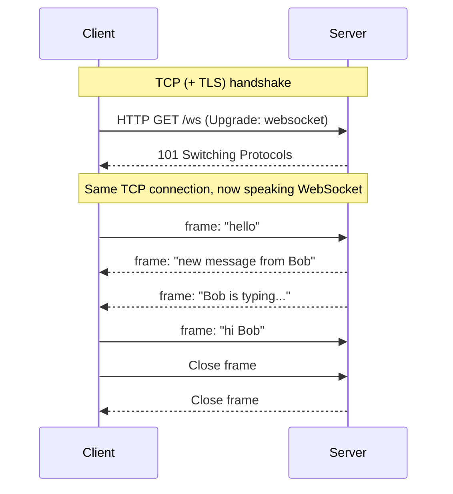
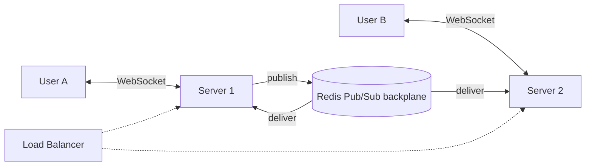

# 🔌 WebSockets

> 📚 Real-time communication series: [Short Polling](01-short-polling.md) → [Long Polling](02-long-polling.md) → **WebSockets** → [Server-Sent Events](04-server-sent-events.md)

---

## 🧠 1. What are WebSockets?

**WebSocket** is a protocol (**RFC 6455**) that gives a **persistent, full-duplex** connection between client and server over a **single TCP connection**.

- **Persistent**: the connection stays open; no new request per message.
- **Full-duplex**: **both sides can send at any time**, independently.
- **Low overhead**: after setup, each message has only a **2 to 14 byte** frame header, not a full set of HTTP headers.

> 👉 *"Polling is sending letters back and forth. A WebSocket is a phone call: once connected, either side can just talk."*

It starts life as an **HTTP request** and then **upgrades** to the WebSocket protocol. URLs use `ws://` (plain) or `wss://` (over TLS, which you should always use in production).

---

## 🤝 2. The Upgrade Handshake

The client asks to switch protocols with a normal HTTP/1.1 `GET`:

```http
GET /ws HTTP/1.1
Host: chat.example.com
Upgrade: websocket
Connection: Upgrade
Sec-WebSocket-Key: dGhlIHNhbXBsZSBub25jZQ==
Sec-WebSocket-Version: 13
Origin: https://chat.example.com
```

The server agrees with **`101 Switching Protocols`**:

```http
HTTP/1.1 101 Switching Protocols
Upgrade: websocket
Connection: Upgrade
Sec-WebSocket-Accept: s3pPLMBiTxaQ9kYGzzhZRbK+xOo=
```



| Header | Purpose |
| --- | --- |
| `Upgrade: websocket` + `Connection: Upgrade` | "Please switch this connection to WebSocket" |
| `Sec-WebSocket-Key` | Random base64 value from the client |
| `Sec-WebSocket-Accept` | Server's proof: `base64(SHA1(key + fixed GUID))` |
| `Origin` | Lets the server **reject cross-site connections** |

> ⚠️ `Sec-WebSocket-Accept` only proves the server **understands WebSocket**. It is **not security**. Authenticate the user (cookie or token) and **check `Origin`** yourself.

---

## 📦 3. Frames: What Travels on the Wire

After the upgrade, data is sent as **frames**, not HTTP messages.

| Field | Meaning |
| --- | --- |
| **FIN** bit | Is this the last frame of the message? (large messages can be split) |
| **Opcode** | `0x1` text, `0x2` binary, `0x0` continuation, `0x8` close, `0x9` ping, `0xA` pong |
| **MASK** bit | Client → server frames **must be masked**; server → client frames are not |
| **Payload length** | 7 bits, or 7 + 16, or 7 + 64 bits, depending on size |
| **Payload** | The actual data (UTF-8 text or raw bytes) |

- **Ping / Pong**: control frames used as **heartbeats** to detect dead connections and keep proxies from closing idle ones.
- **Close**: a clean shutdown with a **status code** (e.g. `1000` normal, `1001` going away).

> 💡 WebSocket gives you a **message pipe**, not a message **format**. You still choose what's inside (JSON, Protobuf, MessagePack) and define your own message types.

---

## 💻 4. Code Example (C#)

### Server: raw WebSockets in ASP.NET Core

```csharp
using System.Net.WebSockets;
using System.Text;

var app = WebApplication.CreateBuilder(args).Build();
app.UseWebSockets(new WebSocketOptions { KeepAliveInterval = TimeSpan.FromSeconds(30) });

app.Map("/ws", async (HttpContext context) =>
{
    if (!context.WebSockets.IsWebSocketRequest)
    {
        context.Response.StatusCode = StatusCodes.Status400BadRequest;
        return;
    }

    using var socket = await context.WebSockets.AcceptWebSocketAsync();
    var buffer = new byte[4 * 1024];

    while (socket.State == WebSocketState.Open)
    {
        var result = await socket.ReceiveAsync(new ArraySegment<byte>(buffer), context.RequestAborted);
        if (result.MessageType == WebSocketMessageType.Close)
        {
            await socket.CloseAsync(WebSocketCloseStatus.NormalClosure, "bye", CancellationToken.None);
            break;
        }

        var text = Encoding.UTF8.GetString(buffer, 0, result.Count);
        var reply = Encoding.UTF8.GetBytes($"echo: {text}");
        await socket.SendAsync(new ArraySegment<byte>(reply), WebSocketMessageType.Text, endOfMessage: true, context.RequestAborted);
    }
});

app.Run();
```

> ⚠️ For brevity this assumes each message fits in one `ReceiveAsync` call. Real code should loop until `result.EndOfMessage` is `true`.

### Client: `ClientWebSocket`

```csharp
using System.Net.WebSockets;
using System.Text;

using var ws = new ClientWebSocket();
await ws.ConnectAsync(new Uri("wss://localhost:5001/ws"), CancellationToken.None);

await ws.SendAsync(new ArraySegment<byte>(Encoding.UTF8.GetBytes("hello")), WebSocketMessageType.Text, true, CancellationToken.None);

var buffer = new byte[4 * 1024];
var result = await ws.ReceiveAsync(new ArraySegment<byte>(buffer), CancellationToken.None);
Console.WriteLine(Encoding.UTF8.GetString(buffer, 0, result.Count)); // echo: hello

await ws.CloseAsync(WebSocketCloseStatus.NormalClosure, "done", CancellationToken.None);
```

---

## 🧰 5. SignalR: WebSockets with Batteries Included

Raw WebSockets leave a lot to you: reconnection, message routing, groups, fallbacks, scale-out. **ASP.NET Core SignalR** handles these.

- Uses **WebSockets** by default, and **falls back** to SSE, then long polling.
- **RPC style**: the server calls client methods and clients call hub methods.
- Built-in **groups**, **user targeting**, **automatic reconnect** and **scale-out backplanes**.

### Server: a hub

```csharp
using Microsoft.AspNetCore.SignalR;

var builder = WebApplication.CreateBuilder(args);
builder.Services.AddSignalR();
var app = builder.Build();

app.MapHub<ChatHub>("/hubs/chat");
app.Run();

public class ChatHub : Hub
{
    public Task JoinRoom(string room) => Groups.AddToGroupAsync(Context.ConnectionId, room);

    public Task SendMessage(string room, string user, string text) =>
        Clients.Group(room).SendAsync("ReceiveMessage", user, text);
}
```

### Client: .NET `HubConnection`

```csharp
using Microsoft.AspNetCore.SignalR.Client;

var connection = new HubConnectionBuilder()
    .WithUrl("https://localhost:5001/hubs/chat")
    .WithAutomaticReconnect()
    .Build();

connection.On<string, string>("ReceiveMessage", (user, text) => Console.WriteLine($"{user}: {text}"));

await connection.StartAsync();
await connection.InvokeAsync("JoinRoom", "general");
await connection.InvokeAsync("SendMessage", "general", "Rajesh", "Hello everyone!");
```

---

## 🏗️ 6. Scaling WebSockets (System Design)

A WebSocket is **stateful**: each client is tied to **one specific server** for the whole connection. That changes how you scale.

### Problem 1: the message is on the wrong server

User A is connected to **server 1**, user B to **server 2**. A sends B a message. Server 1 has no socket for B.

**Solution: a backplane (pub/sub).** Every server publishes outgoing messages to a shared channel, and every server delivers them to its own local connections.



In SignalR this is one line (package `Microsoft.AspNetCore.SignalR.StackExchangeRedis`):

```csharp
builder.Services.AddSignalR().AddStackExchangeRedis("localhost:6379");
```

> 💡 Alternatives: **Azure SignalR Service** (a managed service that holds the connections for you), or a message broker like **Kafka / NATS** for very large fan-out.

### Problem 2: sticky sessions

- A **pure** WebSocket connection is one long TCP connection, so it naturally stays on one server.
- But **SignalR's negotiate step** (and its long-polling / SSE fallbacks) makes **several HTTP requests** that must hit the **same server**.
- So SignalR **needs sticky sessions** (session affinity) on the load balancer, unless all clients use WebSockets only with `SkipNegotiation = true`, or you use Azure SignalR Service.

### Other scaling concerns

| Concern | What to do |
| --- | --- |
| **Many open connections** | Each uses memory and a file descriptor; tune OS limits, use async servers. A single well-tuned server can hold tens of thousands or more. |
| **Load balancer support** | Use an LB that supports the `Upgrade` header (L7) or plain TCP (L4), and raise its **idle timeout** |
| **Dead connections** | Use **ping/pong heartbeats** (`KeepAliveInterval`) to detect and clean them up |
| **Deploys / restarts** | All connections on a server drop at once; clients need **reconnect with backoff + jitter** |
| **Uneven load** | Long-lived connections don't rebalance when you add servers; new servers only get **new** connections |
| **Missed messages** | On reconnect, the client should **resync** (fetch missed data by cursor), since WebSocket itself doesn't replay |
| **Auth** | Browsers can't set custom headers on the WebSocket API; use cookies or a token in the query string (keep it short-lived and out of logs) |

> 💡 WebSockets over **HTTP/2** (RFC 8441, "extended CONNECT") also exist and are supported by ASP.NET Core 7+, but HTTP/1.1 upgrade is still the most common.

---

## ✅❌ 7. Pros and Cons

| ✅ Pros | ❌ Cons |
| --- | --- |
| **True real-time**, lowest latency of the four techniques | **Stateful** connections: harder to scale and load balance |
| **Two-way**: client and server both send anytime | No built-in **reconnect, replay or message format** |
| **Tiny per-message overhead** after the handshake | Some proxies and firewalls **block or cut** them |
| Text **and binary** data | Not cacheable; doesn't benefit from HTTP tooling |

### When to use it

- **Chat** and messaging apps.
- **Multiplayer games** and collaborative editing (Google Docs style).
- **Live trading** dashboards where the client also sends orders.
- Anything with **frequent messages in both directions**.

> ⚠️ If data only flows **server → client** (notifications, live scores), WebSockets may be overkill. Consider [SSE](04-server-sent-events.md).

---

## 💬 Interview Takeaway

> *"WebSocket is a protocol that upgrades an HTTP connection into a persistent, full-duplex channel over one TCP connection, so both sides can send messages at any time with very little overhead. It's ideal for chat, gaming and collaborative apps.*
>
> *The main challenge is scaling, because connections are stateful. I'd use a pub/sub backplane like Redis so messages reach clients on any server, configure the load balancer for long-lived connections, add heartbeats, and make clients reconnect with backoff and resync missed data. In .NET, SignalR handles most of this for me."*

---

## 🔑 Final Takeaway

- **WebSocket** = one **persistent, full-duplex** connection, started by an **HTTP Upgrade** (`101 Switching Protocols`).
- Data flows as **frames**: text, binary, ping/pong, close.
- **Lowest latency and overhead**, and the only one of the four that is truly **two-way**.
- Connections are **stateful**: scale with a **backplane (Redis)**, **sticky sessions** where needed, heartbeats and reconnect logic.
- **SignalR** adds reconnect, groups, fallbacks and scale-out on top of WebSockets.
- Next step: [Server-Sent Events](04-server-sent-events.md), a simpler option when you only need **server → client** streaming.
