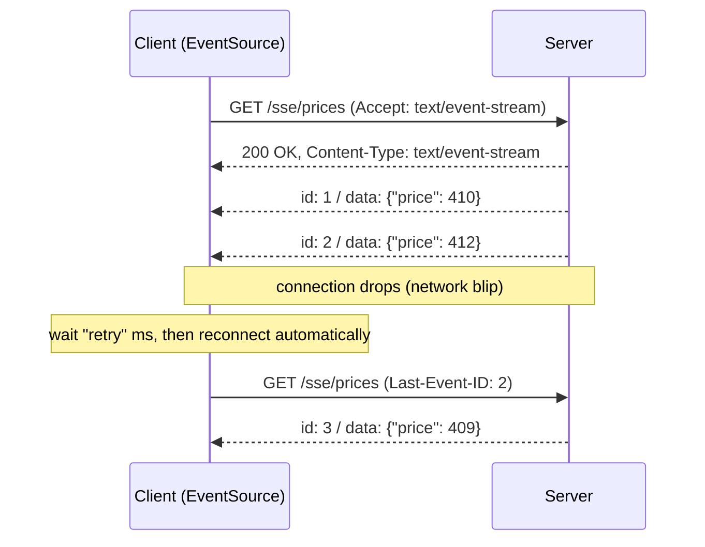
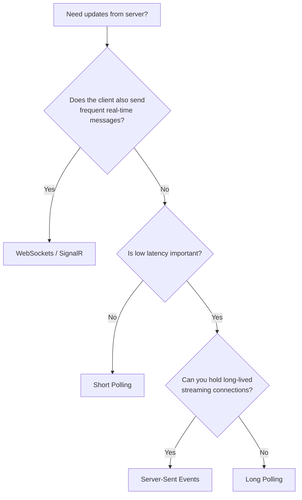

# 📡 Server-Sent Events (SSE)

> 📚 Real-time communication series: [Short Polling](01-short-polling.md) → [Long Polling](02-long-polling.md) → [WebSockets](03-websockets.md) → **Server-Sent Events**

---

## 🧠 1. What are Server-Sent Events?

**Server-Sent Events (SSE)** let a server **push a stream of events** to the client over **one long-lived HTTP response**.

- The client makes **one normal HTTP `GET`**.
- The server replies with `Content-Type: text/event-stream` and **never finishes the response**. It keeps writing events as they happen.
- It's **one-way**: **server → client** only.
- Part of the **HTML standard**; browsers expose it through the built-in **`EventSource`** API.

> 👉 *"Like subscribing to a radio station. You tune in once, and the station keeps broadcasting to you. You can't talk back on the same channel."*

Think of it as **long polling that never closes**: instead of one response per update, it's **one response with many updates**.

---

## ⚙️ 2. How It Works



1. Client opens the stream with a `GET`.
2. Server sends headers, then **writes events and flushes** them one by one.
3. If the connection drops, the browser **reconnects automatically** and sends the **`Last-Event-ID`** header.
4. The server can use that ID to **resume** from where the client left off.

---

## 📝 3. The `text/event-stream` Format

SSE is a **plain-text** protocol. Each event is a few `field: value` lines, ending with a **blank line**.

```text
retry: 5000

: this is a comment, often used as a heartbeat

id: 41
event: price
data: {"symbol":"MSFT","price":410.25}

id: 42
data: first line of a message
data: second line of the same message

```

| Field | Meaning |
| --- | --- |
| `data:` | The payload. Several `data:` lines are joined with `\n` into **one** message. |
| `event:` | Event **type** name (default is `message`). Lets the client listen for specific types. |
| `id:` | Event ID. The browser remembers it and sends it back as **`Last-Event-ID`** on reconnect. |
| `retry:` | How many **milliseconds** to wait before reconnecting. |
| `: ...` | A **comment**, ignored by the client. Useful as a **keep-alive** ping. |

> 💡 SSE is **UTF-8 text only**. Binary data must be encoded (e.g. base64), which is one reason to pick WebSockets for binary streams.

---

## 💻 4. Code Example (C#)

### Server: stream events from a minimal API (.NET 8)

```csharp
using System.Text.Json;

var app = WebApplication.CreateBuilder(args).Build();

app.MapGet("/sse/prices", async (HttpContext ctx, CancellationToken ct) =>
{
    ctx.Response.Headers.ContentType = "text/event-stream";
    ctx.Response.Headers.CacheControl = "no-cache";

    // Resume support: the browser sends this header when it reconnects
    long lastId = long.TryParse(ctx.Request.Headers["Last-Event-ID"], out var id) ? id : 0;

    await ctx.Response.WriteAsync("retry: 5000\n\n", ct);

    while (!ct.IsCancellationRequested)          // ct fires when the client disconnects
    {
        lastId++;
        var json = JsonSerializer.Serialize(new { symbol = "MSFT", price = Random.Shared.Next(400, 450) });

        await ctx.Response.WriteAsync($"id: {lastId}\nevent: price\ndata: {json}\n\n", ct);
        await ctx.Response.Body.FlushAsync(ct);  // push it now, don't wait for a buffer to fill
        await Task.Delay(TimeSpan.FromSeconds(1), ct);
    }
});

app.Run();
```

> ⚠️ In a real app, `Last-Event-ID` should be used to **replay missed events** from a store (e.g. a Redis stream or a DB table), not just to continue a counter.

> 💡 **.NET 10** adds a built-in `TypedResults.ServerSentEvents(...)` result that does this formatting for you from an `IAsyncEnumerable`.

### Client: read the stream with `HttpClient`

In the browser you'd use `EventSource`. From a .NET service, read the response as a stream:

```csharp
using var http = new HttpClient { Timeout = Timeout.InfiniteTimeSpan }; // the stream never "completes"

using var request = new HttpRequestMessage(HttpMethod.Get, "https://localhost:5001/sse/prices");
request.Headers.Accept.ParseAdd("text/event-stream");

using var response = await http.SendAsync(request, HttpCompletionOption.ResponseHeadersRead);
using var reader = new StreamReader(await response.Content.ReadAsStreamAsync());

while (await reader.ReadLineAsync() is { } line)
{
    if (line.StartsWith("data:"))
        Console.WriteLine(line["data:".Length..].TrimStart());
}
```

- `ResponseHeadersRead` is key: it returns **as soon as headers arrive**, instead of waiting for a body that never ends.
- This simple reader **doesn't auto-reconnect**. You'd wrap it in a retry loop and send `Last-Event-ID` yourself.

> 💡 The **`System.Net.ServerSentEvents`** package (built into .NET 9, also on NuGet) has an `SseParser` that parses events properly, including `id`, `event` and multi-line `data`.

---

## 🔄 5. Built-in Superpowers of `EventSource`

What the browser gives you **for free**, which WebSockets don't:

| Feature | How |
| --- | --- |
| **Auto-reconnect** | If the connection drops, the browser reconnects after `retry` ms |
| **Resume** | Sends `Last-Event-ID` so the server can **replay missed events** |
| **Event types** | `addEventListener("price", ...)` for named `event:` types |
| **Plain HTTP** | Works with existing **auth cookies, CORS, HTTP/2, proxies, load balancers** |

> ⚠️ The native `EventSource` **can't set custom headers** (e.g. `Authorization: Bearer ...`). Use **cookies**, a short-lived token in the URL, or a fetch-based SSE client library.

---

## 🚦 6. The HTTP/1.1 Connection Limit (and HTTP/2)

This is the **classic SSE gotcha**.

- Over **HTTP/1.1**, browsers allow only about **6 concurrent connections per domain**.
- Each SSE stream **permanently uses one** of them.
- Open the app in **6 tabs** with one stream each, and the 7th tab (and even normal API calls) can **hang**.

| | HTTP/1.1 | HTTP/2 |
| --- | --- | --- |
| Connections per domain | ~6 (browser limit) | Usually **1**, shared |
| SSE streams | One TCP connection **each** | Many **streams multiplexed** on one connection |
| Limit | ~6 streams total | Max concurrent streams, negotiated (often **100**) |

> 💡 **Serve SSE over HTTP/2 (or HTTP/3)** in production. Kestrel supports HTTP/2 over TLS by default. Make sure every hop (CDN, load balancer) speaks HTTP/2 to the browser.

---

## 🏗️ 7. System Design View

### When to use it

- Data flows **only server → client**, and the client rarely sends (it can use normal `POST`s when it does).
- **Live feeds**: notifications, live scores, stock tickers, news, build/CI logs.
- **AI / LLM token streaming**: many chat APIs stream responses as SSE.
- Progress updates for **long-running jobs**.

### Scaling concerns

| Concern | What to do |
| --- | --- |
| **Open connections** | Like WebSockets, each client holds a connection. Use async I/O and tune OS limits. |
| **Multiple servers** | Use a **pub/sub backplane** (Redis, Kafka, NATS) so an event reaches clients on every server |
| **Buffering proxies** | Proxies or compression middleware may **buffer** the stream. Disable buffering (e.g. `X-Accel-Buffering: no` for nginx) and don't gzip the stream. |
| **Idle timeouts** | Send a **comment heartbeat** (`: ping`) every 15 to 30 s so load balancers don't cut the connection |
| **Missed events** | Store recent events with IDs so you can **replay on `Last-Event-ID`** |
| **Reconnect storms** | After a deploy, all clients reconnect; set a sensible `retry` and spread restarts |

> 💡 Compared to WebSockets, SSE is **just HTTP**, so it reuses your existing **auth, routing, logging and HTTP/2 infrastructure**. No sticky sessions are needed for the stream itself, since it's a single request.

---

## ⚖️ 8. Comparing All Four Techniques

| | [Short Polling](01-short-polling.md) | [Long Polling](02-long-polling.md) | [WebSockets](03-websockets.md) | **SSE** |
| --- | --- | --- | --- | --- |
| **Latency** | Up to the polling interval | Near real-time | Real-time (lowest) | Real-time |
| **Direction** | Client pulls | Client pulls (server answers when ready) | **Full duplex** (both ways) | **Server → client** only |
| **Connection** | New request each poll | One held request per update batch | One persistent TCP connection | One long-lived HTTP response |
| **Server load** | High: many empty requests | Medium: held requests + reconnects | Low per message, but stateful connections | Low per message, open connections |
| **Overhead per message** | Full HTTP request + response | Full HTTP request + response | 2 to 14 byte frame header | A few bytes of text framing |
| **Data types** | Any | Any | Text **and binary** | **UTF-8 text** only |
| **Reconnect / resume** | Not needed | Manual (cursor) | Manual | **Built-in** (`retry`, `Last-Event-ID`) |
| **Complexity** | Very low | Medium (timeouts, cursors) | High (state, scaling, protocol) | Low to medium |
| **Proxy / firewall friendly** | ✅ Yes | ✅ Yes | ⚠️ Usually, sometimes blocked | ✅ Yes (watch buffering) |
| **Use cases** | Job status, simple dashboards | Fallback transport, notifications, older chat systems | Chat, games, collaborative editing, trading | Live feeds, notifications, LLM streaming, logs |

### 🧭 Quick decision guide



---

## 💬 Interview Takeaway

> *"Server-Sent Events let the server push a stream of text events to the client over a single long-lived HTTP response with the `text/event-stream` content type. It's one-way, server to client, and the browser's EventSource gives automatic reconnection and resume through `Last-Event-ID`.*
>
> *I'd choose SSE over WebSockets when data only flows from server to client, like notifications, live feeds or LLM token streaming, because it's simpler and works with standard HTTP infrastructure. I'd serve it over HTTP/2 to avoid the six-connections-per-domain limit of HTTP/1.1, and use a pub/sub backplane to scale across servers."*

---

## 🔑 Final Takeaway

- **SSE** = one HTTP `GET`, one **never-ending response**, many events.
- Simple **text format**: `data`, `event`, `id`, `retry`, blank line ends an event.
- **One-way** (server → client); the client uses normal HTTP requests to send.
- **Auto-reconnect** and **resume via `Last-Event-ID`** are built in.
- Watch out for the **HTTP/1.1 ~6 connections per domain** limit: use **HTTP/2**.
- Pick the simplest tool that fits: **short polling** for rare updates, **long polling** as a fallback, **SSE** for server push, **WebSockets** for true two-way real-time.
