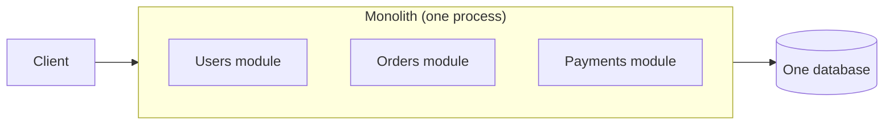
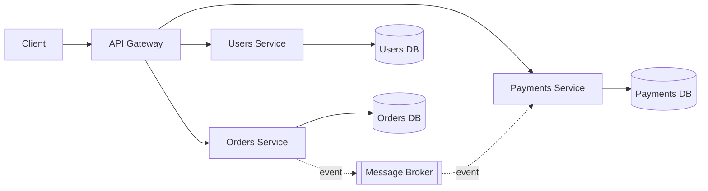
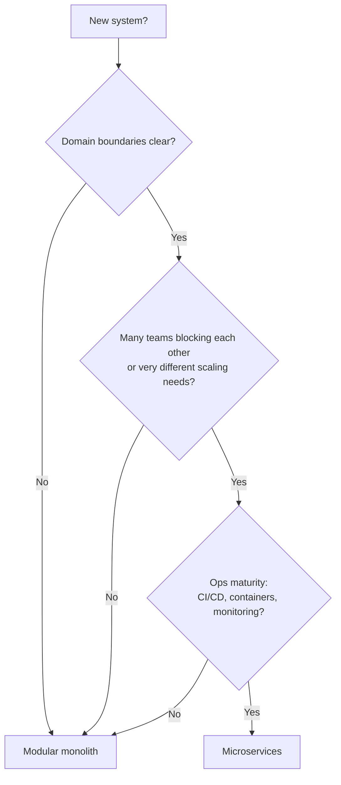
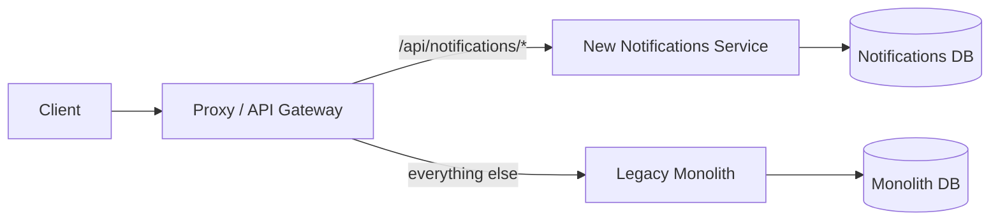

# 🏛️ Monolith and Microservices

> Deep dive on building microservices: [Microservices](../11-microservices/README.md)

---

## 🧠 1. What is a Monolith?

A **monolith** is an application built and deployed as **one single unit**.

- One codebase (usually one repo).
- One build, one deployable artifact (e.g. one ASP.NET Core app).
- Usually **one shared database**.
- All features (users, orders, payments) run in the **same process** and call each other with **plain method calls**.



> 👉 *"Everything lives in one box. Simple to build, simple to run, but the box grows."*

> 💡 "Monolith" is **not** a bad word. Most successful products (Shopify, Stack Overflow, early Amazon) started as one, and many still are.

---

## 🧩 2. What are Microservices?

**Microservices** split the application into **many small, independent services**.

- Each service owns **one business capability** (e.g. Orders, Payments).
- Each one is **deployed independently**, in its own process.
- Each one owns **its own data** (database-per-service).
- Services talk **over the network**: REST, gRPC, or a message broker.



> ⚠️ The key change: a **method call** becomes a **network call**. Network calls can be slow, fail, or time out. That's where most of the complexity comes from.

---

## 🧱 3. The Middle Ground: Modular Monolith

A **modular monolith** is **one deployable unit**, but split inside into **strict modules** with clear boundaries.

- Each module has its **own public API** (interfaces) and hides its internals.
- Modules **don't reach into each other's tables**. Often one schema per module.
- Still **one process, one deployment**, so no network calls between modules.

```mermaid
flowchart TB
    subgraph APP["Modular Monolith (one deployment)"]
        direction LR
        U["Users module<br/>(public API)"] --- O["Orders module<br/>(public API)"] --- P["Payments module<br/>(public API)"]
    end
    APP --> DB[("One database<br/>schemas: users, orders, payments")]
```



In .NET, a common setup is **one project per module**, with only a contracts project shared:

```csharp
// Orders module talks to Payments ONLY through its public contract
public interface IPaymentsModule
{
    Task<PaymentResult> ChargeAsync(Guid orderId, decimal amount, CancellationToken ct);
}

public sealed class PlaceOrderHandler(IPaymentsModule payments, OrdersDbContext db)
{
    public async Task HandleAsync(PlaceOrder cmd, CancellationToken ct)
    {
        var order = Order.Create(cmd.CustomerId, cmd.Items);
        db.Orders.Add(order);
        await db.SaveChangesAsync(ct);

        await payments.ChargeAsync(order.Id, order.Total, ct); // in-process call, not HTTP
    }
}
```

> 💡 A clean modular monolith is the **easiest starting point for microservices later**. Each module is already a candidate service.

---

## ⚖️ 4. Pros and Cons

| | **Monolith** | **Modular Monolith** | **Microservices** |
| --- | --- | --- | --- |
| Deployment | One unit, simple | One unit, simple | Many units, needs CI/CD + orchestration |
| Development speed (early) | ⚡ Fast | ⚡ Fast | 🐢 Slow (lots of setup) |
| Communication | In-process calls | In-process calls via contracts | Network calls (latency, failures) |
| Data consistency | Easy (one DB transaction) | Easy | Hard (eventual consistency, sagas) |
| Scaling | Scale the **whole app** | Scale the whole app | Scale **each service** independently |
| Team autonomy | Low (everyone in one codebase) | Medium | High (team owns a service end-to-end) |
| Fault isolation | One bug can take down everything | Same | One service can fail, others keep running (if designed well) |
| Tech freedom | One stack | One stack | Different stack per service possible |
| Debugging | Easy (one stack trace) | Easy | Hard (needs distributed tracing) |
| Ops cost | Low | Low | High (monitoring, infra, on-call) |

---

## 🎯 5. When to Choose Which

### ✅ Choose a monolith (or modular monolith) when

- You're a **small team** (roughly < 10–20 devs).
- The product is **new** and domain boundaries are still **unclear**.
- You need to **ship fast** and validate the idea.
- You don't have strong **DevOps / platform** skills yet.

### ✅ Choose microservices when

- **Many teams** step on each other in one codebase and releases are blocked.
- Parts of the system need **very different scaling** (e.g. search gets 100x the traffic of billing).
- Parts need **independent release cycles** or different tech.
- Domain boundaries are **well understood**.
- You can afford the **operational cost**: containers, Kubernetes, tracing, on-call.



> ⚠️ **Microservices solve an organisational scaling problem** more than a technical one. If you don't have that problem, you mostly get the costs.

> ⚠️ Watch out for the **distributed monolith**: services that must be deployed together, share a database, or call each other in long synchronous chains. You get all the costs of microservices and none of the benefits.

---

## 🌱 6. Migration: The Strangler Fig Pattern

Rewriting a monolith from scratch ("big bang") is risky. The **strangler fig** pattern migrates **piece by piece**.

> 🌳 Named after the strangler fig tree, which grows around a host tree until it slowly replaces it.

### How it works

1. Put a **facade / proxy** (API gateway or reverse proxy) in front of the monolith.
2. Pick **one capability** (e.g. Notifications), build it as a new service.
3. **Route** that traffic to the new service. Everything else still goes to the monolith.
4. Repeat. Remove the old code from the monolith once it's unused.



In .NET, **YARP** (Yet Another Reverse Proxy) is a natural fit for the facade:

```csharp
// Program.cs of the proxy (package: Yarp.ReverseProxy)
var builder = WebApplication.CreateBuilder(args);
builder.Services.AddReverseProxy()
    .LoadFromConfig(builder.Configuration.GetSection("ReverseProxy"));

var app = builder.Build();
app.MapReverseProxy();
app.Run();
```

Routes in `appsettings.json` decide which paths go to the new service and which to the monolith. Moving a feature = **changing a route**, not redeploying clients.

### 🏗️ Tips from practice

- Start with a capability that is **loosely coupled** and **low risk** (notifications, reporting, search).
- **Split the data** too. A new service still reading the monolith's tables is not really extracted.
- Use **events** (or change data capture) to keep old and new data in sync during the transition.
- Keep it **reversible**: if the new service misbehaves, route traffic back.

---

## 💬 Interview Takeaway

> *"A monolith is one deployable unit with a shared database: simple to build, test and deploy, but it scales as a whole and teams can get in each other's way. Microservices split the system into independently deployable services that own their data, which gives independent scaling and team autonomy, at the cost of network failures, eventual consistency and much higher operational complexity.*
>
> *I'd usually start with a modular monolith and extract services with the strangler fig pattern only when there's a clear reason, like team scaling or very different load profiles."*

---

## 🔑 Final Takeaway

- **Monolith** = one unit, one DB. Simple, fast to start, scales as a whole.
- **Microservices** = many independent services, each owns its data, talk over the network.
- **Modular monolith** = the sweet spot for most teams: strong boundaries, simple ops.
- Microservices trade **code complexity** for **distributed-systems complexity**.
- Choose based on **team size, domain clarity, scaling needs, and ops maturity**, not hype.
- Migrate with the **strangler fig**: one capability at a time, behind a proxy.
- Go deeper: [Microservices](../11-microservices/README.md)
