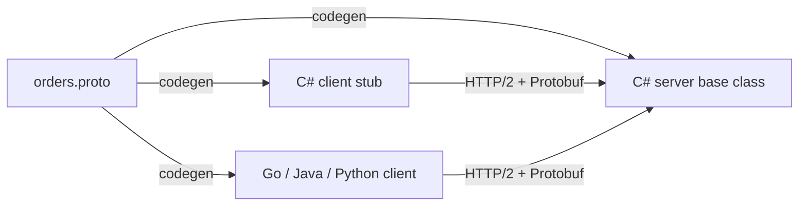
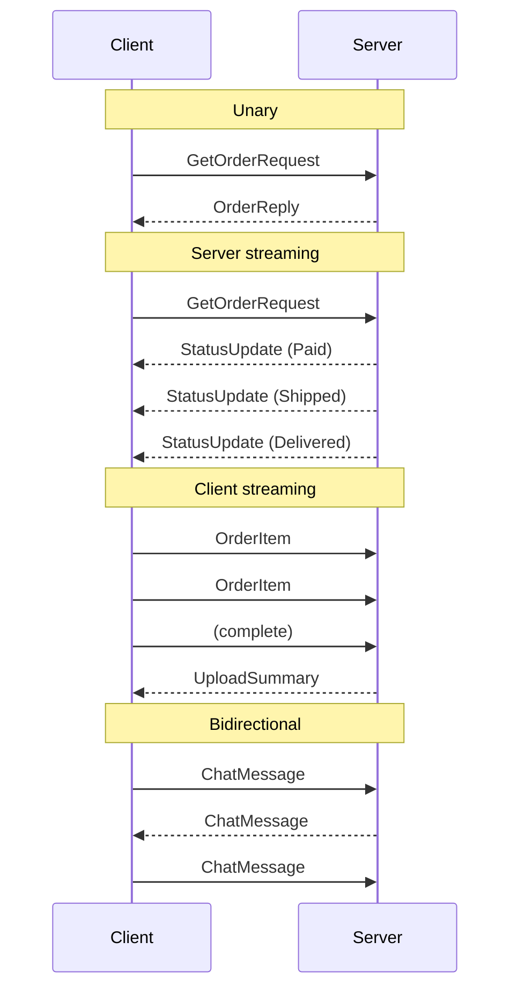

# ⚡ gRPC

## 🧠 1. What is gRPC?

**gRPC** is a high-performance **RPC (Remote Procedure Call)** framework, originally built by Google and now open source (CNCF).

- **RPC** = call a function on **another machine** as if it were a **local method**.
- You define the API **once** in a `.proto` file.
- Tooling **generates** client and server code (C#, Go, Java, Python, ...).
- Runs on **HTTP/2** and sends data as **Protocol Buffers** (compact binary), not JSON.

> 👉 *"With REST you think in resources and URLs. With gRPC you think in methods: `orders.GetOrder(id)`."*



---

## 🧱 2. The Two Building Blocks

### 🚄 HTTP/2 (the transport)

> HTTP versions explained: [HTTP — The Basics](../02-networking/chapter-1-basics/03-http-basics.md)

| HTTP/2 feature | What gRPC gets from it |
| --- | --- |
| **Binary framing** | Efficient parsing, no text overhead |
| **Multiplexing** | Many concurrent calls over **one TCP connection** |
| **Streams** | Natural support for **streaming** RPCs in both directions |
| **Header compression (HPACK)** | Smaller metadata on every call |
| **Trailers** | gRPC sends the call **status** (`grpc-status`) in trailers, after the body |

### 📦 Protocol Buffers (the format)

- A **language-neutral schema** + **binary serialization** format.
- Fields are identified by **numbers**, not names, on the wire, so messages are **small** and **fast** to parse.
- **Strongly typed**: the contract is checked at compile time on both sides.

| | **JSON** | **Protobuf** |
| --- | --- | --- |
| Format | Text, human-readable | Binary, not human-readable |
| Size | Larger (field names repeated) | Smaller (field numbers, varints) |
| Schema | Optional (OpenAPI) | **Required** (`.proto`) |
| Speed | Slower to parse | Faster to parse |

---

## 📝 3. A `.proto` Example

```protobuf
syntax = "proto3";

option csharp_namespace = "Orders.Grpc";

package orders.v1;

service OrderService {
  // 1. Unary
  rpc GetOrder (GetOrderRequest) returns (OrderReply);
  // 2. Server streaming
  rpc WatchOrderStatus (GetOrderRequest) returns (stream StatusUpdate);
  // 3. Client streaming
  rpc UploadItems (stream OrderItem) returns (UploadSummary);
  // 4. Bidirectional streaming
  rpc Chat (stream ChatMessage) returns (stream ChatMessage);
}

message GetOrderRequest { string order_id = 1; }

message OrderReply {
  string order_id = 1;
  string status   = 2;
  double total    = 3;
}

message StatusUpdate  { string status = 1; }
message OrderItem     { string sku = 1; int32 quantity = 2; }
message UploadSummary { int32 item_count = 1; }
message ChatMessage   { string user = 1; string text = 2; }
```

> ⚠️ **Field numbers are the contract.** Never change or reuse them. To evolve safely: **add** new fields with new numbers, and mark removed ones as `reserved`.

> 💡 In a .NET project, add the file to the `.csproj` with `<Protobuf Include="Protos\orders.proto" GrpcServices="Server" />` (or `"Client"`). The `Grpc.Tools` package generates the C# code on build.

---

## 🔀 4. The 4 RPC Types

| Type | Client sends | Server sends | Example |
| --- | --- | --- | --- |
| **Unary** | 1 message | 1 message | `GetOrder(id)`, like a normal REST call |
| **Server streaming** | 1 message | **stream** | Live order status, price ticker, large result sets |
| **Client streaming** | **stream** | 1 message | Uploading many items / sensor readings, then one summary |
| **Bidirectional streaming** | **stream** | **stream** | Chat, real-time collaboration, game sync |



> 💡 All of these run as **HTTP/2 streams** on the same connection. Streaming is not a hack on top, it's built in.

---

## 🖥️ 5. C# Server (ASP.NET Core + `Grpc.AspNetCore`)

```csharp
// Program.cs
var builder = WebApplication.CreateBuilder(args);
builder.Services.AddGrpc();

var app = builder.Build();
app.MapGrpcService<OrderServiceImpl>();
app.Run();
```

```csharp
// OrderServiceImpl.cs — inherits the generated base class
public sealed class OrderServiceImpl(IOrderRepository repo) : OrderService.OrderServiceBase
{
    // Unary
    public override async Task<OrderReply> GetOrder(GetOrderRequest request, ServerCallContext context)
    {
        var order = await repo.FindAsync(request.OrderId, context.CancellationToken)
            ?? throw new RpcException(new Status(StatusCode.NotFound, "Order not found"));

        return new OrderReply { OrderId = order.Id, Status = order.Status, Total = (double)order.Total };
    }

    // Server streaming
    public override async Task WatchOrderStatus(GetOrderRequest request,
        IServerStreamWriter<StatusUpdate> responseStream, ServerCallContext context)
    {
        await foreach (var status in repo.WatchStatusAsync(request.OrderId, context.CancellationToken))
            await responseStream.WriteAsync(new StatusUpdate { Status = status });
    }

    // Client streaming
    public override async Task<UploadSummary> UploadItems(
        IAsyncStreamReader<OrderItem> requestStream, ServerCallContext context)
    {
        var count = 0;
        await foreach (var item in requestStream.ReadAllAsync(context.CancellationToken))
            count++;
        return new UploadSummary { ItemCount = count };
    }
}
```

> 💡 Errors are returned as **gRPC status codes** (`NotFound`, `InvalidArgument`, `Unavailable`, `DeadlineExceeded`, ...) via `RpcException`, not HTTP status codes.

---

## 📞 6. C# Client (`Grpc.Net.Client`)

```csharp
using var channel = GrpcChannel.ForAddress("https://localhost:5001");
var client = new OrderService.OrderServiceClient(channel);

// Unary
var order = await client.GetOrderAsync(new GetOrderRequest { OrderId = "o-123" });

// Server streaming
using var call = client.WatchOrderStatus(new GetOrderRequest { OrderId = "o-123" });
await foreach (var update in call.ResponseStream.ReadAllAsync())
    Console.WriteLine($"Status: {update.Status}");
```

In an ASP.NET Core app, register it with the client factory (`Grpc.Net.ClientFactory`) so the channel is reused:

```csharp
builder.Services.AddGrpcClient<OrderService.OrderServiceClient>(o =>
    o.Address = new Uri("https://orders"));
```

> ⚠️ **Reuse channels.** Creating a `GrpcChannel` is expensive (new HTTP/2 connection). Create once, share it.

---

## ⏱️ 7. Deadlines (and Cancellation)

A **deadline** = "this call must finish by time X". gRPC sends it to the server (`grpc-timeout` header).

```csharp
try
{
    var reply = await client.GetOrderAsync(
        new GetOrderRequest { OrderId = "o-123" },
        deadline: DateTime.UtcNow.AddSeconds(2));
}
catch (RpcException ex) when (ex.StatusCode == StatusCode.DeadlineExceeded)
{
    // fail fast, fallback, or retry
}
```

- When the deadline passes, the server's `context.CancellationToken` is **cancelled**, so it stops wasted work.
- Pass `context.CancellationToken` into DB calls and downstream calls.
- With `Grpc.AspNetCore`, you can enable **deadline propagation** to downstream gRPC calls (`EnableCallContextPropagation()` on the client factory).

> ⚠️ **No deadline = possibly waiting forever.** Always set one for service-to-service calls.

---

## ⚖️ 8. gRPC vs REST

| | **gRPC** | **REST (JSON over HTTP)** |
| --- | --- | --- |
| Contract | `.proto`, **required**, strongly typed | Optional (OpenAPI) |
| Payload | Protobuf (binary, small) | JSON (text, larger) |
| Transport | **HTTP/2** required | HTTP/1.1, HTTP/2 or HTTP/3 |
| Style | Methods (`GetOrder`) | Resources + verbs (`GET /orders/1`) |
| Streaming | ✅ Built in (4 types) | Limited (SSE, chunked, or WebSockets) |
| Code generation | ✅ Built in, many languages | Optional (OpenAPI generators) |
| Browser support | ❌ Not directly (needs gRPC-Web) | ✅ Native |
| Human-readable / curl-friendly | ❌ Needs tools (grpcurl, Postman) | ✅ Yes |
| Caching | Hard (all `POST`) | ✅ HTTP caching, CDNs |
| Best for | **Internal** service-to-service, low latency, streaming | **Public** APIs, browsers, third parties |

---

## 🌐 9. Browser Limitation and gRPC-Web

Browsers **can't speak native gRPC**:

- Browser APIs (`fetch`, XHR) don't give low-level control over **HTTP/2 frames** and **trailers**, which gRPC depends on.

**gRPC-Web** solves this:

- A slightly different wire format that works over HTTP/1.1 or HTTP/2 from the browser.
- Supports **unary** and **server streaming** only (no client or bidi streaming).
- Needs a translation layer: an **Envoy** proxy, or directly in ASP.NET Core:

```csharp
builder.Services.AddGrpc();

var app = builder.Build();
app.UseGrpcWeb();                               // package: Grpc.AspNetCore.Web
app.MapGrpcService<OrderServiceImpl>().EnableGrpcWeb();
```

> 💡 Another option in .NET 7+: **gRPC JSON transcoding** (`Microsoft.AspNetCore.Grpc.JsonTranscoding`). One gRPC service is also exposed as a **REST/JSON** API, using `google.api.http` annotations in the `.proto`.

---

## 🏗️ 10. System Design: When to Use gRPC

### ✅ Good fit

- **Internal microservice-to-microservice** calls (see [Microservices](../11-microservices/README.md)).
- **Low latency, high throughput** paths (lots of small calls).
- **Streaming**: live updates, telemetry, real-time feeds.
- **Polyglot** systems: one `.proto`, clients in every language.
- Mobile apps on poor networks (smaller payloads).

### ❌ Poor fit

- **Public APIs** for third parties: REST/JSON is easier to consume.
- **Browser-first** apps (unless you add gRPC-Web or transcoding).
- When you need **HTTP caching** / CDNs.

### ⚠️ Gotchas from practice

- **Load balancing**: HTTP/2 keeps **one long-lived connection**, so an L4 (TCP) load balancer sends **all calls to one pod**. Use an **L7** balancer (Envoy, service mesh) or **client-side** load balancing.
- **Schema evolution**: never reuse field numbers; version the package (`orders.v1`, `orders.v2`).
- **Debugging**: binary payloads. Use `grpcurl`, Postman, or enable **server reflection**.
- Combine with **deadlines + retries** (gRPC has built-in retry policies in the channel's service config).

---

## 💬 Interview Takeaway

> *"gRPC is an RPC framework that runs on HTTP/2 and uses Protocol Buffers. You define services and messages in a .proto file and generate strongly typed clients and servers. It's faster and smaller than JSON over REST, supports four call types including bidirectional streaming, and uses deadlines for timeouts.*
>
> *I'd use it for internal service-to-service communication where latency and contracts matter, and keep REST for public and browser-facing APIs, since browsers need gRPC-Web. One thing to watch is load balancing, because HTTP/2 connections are long-lived, so you need L7 or client-side balancing."*

---

## 🔑 Final Takeaway

- **gRPC = RPC + HTTP/2 + Protobuf.** Call remote methods like local ones.
- The **`.proto` file is the contract**; code is generated for every language.
- **4 RPC types**: unary, server streaming, client streaming, bidirectional.
- Always set **deadlines**; use `CancellationToken` on the server.
- **Faster and smaller** than REST/JSON, but **not browser-native** (use gRPC-Web or JSON transcoding).
- Best for **internal service-to-service** calls; REST stays king for **public APIs**.
- Watch out for **L4 load balancing** with long-lived HTTP/2 connections.
