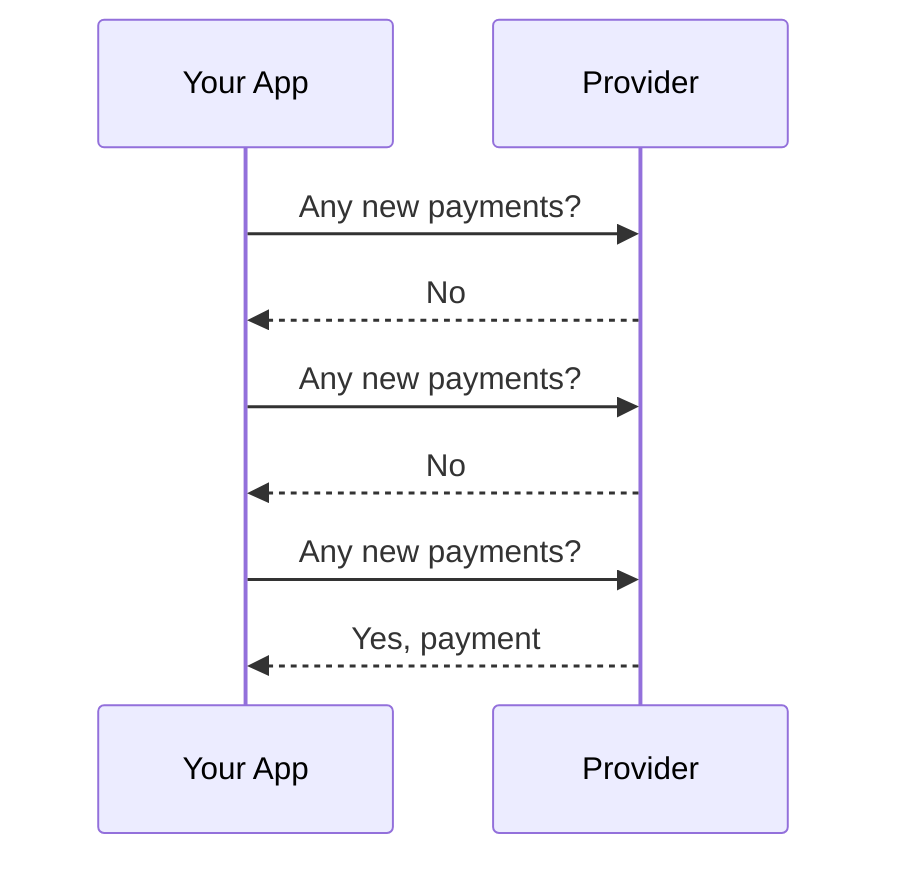
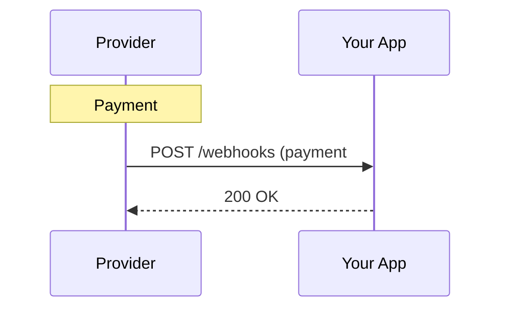
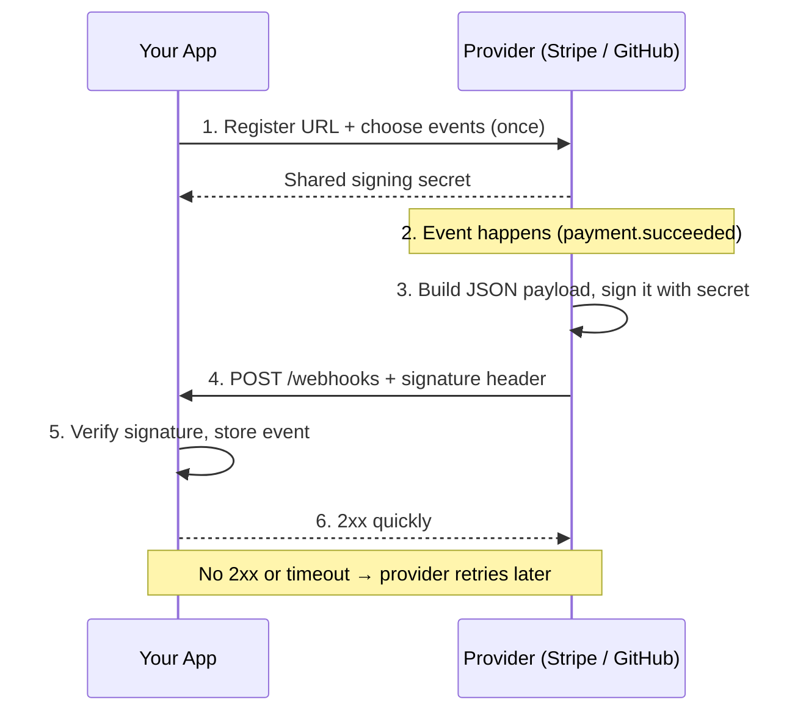
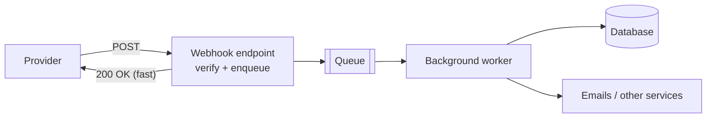
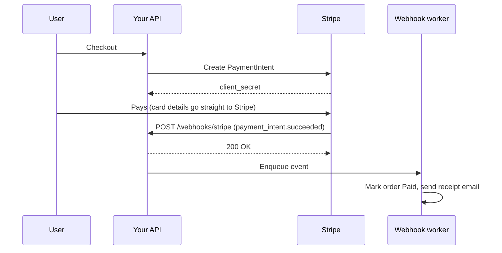

# 🪝 Webhooks

## 🧠 1. What is a Webhook?

A **webhook** is an **HTTP callback**: when something happens in system A, A sends an **HTTP `POST`** to a URL that system B registered earlier.

- B says once: *"When a payment succeeds, call `https://myapp.com/webhooks/stripe`."*
- A **pushes** the event to B as soon as it happens.
- No one keeps asking *"anything new?"*.

> 👉 *"Don't call us, we'll call you."*

> 💡 Webhooks are often called **"reverse APIs"**: instead of you calling the provider's API, the provider calls **your** API.

---

## 🔄 2. Push vs Polling

### 🐢 Polling: the client keeps asking



- Most requests return **nothing** → wasted CPU, bandwidth and **API rate limit**.
- Data is only as fresh as the **poll interval** (poll every 60s → up to 60s late).

### ⚡ Webhook: the provider pushes



- **One request per real event**. Near **real-time**.
- But **your endpoint must be public, reliable, and secure**.

---

## ⚙️ 3. How Webhooks Work (End to End)



1. **Register** an endpoint URL and the events you care about.
2. Provider gives you a **signing secret**.
3. When an event happens, the provider sends a **`POST`** with a JSON body and headers (event type, event ID, signature, timestamp).
4. You **verify**, **acknowledge fast** with `2xx`, and **process**.
5. If you don't answer `2xx` in time, the provider **retries**.

---

## 🖥️ 4. A Simple C# Receiver Endpoint

```csharp
var builder = WebApplication.CreateBuilder(args);
var app = builder.Build();

app.MapPost("/webhooks/orders", async (HttpRequest request, ILogger<Program> log) =>
{
    var evt = await request.ReadFromJsonAsync<WebhookEvent>();
    if (evt is null) return Results.BadRequest();

    log.LogInformation("Received {Type} {Id}", evt.Type, evt.Id);
    return Results.Ok();
});

app.Run();

public sealed record WebhookEvent(string Id, string Type, DateTimeOffset CreatedAt, JsonElement Data);
```

> ⚠️ This version **trusts anyone** who knows the URL. Never ship it like this. Next: verify the signature.

---

## 🔐 5. HMAC Signature Verification

Anyone can `POST` to a public URL. How do you know the request really came from the provider?

**HMAC** (Hash-based Message Authentication Code):

1. Provider and you share a **secret**.
2. Provider computes `HMAC-SHA256(secret, rawBody)` and sends it in a header.
3. You compute the same HMAC over the **raw body** you received.
4. **Equal** → authentic and not tampered with. **Different** → reject with `401`.

```csharp
app.MapPost("/webhooks/github", async (HttpRequest request, IConfiguration config) =>
{
    // 1. Read the RAW body bytes (don't deserialize first: re-serializing changes the bytes)
    using var ms = new MemoryStream();
    await request.Body.CopyToAsync(ms);
    var body = ms.ToArray();

    // 2. GitHub sends: X-Hub-Signature-256: sha256=<hex>
    var header = request.Headers["X-Hub-Signature-256"].ToString();
    if (!header.StartsWith("sha256=")) return Results.Unauthorized();

    var secret = Encoding.UTF8.GetBytes(config["GitHub:WebhookSecret"]!);
    var expected = HMACSHA256.HashData(secret, body);

    byte[] received;
    try { received = Convert.FromHexString(header["sha256=".Length..]); }
    catch (FormatException) { return Results.Unauthorized(); }

    // 3. Constant-time compare (prevents timing attacks)
    if (!CryptographicOperations.FixedTimeEquals(expected, received))
        return Results.Unauthorized();

    var evt = JsonSerializer.Deserialize<JsonElement>(body);
    // ... enqueue for processing
    return Results.Ok();
});
```

> ⚠️ Always use **`CryptographicOperations.FixedTimeEquals`**, not `==` or `SequenceEqual`. A normal compare stops at the first different byte, which leaks timing information.

> 💡 For Stripe, prefer the official SDK: `EventUtility.ConstructEvent(json, signatureHeader, secret)` verifies the signature **and** the timestamp for you.

---

## ⏰ 6. Timestamp and Replay Protection

A valid signed request can be **captured and re-sent** later (a **replay attack**). The signature alone is still valid.

Fix: include a **timestamp** in what gets signed, and reject old requests.

- Stripe's header looks like `Stripe-Signature: t=1700000000,v1=<hex>`.
- The signed string is `"{t}.{rawBody}"`, so the timestamp can't be changed without breaking the signature.

```csharp
static bool IsFresh(long unixSeconds, TimeSpan tolerance) =>
    (DateTimeOffset.UtcNow - DateTimeOffset.FromUnixTimeSeconds(unixSeconds)).Duration() <= tolerance;

// signedPayload = $"{timestamp}.{rawBody}"
var expected = HMACSHA256.HashData(secret, Encoding.UTF8.GetBytes($"{timestamp}.{rawBody}"));
var ok = IsFresh(timestamp, TimeSpan.FromMinutes(5))
         && CryptographicOperations.FixedTimeEquals(expected, Convert.FromHexString(v1));
```

> 💡 Combine with **event ID deduplication** (next section) and a replayed event is harmless even inside the time window.

---

## 🔁 7. Retries and Idempotency

Providers deliver **at least once**:

- If your server is down, slow, or returns `5xx`, they **retry** (usually with **exponential backoff**, over hours or days).
- If your `200` gets lost on the network, they retry an event you **already processed**.

So the same event **will** arrive more than once. Your handler must be **idempotent**.

```csharp
// Unique index on ProcessedWebhooks.EventId
public async Task<bool> TryMarkProcessedAsync(string eventId, AppDb db, CancellationToken ct)
{
    db.ProcessedWebhooks.Add(new ProcessedWebhook { EventId = eventId, ReceivedAt = DateTime.UtcNow });
    try
    {
        await db.SaveChangesAsync(ct);
        return true;                       // first time: process it
    }
    catch (DbUpdateException)              // duplicate key: already seen
    {
        return false;                      // skip, but still answer 200
    }
}
```

| Your response | What the provider does |
| --- | --- |
| `2xx` | ✅ Delivered, done |
| `4xx` (e.g. `400`, `401`) | Usually treated as failure; many providers still retry |
| `5xx` or timeout | ❌ Retries later with backoff |
| Many failures in a row | May **disable** the endpoint and alert you |

> ⚠️ Events can also arrive **out of order** (`payment.updated` before `payment.created`). Use the event's timestamp / object version, or re-fetch the latest state from the provider's API.

---

## 🚀 8. Respond Fast, Process Async

Providers have short timeouts (GitHub expects a response within **10 seconds**). If you send emails, call APIs, and update 5 tables **inside** the request, you'll time out and get retries.

**Pattern:** verify → store / enqueue → return `200` → process in the background.



A minimal in-process version with `Channel<T>` (use a durable queue like **Azure Service Bus / RabbitMQ / SQS** in production, or store the raw event in a DB table first):

```csharp
builder.Services.AddSingleton(Channel.CreateUnbounded<WebhookEvent>());
builder.Services.AddHostedService<WebhookWorker>();

app.MapPost("/webhooks/orders", async (WebhookEvent evt, Channel<WebhookEvent> queue) =>
{
    // (signature check omitted here)
    await queue.Writer.WriteAsync(evt);
    return Results.Ok();                       // answer immediately
});

public sealed class WebhookWorker(Channel<WebhookEvent> queue, IServiceScopeFactory scopes) : BackgroundService
{
    protected override async Task ExecuteAsync(CancellationToken ct)
    {
        await foreach (var evt in queue.Reader.ReadAllAsync(ct))
        {
            using var scope = scopes.CreateScope();
            var handler = scope.ServiceProvider.GetRequiredService<IWebhookHandler>();
            await handler.HandleAsync(evt, ct);  // idempotent processing
        }
    }
}
```

> ⚠️ An in-memory channel **loses events** if the process restarts before processing. For anything important (payments), **persist first**, then acknowledge.

---

## 🛡️ 9. Security Checklist

| Measure | Why |
| --- | --- |
| **HTTPS only** | Payload and signature can't be read or changed in transit |
| **Verify HMAC signature** | Proves the sender knows the secret, body not tampered |
| **Check timestamp** | Blocks replay of old captured requests |
| **Deduplicate by event ID** | Retries and replays become harmless |
| **Keep the secret in a vault** | Rotate it if leaked; support two secrets during rotation |
| **Don't trust the payload blindly** | For critical actions, **re-fetch** the object from the provider's API |
| **Limit body size + rate limit** | The endpoint is public; protect it from abuse |
| **Optional IP allowlist** | Some providers (GitHub, Stripe) publish their sender IP ranges |

---

## ⚖️ 10. Webhooks vs Polling vs WebSockets

| | **Polling** | **Webhooks** | **WebSockets** |
| --- | --- | --- | --- |
| Direction | Client → server, repeatedly | Server → server (push via HTTP POST) | **Two-way**, persistent connection |
| Latency | Up to the poll interval | Near real-time | Real-time |
| Connection | New request each time | New request per event | One long-lived connection |
| Wasted requests | Many | None | None (but keep-alive pings) |
| Receiver needs | Nothing special | A **public HTTPS endpoint** | Keep a connection open |
| Typical use | Simple integrations, no public endpoint | **Server-to-server** event notifications | **Browser / app** live UIs: chat, dashboards, games |
| Reliability | You control it | Provider retries; you must be idempotent | Must handle reconnects and missed messages |

> 💡 Rule of thumb: **webhooks for servers, WebSockets for live UIs, polling as a fallback**. Many systems combine them: a webhook updates your backend, which then pushes to the browser over WebSockets.

---

## 🌍 11. Real-World Examples

| Provider | Example events | Notes |
| --- | --- | --- |
| **Stripe** | `payment_intent.succeeded`, `invoice.paid`, `customer.subscription.deleted` | Signature in `Stripe-Signature` (timestamp + HMAC-SHA256). Retries failed deliveries for up to **3 days** with backoff. |
| **GitHub** | `push`, `pull_request`, `issues`, `workflow_run` | Signature in `X-Hub-Signature-256`. Unique delivery ID in `X-GitHub-Delivery`. Failed deliveries can be **redelivered** manually or via API. |
| **Twilio** | Incoming SMS, call status | Signs requests with `X-Twilio-Signature` |
| **Shopify** | `orders/create`, `products/update` | HMAC in `X-Shopify-Hmac-Sha256` |

### 🏗️ Typical flow: Stripe payment



> 💡 Don't mark an order as paid based on the **browser redirect** alone. The **webhook** is the reliable source of truth.

---

## 💬 Interview Takeaway

> *"A webhook is an HTTP callback: when an event happens, the provider POSTs it to a URL we registered, instead of us polling. It's near real-time and avoids wasted requests.*
>
> *Because the endpoint is public and delivery is at least once, I verify an HMAC signature over the raw body with a constant-time compare, check the timestamp to block replays, and deduplicate by event ID so retries are safe. I respond with 2xx fast and do the real work asynchronously through a queue."*

---

## 🔑 Final Takeaway

- **Webhook = provider pushes an HTTP POST** to your URL when an event happens.
- Beats **polling** for freshness and efficiency, but needs a **public, reliable endpoint**.
- **Verify the HMAC signature** on the **raw body**, using a **constant-time** compare.
- **Timestamp checks** stop replays; **event ID dedup** makes retries safe.
- Delivery is **at least once** and possibly **out of order**: be **idempotent**.
- **Respond fast, process async** via a queue; persist before acknowledging critical events.
- **Webhooks** for server-to-server events, **WebSockets** for live UIs, **polling** as a fallback.
