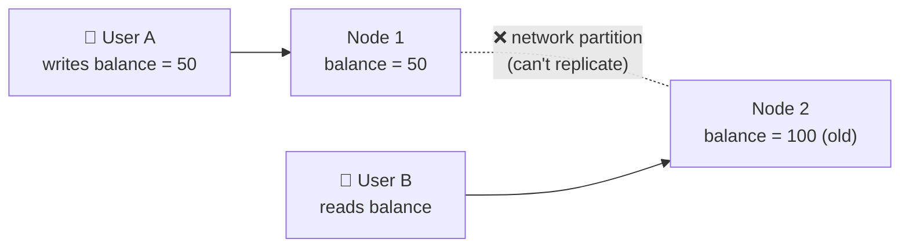
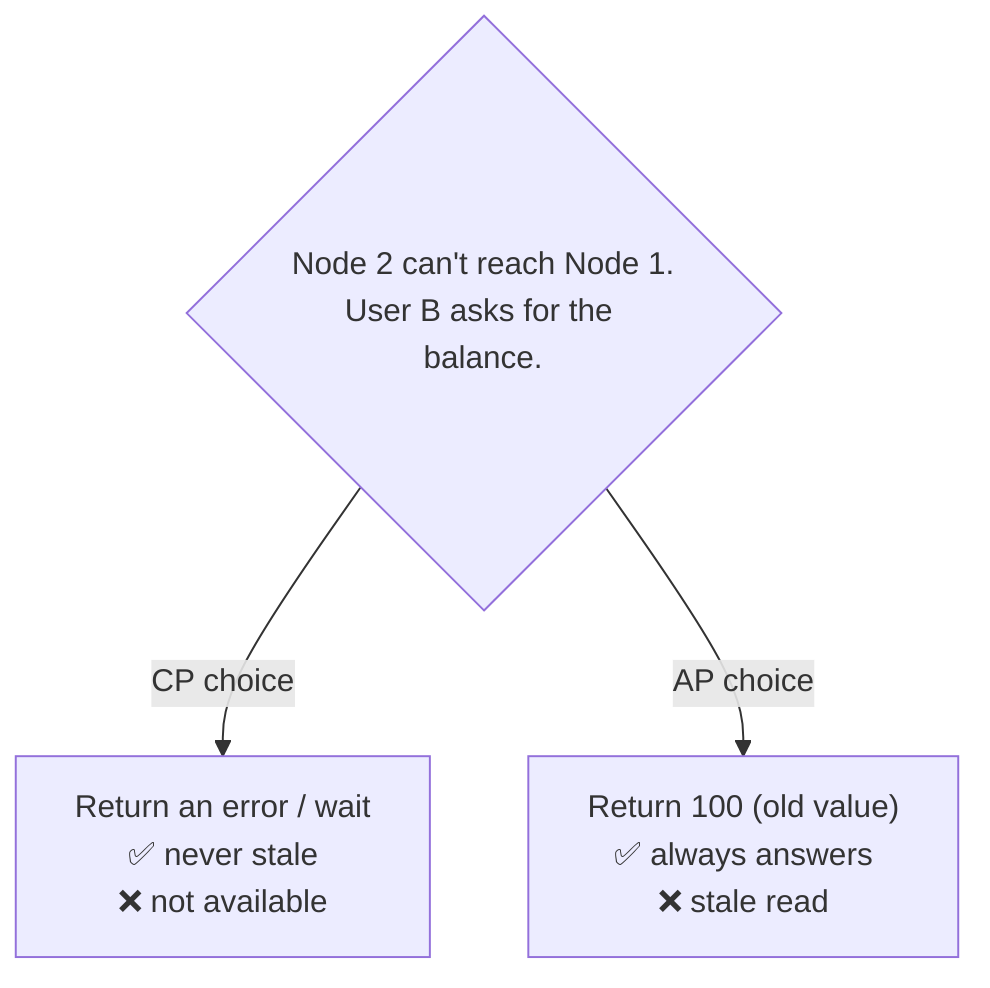
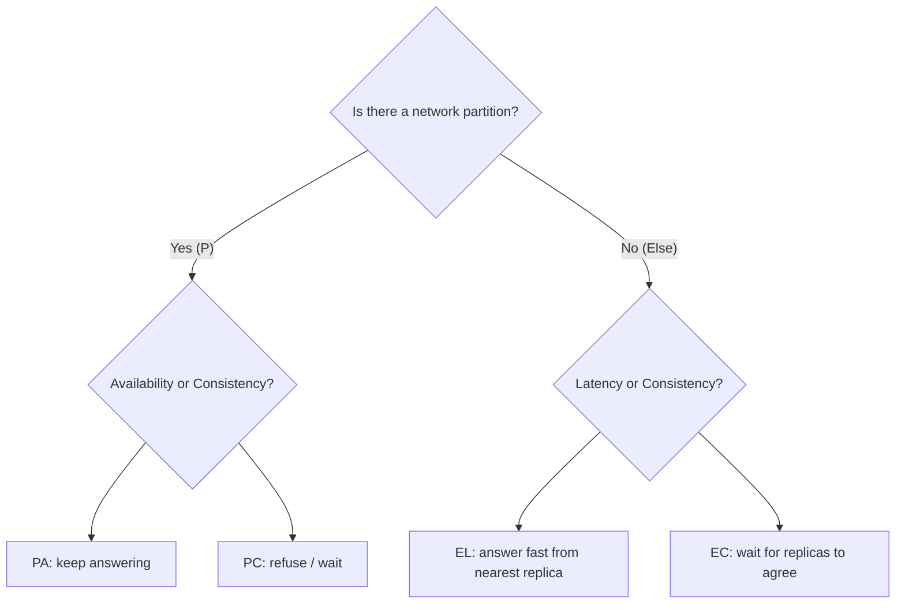

# ⚖️ CAP Theorem

## 🧠 1. What is the CAP Theorem?

The **CAP theorem** (Eric Brewer, 2000; proved by Gilbert & Lynch, 2002) is about **distributed data stores**: data copied across several machines (nodes) that talk over a network.

It says a distributed system can't fully guarantee all three of these **at the same time**:

- **C**onsistency
- **A**vailability
- **P**artition tolerance

> 👉 *"When the network breaks, you must choose: give a possibly stale answer, or give no answer."*

> ⚠️ The popular version, *"pick any 2 of 3"*, is a **simplification**. In a real distributed system, **P is not optional**. The real choice is **C vs A, only while a partition is happening**.

---

## 🔍 2. C, A and P Defined Precisely

| Letter | Means | Precise meaning |
| --- | --- | --- |
| **C** | Consistency | Every read sees the **most recent write** (or gets an error). All nodes act like **one single copy** of the data. Formally this is **linearizability**. |
| **A** | Availability | Every request to a **non-failing node** gets a **non-error response**, but it may not be the latest data. |
| **P** | Partition tolerance | The system **keeps working** even if the network **drops or delays messages** between nodes. |

> ⚠️ CAP's **C** is **not** the **C in ACID**. ACID's C means "the data follows your rules" (constraints, foreign keys). CAP's C means "all replicas agree on the latest value".

> 💡 CAP's **A** is strict: **every** working node must answer. "99.99% uptime" is a different (everyday) meaning of availability.

---

## 🌐 3. Why P is Mandatory

A **network partition** = some nodes **can't talk** to other nodes, but both sides are still running.

Partitions **will happen** in any real network:

- a switch or router fails,
- a cable is cut between data centers,
- a long GC pause makes a node look dead,
- a cloud availability zone loses connectivity.

You can't "choose" to never have partitions. So a distributed system **must tolerate** them.

That leaves only one real decision: **what to do during a partition**.

| Choice | During a partition |
| --- | --- |
| **CP** | Refuse some requests (error / timeout) so nobody sees stale or conflicting data |
| **AP** | Keep answering every request, even if some answers are stale, and fix conflicts later |

> 💡 A "CA" system only exists if there's **no network to break**, e.g. a single-node database. Once you replicate over a network, you're choosing **CP or AP**.

---

## 🧩 4. A Partition Scenario

Two replicas of a bank balance. The link between them breaks. A user writes on one side and reads on the other.

Node 2 now has two options:

- **CP**: Node 2 says *"I can't confirm the latest value, try again later"*.
- **AP**: Node 2 says *"Here's what I have: 100"*. The nodes **reconcile** after the network heals.

---

## 🏢 5. Real Examples: CP vs AP

### 🔒 CP systems (consistency first)

| System | How it behaves in a partition |
| --- | --- |
| **ZooKeeper / etcd** | Use consensus (ZAB / Raft). Only the side with a **majority (quorum)** can accept writes. The minority side stops serving writes. |
| **HBase** | Each row range is owned by **one region server**. If it's unreachable, that range is unavailable until it's reassigned. |
| **MongoDB (default)** | Single **primary** per replica set. Writes and default reads go to the primary. A primary that loses the majority **steps down**, so the minority side can't take writes. |

> 💡 That's why ZooKeeper and etcd are used for **leader election, locks and config**: being wrong is worse than being briefly unavailable.

### 🌍 AP systems (availability first)

| System | How it behaves in a partition |
| --- | --- |
| **Cassandra** | Any replica can accept writes. Conflicts resolved with **last-write-wins** (timestamps). Repairs data later (hinted handoff, read repair, anti-entropy). |
| **DynamoDB** | Based on Dynamo ideas. Reads are **eventually consistent by default**. |
| **CouchDB** | Multi-master replication. Keeps conflicting versions and lets the app resolve them. |

### 🎛️ Tunable consistency

Many systems are **not purely CP or AP**. You pick per request:

- **Cassandra**: consistency levels like `ONE`, `QUORUM`, `ALL`.
  - With `N` replicas, if **`R + W > N`** (read replicas + write replicas), every read **overlaps** with the latest write.
  - e.g. `N = 3`, `W = QUORUM (2)`, `R = QUORUM (2)` → strongly consistent reads, but less available.
- **DynamoDB**: `ConsistentRead = true` gives **strongly consistent** reads (costs more, can fail during outages).
- **MongoDB**: `readConcern` / `writeConcern` and reading from secondaries move it toward AP.

> ⚠️ Labels like "Cassandra is AP" describe the **default** behaviour. Configuration can move a system along the spectrum.

---

## 📏 6. Consistency Models (Strong → Weak)

CAP talks about **strong** consistency only. Real systems use a range of models:

| Model | Guarantee | Example |
| --- | --- | --- |
| **Strong (linearizable)** | Every read sees the latest write, as if there's one copy | etcd, Spanner, a single-primary SQL DB |
| **Read-your-writes** | **You** always see **your own** writes. Others may see them later. | You post a comment and it shows up for you immediately |
| **Monotonic reads** | You never see data go **back in time** | Refreshing a feed doesn't hide a post you just saw |
| **Causal** | If A caused B, everyone sees A before B | A reply never appears before the message it replies to |
| **Eventual** | If writes stop, all replicas **eventually** agree. No promise about when. | DNS, Cassandra at `ONE`, likes counters |

> 💡 **Read-your-writes** is a common middle ground: route a user's reads to the primary (or a fresh replica) for a few seconds after they write.

---

## 🧮 7. PACELC — The Better Model

CAP only describes behaviour **during a partition**. But most of the time there **is no partition**. PACELC (Daniel Abadi, 2010) covers both:

> **If P**artition → choose **A** or **C**.
> **E**lse (normal operation) → choose **L**atency or **C**onsistency.

Why the "else" part? Even with a healthy network, keeping replicas in sync means **waiting for other nodes**, which adds **latency**.

| System | PACELC | Meaning |
| --- | --- | --- |
| **Cassandra, DynamoDB** | **PA/EL** | Available in a partition; fast (not strongly consistent) normally |
| **HBase, Google Spanner** | **PC/EC** | Consistent always; pays with availability and latency |

> 💡 In interviews, mentioning **PACELC** shows you know CAP is only about the **failure case**.

---

## 🏗️ 8. System Design: How to Choose

Ask: **"What's worse for this feature: a wrong answer, or no answer?"**

| Use case | Choose | Why |
| --- | --- | --- |
| **Banking / payments / balances** | **CP** | A stale balance can allow **double spending**. Better to show "try again". |
| **Inventory for the last item / seat booking** | **CP** | Overselling is costly. |
| **Leader election, distributed locks** | **CP** | Two leaders = data corruption. |
| **Social feed, likes, view counts** | **AP** | A post showing up 2 seconds late is fine. An error page is not. |
| **Shopping cart** | **AP** | Amazon's Dynamo paper: always accept "add to cart", merge conflicts later. |
| **DNS, CDN content** | **AP** | Slightly stale is fine; must always answer. |

> 💡 You don't pick one model for the **whole system**. A single app often uses **CP** for payments and **AP** for the feed and notifications.

> ⚠️ "AP" doesn't mean "never consistent". It means **eventually** consistent, plus a plan for **conflicts** (last-write-wins, version vectors, CRDTs, or app-level merge).

---

## 💬 Interview Takeaway

> *"CAP says that during a network partition, a distributed system must choose between consistency and availability. Partitions are unavoidable, so the real choice is CP or AP, not 'pick any two'.*
>
> *CP systems like etcd, ZooKeeper and HBase reject requests rather than return stale data. AP systems like Cassandra and DynamoDB keep answering and reconcile later. Many systems have tunable consistency, like quorum reads and writes. PACELC extends this: even without a partition, you trade latency against consistency. For payments I'd pick CP; for a social feed, AP."*

---

## 🔑 Final Takeaway

- **C** = every read sees the latest write; **A** = every working node answers; **P** = survives network splits.
- **P is mandatory** in distributed systems, so the real choice is **CP vs AP during a partition**.
- **CP**: ZooKeeper, etcd, HBase, MongoDB (default). **AP**: Cassandra, DynamoDB, CouchDB.
- Many databases offer **tunable consistency** (`R + W > N` for quorum overlap).
- Consistency is a **spectrum**: strong → read-your-writes → causal → eventual.
- **PACELC**: if Partition, A vs C; Else, **Latency vs Consistency**.
- Choose per feature: **money → CP**, **feeds and counters → AP**.
