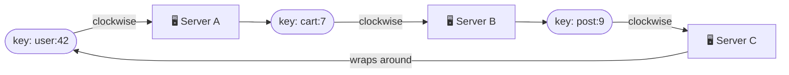
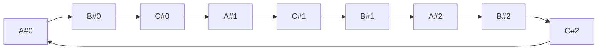
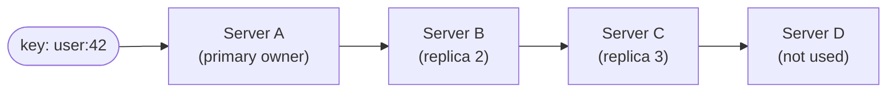

# 💍 Consistent Hashing

## 🧠 1. What Problem Does It Solve?

When data is spread across many servers (cache nodes, DB shards), we need a rule: **"which server owns this key?"**

The obvious rule is:

```text
server = hash(key) % N      (N = number of servers)
```

It works fine, **until N changes**.

> 👉 *"Consistent hashing is a way to map keys to servers so that adding or removing a server moves only a small share of the keys."*

---

## 💥 2. The Problem with `hash(key) % N`

Say we have **4 cache servers** and add a **5th**.

| Key hash | `% 4` | `% 5` | Moved? |
| --- | --- | --- | --- |
| 10 | 2 | 0 | ✅ moved |
| 11 | 3 | 1 | ✅ moved |
| 12 | 0 | 2 | ✅ moved |
| 13 | 1 | 3 | ✅ moved |
| 20 | 0 | 0 | ❌ stayed |

- Going from **N → N+1** servers remaps about **N/(N+1)** of all keys.
- 4 → 5 servers: about **80% of keys move**.

### 🏗️ Why this hurts

- **Cache**: almost every key now points to the wrong server → **mass cache misses** → all traffic hits the database at once (a **cache stampede**).
- **Database shards**: most data must be **copied between servers**, which is slow and risky.
- A **server crash** (N → N-1) causes the same storm.

> ⚠️ Plain modulo hashing makes **scaling up, scaling down, and failures** all expensive.

---

## 🔄 3. The Hash Ring

Consistent hashing (Karger et al., 1997) puts **both servers and keys** on the same circle.

1. Take a hash space, e.g. `0 … 2³² − 1`, and bend it into a **ring** (the end wraps back to 0).
2. Hash each **server** (e.g. its name or IP) → place it on the ring.
3. Hash each **key** → place it on the ring.
4. A key belongs to the **first server found going clockwise** from the key.



> 💡 Each server owns the **arc** between the previous server and itself.

---

## ➕ 4. Adding or Removing a Node

### Adding a server

- New server **D** lands between **A** and **B**.
- Only keys on the arc **A → D** move (from B to D).
- Every other key **stays where it was**.

### Removing a server

- If **B** dies, only **B's keys** move, to the next server clockwise (**C**).
- Keys on A and C are untouched.

| | `hash % N` | Consistent hashing |
| --- | --- | --- |
| Keys moved when a node is added/removed | ~**all** keys | ~**K/N** keys (K = keys, N = nodes) |
| Who is affected | Every server | Only the **neighbour** on the ring |
| Lookup cost | O(1) | O(log N) with binary search |

> 💡 That's the whole point: resizing becomes **cheap and local**.

---

## ⚖️ 5. Virtual Nodes (VNodes) for Balance

With only a few servers, their hash positions land **randomly**. One server may get a huge arc, another a tiny one.

Also, when a server dies, **all** its load goes to **one** neighbour, which may overload it.

**Fix: virtual nodes.** Each physical server is placed on the ring **many times** (e.g. 100–200 positions), using names like `A#0`, `A#1`, `A#2`, ...



| Benefit | Why |
| --- | --- |
| **Even load** | Many small arcs average out, so each server gets close to 1/N of keys |
| **Smooth failover** | When a server dies, its many small arcs are spread across **all** other servers, not one |
| **Weighted capacity** | A bigger server gets **more** virtual nodes, so it owns more keys |

> 💡 Cassandra calls this `num_tokens` (default 16 in Cassandra 4.0; 256 in older versions).

---

## 🔁 6. Replication Along the Ring

Consistent hashing also decides **where copies go**.

- For replication factor **N = 3**, store the key on the owner **plus the next 2 distinct physical servers** clockwise.
- With virtual nodes, **skip** positions that belong to a server already chosen.



> 💡 In the Dynamo paper, this list of servers is called the **preference list**. Quorum reads/writes (`R + W > N`) then run against it. See [CAP Theorem](../06-cap-theorem/README.md).

---

## 🏢 7. Who Uses It

| System | How |
| --- | --- |
| **Amazon Dynamo** (the paper behind DynamoDB) | Ring + virtual nodes + preference lists for replication |
| **Apache Cassandra** | Token ring; each node owns token ranges (vnodes) |
| **Riak, ScyllaDB** | Ring-based partitioning, like Dynamo |
| **Memcached clients** | **Ketama** hashing to pick a cache server |
| **Load balancers** | Nginx `hash ... consistent`, HAProxy `hash-type consistent` for **sticky** routing that survives backend changes |
| **CDNs** | Akamai (origin of the idea) maps content to edge cache servers |

> ⚠️ Not every system uses a ring. **Redis Cluster** uses **16,384 fixed hash slots** instead (`CRC16(key) % 16384`), and moves slots between nodes. Same goal, different technique.

---

## 💻 8. C# Implementation (Ring with Virtual Nodes)

- `SortedDictionary` keeps ring positions in order.
- A cached sorted array allows **binary search** (`O(log N)`) for the next position clockwise.

```csharp
using System.Buffers.Binary;
using System.Security.Cryptography;
using System.Text;

public sealed class ConsistentHashRing(int virtualNodes = 150)
{
    private readonly SortedDictionary<uint, string> _ring = new();
    private uint[] _positions = [];

    public void AddNode(string node)
    {
        for (int i = 0; i < virtualNodes; i++)
            _ring[Hash($"{node}#{i}")] = node;
        _positions = [.. _ring.Keys];
    }

    public void RemoveNode(string node)
    {
        for (int i = 0; i < virtualNodes; i++)
            _ring.Remove(Hash($"{node}#{i}"));
        _positions = [.. _ring.Keys];
    }

    public string GetNode(string key) => _ring[_positions[NextIndex(Hash(key))]];

    // Owner + next distinct physical nodes clockwise (for replication).
    public List<string> GetReplicas(string key, int count)
    {
        var result = new List<string>();
        int start = NextIndex(Hash(key));
        for (int i = 0; i < _positions.Length && result.Count < count; i++)
        {
            string node = _ring[_positions[(start + i) % _positions.Length]];
            if (!result.Contains(node)) result.Add(node);
        }
        return result;
    }

    private int NextIndex(uint hash)
    {
        if (_positions.Length == 0) throw new InvalidOperationException("Ring is empty.");
        int idx = Array.BinarySearch(_positions, hash);
        if (idx < 0) idx = ~idx;                      // first position >= hash
        return idx == _positions.Length ? 0 : idx;    // wrap around the ring
    }

    private static uint Hash(string value) =>
        BinaryPrimitives.ReadUInt32LittleEndian(MD5.HashData(Encoding.UTF8.GetBytes(value)));
}
```

Usage:

```csharp
var ring = new ConsistentHashRing();
foreach (var n in new[] { "cache-a", "cache-b", "cache-c" }) ring.AddNode(n);

var keys = Enumerable.Range(0, 10_000).Select(i => $"user:{i}").ToList();
var before = keys.ToDictionary(k => k, ring.GetNode);

ring.AddNode("cache-d");
int moved = keys.Count(k => before[k] != ring.GetNode(k));
Console.WriteLine($"Moved {moved} of {keys.Count}");   // roughly 25%, not ~75%
Console.WriteLine(string.Join(", ", ring.GetReplicas("user:42", 3)));
```

> ⚠️ Don't use `string.GetHashCode()` here. In .NET it's **randomized per process**, so two servers would build **different rings**. Use a stable hash (MD5, xxHash, MurmurHash).

> 💡 MD5 is fine here because we only need **spread**, not security. Real systems often use **MurmurHash** or **xxHash** for speed.

---

## 💬 Interview Takeaway

> *"With hash(key) mod N, changing the number of servers remaps almost every key, which causes cache stampedes and huge data moves. Consistent hashing puts servers and keys on a ring; a key goes to the next server clockwise. Adding or removing a node only moves about K/N keys, from its neighbour.*
>
> *Virtual nodes give each server many positions, which balances load and spreads a failed node's keys across the cluster. Replicas go on the next distinct servers clockwise. Dynamo, Cassandra, Memcached clients and some load balancers use it."*

---

## 🔑 Final Takeaway

- `hash % N` breaks on resize: ~**all keys move**.
- **Hash ring**: key → first server **clockwise**.
- Adding/removing a node moves only ~**K/N** keys, from **one neighbour**.
- **Virtual nodes** → even load, smooth failover, weighted capacity.
- **Replication**: copy to the next **distinct** physical nodes on the ring.
- Used by **Dynamo, Cassandra, Memcached (ketama), load balancers, CDNs**.
- Use a **stable hash** and **binary search** over sorted positions.
