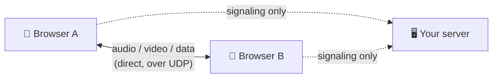
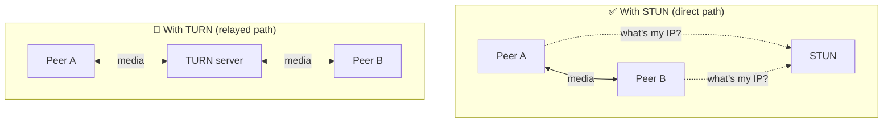
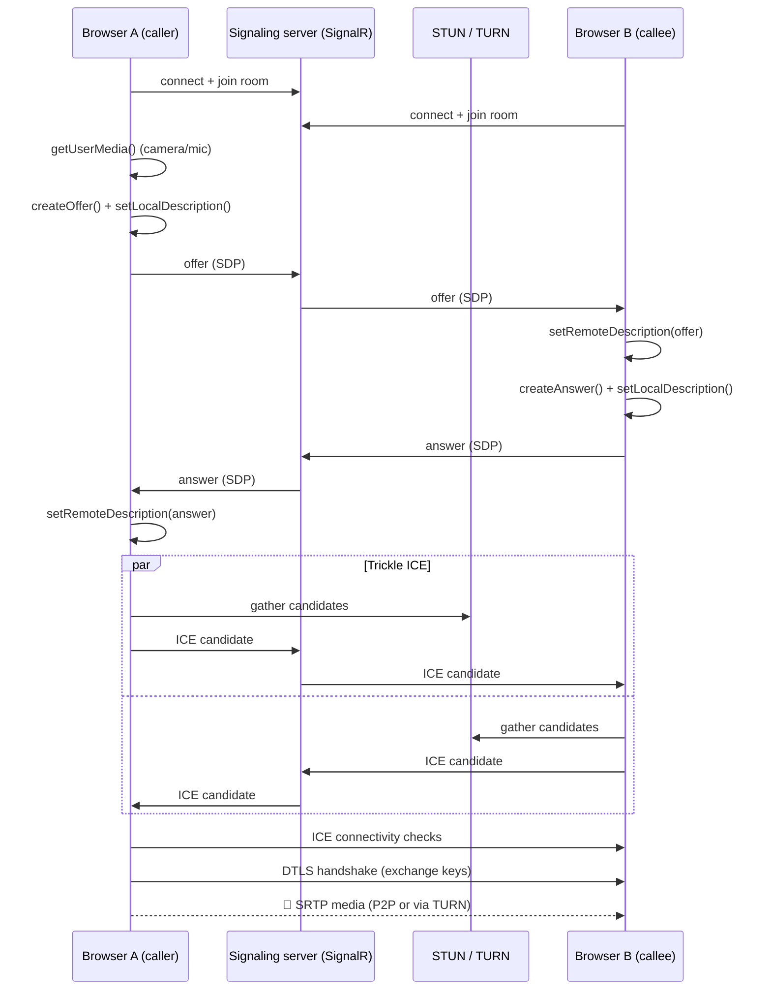
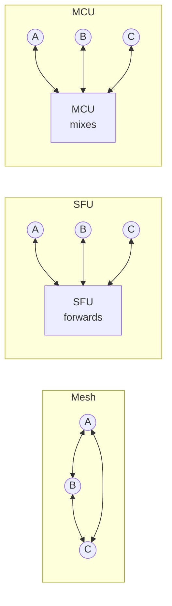

# ☠️ WebRTC → Maut ka doosra Naam

> 😅 *"Maut ka doosra naam"* = *"another name for death"*.
> WebRTC earns the title. The API looks like 10 lines of code. Then you meet NATs, firewalls, codecs, ICE, STUN, TURN, SDP, and a call that works on your Wi-Fi but **not** on your friend's office network.

---

## 🧠 1. What is WebRTC?

**WebRTC** (Web Real-Time Communication) lets two browsers (or apps) send **audio, video and data directly to each other**, peer-to-peer.

- Built into every modern browser. No plugins.
- Used by **Google Meet, Discord, WhatsApp Web calls, Zoom (in browser)** and many more.
- Gives you three things:

| Piece | What it does |
| --- | --- |
| **Media streams** | Camera, mic, screen share |
| **`RTCPeerConnection`** | The actual peer-to-peer connection (audio/video) |
| **`RTCDataChannel`** | Send arbitrary data peer-to-peer (chat, files, game state) |

> 👉 *"Instead of Client → Server → Client, WebRTC tries to go Client → Client directly."*



---

## 💀 2. Why is it So Hard?

Peer-to-peer *sounds* simple. The internet was not built for it.

| Problem | Why it hurts |
| --- | --- |
| **NAT** | Your laptop has a private IP (`192.168.x.x`). The other peer can't reach it directly. |
| **Firewalls** | Corporate networks often block UDP, or block everything except ports 80/443. |
| **No discovery** | Peer A doesn't know Peer B's address, codecs, or even that B exists. |
| **Signaling is DIY** | WebRTC deliberately **doesn't define** how peers find each other. You build it. |
| **Codec negotiation** | Both sides must agree on VP8 / VP9 / H.264 / AV1, Opus, resolutions… |
| **Bad networks** | Packet loss, jitter, bandwidth swings. Mobile users switch Wi-Fi → 4G mid-call. |
| **Scaling** | P2P works for 2 people. For 50 people, it falls apart (see section 10). |
| **Debugging** | "It works for me" is the most common bug report. `chrome://webrtc-internals` becomes your best friend. |

> ⚠️ The happy path takes a day. Making it work for **every** user on **every** network takes months.

---

## 📡 3. Signaling (The Part You Build Yourself)

Before two peers can talk directly, they must exchange some info **through a middleman**. This is **signaling**.

- WebRTC **does not** say how to do it. Any channel works: **WebSockets, SignalR, HTTP polling, even copy-paste**.
- It's usually a small server that **relays messages** between peers.
- Once the P2P connection is up, signaling is only needed for changes (renegotiation, hang-up).

What gets exchanged:

| Message | Contains |
| --- | --- |
| **Offer** (SDP) | "Here's what I can send/receive: codecs, media tracks, encryption fingerprint" |
| **Answer** (SDP) | "OK, here's what I accept from your offer" |
| **ICE candidates** | "Here are network addresses where you might reach me" |

> 💡 Signaling is plain old client-server. That's why you build it with the tools you already know (WebSockets / SignalR). See [WebSockets](../02-networking/chapter-2-advanced/real-time-communication/03-websockets.md).

---

## 📝 4. SDP — Offer and Answer

**SDP** (Session Description Protocol) is a **text blob** describing a media session. It's ugly, but it's just text.

```text
v=0
o=- 4611731400430051336 2 IN IP4 127.0.0.1
m=audio 9 UDP/TLS/RTP/SAVPF 111
a=rtpmap:111 opus/48000/2
a=ice-ufrag:F7gI
a=fingerprint:sha-256 6B:8B:...
```

It describes:

- **Media**: audio? video? how many tracks?
- **Codecs**: Opus, VP8, H.264…
- **ICE credentials** (`ice-ufrag`, `ice-pwd`)
- **DTLS fingerprint**: used to verify encryption keys later

The **offer/answer model**:

1. **Caller** creates an **offer** → sets it as its *local description* → sends it via signaling.
2. **Callee** sets it as its *remote description* → creates an **answer** → sends it back.
3. **Caller** sets the answer as its *remote description*.

Now both sides agree on **what** to send. They still need to figure out **where** (that's ICE).

---

## 🧊 5. ICE Candidates — "Where Can You Reach Me?"

**ICE** (Interactive Connectivity Establishment) is the process of finding **a network path that actually works** between two peers.

Each peer gathers **candidates** (possible addresses):

| Candidate type | Where it comes from | Example |
| --- | --- | --- |
| **host** | Your local network interface | `192.168.1.5:54321` |
| **srflx** (server reflexive) | Your public IP, learned from a **STUN** server | `49.36.10.20:61000` |
| **relay** | An address on a **TURN** server that relays for you | `turn.myapp.com:3478` |

Then ICE:

1. Exchanges candidates via signaling.
2. **Pairs** local + remote candidates.
3. Runs **connectivity checks** (STUN pings) on each pair.
4. Picks the **best working pair** (direct first, relay last).

> 💡 **Trickle ICE**: candidates are sent **one by one as they're found**, instead of waiting for all of them. Much faster call setup.

---

## 🌍 6. NAT Traversal — STUN and TURN

### The NAT problem

Your router hides many devices behind **one public IP**. Incoming packets are dropped unless the router has seen outgoing traffic for that mapping first.

### 🔦 STUN (Session Traversal Utilities for NAT)

- A tiny, cheap server that answers one question: **"What's my public IP and port?"**
- The peer then shares that public address as an ICE candidate.
- Both peers send packets to each other's public address → the NATs open up (**UDP hole punching**).
- Works for **most** home networks. Free public ones exist (e.g. `stun:stun.l.google.com:19302`).

### 🔁 TURN (Traversal Using Relays around NAT)

- When direct connection **fails** (symmetric NAT, strict corporate firewalls), the media is **relayed through a TURN server**.
- It's no longer peer-to-peer, but **the call works**.
- Can run over UDP, TCP, or **TLS on port 443** to sneak through strict firewalls.
- Popular server: **coturn**. Managed: Twilio, Cloudflare, Xirsys.



| | **STUN** | **TURN** |
| --- | --- | --- |
| Job | Discover public IP | Relay all media |
| Traffic through it | A few tiny packets | **Every audio/video byte** |
| Cost | Almost free | **Expensive (bandwidth)** |
| Works through | Most NATs | Almost everything |

> ⚠️ **TURN cost is real.** A meaningful share of calls (often quoted ~10–20%, more for enterprise users) need TURN. A 1 Mbps video call relayed for an hour is ~450 MB per direction. Multiply by thousands of users and it's a big bandwidth bill.

> 🔐 Never hard-code TURN credentials in the frontend. Issue **short-lived credentials** from your backend (see section 11).

---

## 🔄 7. The Full Connection Sequence



Key point: **the signaling server never sees the media**. It just passes notes.

---

## 🚀 8. Media Transport — UDP, SRTP, DTLS

WebRTC media runs on **UDP** by default. Why? Because for live audio/video, **late data is useless**. (See [TCP / UDP](../02-networking/chapter-1-basics/02-tcp-udp.md).)

| Layer | Role |
| --- | --- |
| **UDP** | Fast transport, no retransmission delays |
| **ICE** | Finds the path |
| **DTLS** | TLS for UDP. Handshake that exchanges encryption keys and checks the SDP fingerprint |
| **SRTP** | Secure RTP. Encrypted audio/video packets, keys from DTLS (**DTLS-SRTP**) |
| **RTCP** | Feedback: packet loss, jitter, bandwidth estimates → the sender adapts bitrate |

> 🔒 **Encryption is mandatory** in WebRTC. There's no "unencrypted mode".

> 💡 If UDP is fully blocked, ICE can fall back to **TCP** or **TURN over TLS (443)**. It works, but quality drops when packets are lost.

---

## 📦 9. Data Channels — P2P for Any Data

`RTCDataChannel` sends **arbitrary data** between peers: chat, file transfer, game state, cursor positions.

- Runs on **SCTP over DTLS over UDP**.
- Configurable per channel:

| Setting | Options |
| --- | --- |
| **Reliability** | Reliable (like TCP) or unreliable (`maxRetransmits` / `maxPacketLifeTime`) |
| **Ordering** | Ordered or unordered |

> 🎮 Multiplayer game? Use **unreliable + unordered** for position updates (old positions don't matter), and **reliable + ordered** for chat.

---

## 🏗️ 10. Scaling Multi-Party Calls — Mesh vs SFU vs MCU

P2P is perfect for **1:1**. Group calls need a different design.



| | **Mesh** | **SFU** (Selective Forwarding Unit) | **MCU** (Multipoint Control Unit) |
| --- | --- | --- | --- |
| How | Everyone sends to everyone | Each sends **1 stream** to server; server **forwards** others' streams | Server **decodes, mixes** into one stream, re-encodes |
| Upload per client | N−1 streams 😵 | 1 | 1 |
| Download per client | N−1 | N−1 (or fewer: only active speakers) | 1 |
| Server CPU | None | Low (no transcoding) | **Very high** |
| Latency | Lowest | Low | Higher (mixing) |
| Good for | 2–4 people | **Most group calls today** | Legacy devices, recording, phone bridges |
| Examples | Simple P2P apps | **mediasoup, LiveKit, Janus, Jitsi Videobridge** | Old video-conf systems, some Janus/Kurento setups |

> 💡 SFUs usually use **simulcast**: each client uploads the same video in 2–3 qualities, and the SFU sends each viewer the quality that fits their bandwidth.

> 🏗️ **System design view:** for anything beyond 4–5 people, the answer is almost always **SFU**. Scale SFUs horizontally (one room per SFU node, or cascade SFUs across regions).

---

## 💻 11. C# Signaling Server with SignalR

The browser side (`RTCPeerConnection`, `getUserMedia`) is **JavaScript-only**. The backend's job is just to **relay** offers, answers and ICE candidates. SignalR is a natural fit.

### The hub

```csharp
using Microsoft.AspNetCore.SignalR;

public class SignalingHub : Hub
{
    public async Task JoinRoom(string roomId)
    {
        await Groups.AddToGroupAsync(Context.ConnectionId, roomId);
        // Tell existing peers someone new arrived, so one of them can send an offer
        await Clients.OthersInGroup(roomId).SendAsync("PeerJoined", Context.ConnectionId);
    }

    public Task SendOffer(string targetId, string sdp) =>
        Clients.Client(targetId).SendAsync("ReceiveOffer", Context.ConnectionId, sdp);

    public Task SendAnswer(string targetId, string sdp) =>
        Clients.Client(targetId).SendAsync("ReceiveAnswer", Context.ConnectionId, sdp);

    public Task SendIceCandidate(string targetId, string candidateJson) =>
        Clients.Client(targetId).SendAsync("ReceiveIceCandidate", Context.ConnectionId, candidateJson);
}
```

### Wiring it up (`Program.cs`)

```csharp
var builder = WebApplication.CreateBuilder(args);
builder.Services.AddSignalR();

var app = builder.Build();
app.MapHub<SignalingHub>("/signaling");
app.Run();
```

### Short-lived TURN credentials

coturn supports a "REST API" style auth: username = `expiryTimestamp:userId`, password = `Base64(HMAC-SHA1(sharedSecret, username))`.

```csharp
app.MapGet("/turn-credentials", (HttpContext ctx, IConfiguration config) =>
{
    var secret = config["Turn:SharedSecret"]!;
    var expiry = DateTimeOffset.UtcNow.AddHours(1).ToUnixTimeSeconds();
    var username = $"{expiry}:{ctx.User.Identity?.Name ?? "guest"}";

    using var hmac = new System.Security.Cryptography.HMACSHA1(System.Text.Encoding.UTF8.GetBytes(secret));
    var password = Convert.ToBase64String(hmac.ComputeHash(System.Text.Encoding.UTF8.GetBytes(username)));

    return Results.Ok(new { urls = new[] { "turn:turn.myapp.com:3478" }, username, credential = password });
}).RequireAuthorization();
```

**Browser side (in words):**

1. Connect to `/signaling`, call `JoinRoom`.
2. Fetch `/turn-credentials`, build `RTCPeerConnection` with STUN + TURN in `iceServers`.
3. On `PeerJoined`: create offer → `SendOffer`.
4. On `ReceiveOffer`: set remote, create answer → `SendAnswer`.
5. On every `onicecandidate` event → `SendIceCandidate`; on `ReceiveIceCandidate` → `addIceCandidate`.

> ⚠️ If you run **multiple signaling servers**, peer A and peer B may be connected to different instances. Use a **Redis backplane** so messages reach the right server. See [Redis, WebSockets, Pub/Sub](../10-redis-websockets-pubsub-message-queues/README.md).

---

## 💬 Interview Takeaway

> *"WebRTC enables real-time peer-to-peer audio, video and data between browsers. Peers first exchange SDP offers/answers and ICE candidates through a signaling server that we build ourselves, usually over WebSockets. ICE uses STUN to discover public addresses for direct connections, and falls back to TURN relays when NAT or firewalls block P2P, which costs bandwidth.*
>
> *Media flows over UDP, encrypted with DTLS-SRTP, and data channels use SCTP. For group calls, mesh doesn't scale, so we use an SFU like mediasoup or LiveKit that forwards streams without transcoding."*

---

## 🔑 Final Takeaway

- **WebRTC** = browser-native, encrypted, peer-to-peer **audio / video / data**.
- **Signaling is not part of WebRTC**. You build it (WebSockets / SignalR). It only carries SDP and ICE.
- **SDP** says **what** to send; **ICE** finds **where** to send it.
- **STUN** = cheap "what's my public IP?"; **TURN** = expensive relay that makes the hard cases work.
- Media = **UDP + DTLS + SRTP**; data channels = **SCTP over DTLS**.
- **Mesh** for 2–4 people, **SFU** for most group calls, **MCU** only when you must mix.
- It's called *maut ka doosra naam* for a reason: the hard part is **networks**, not the API. 😄
