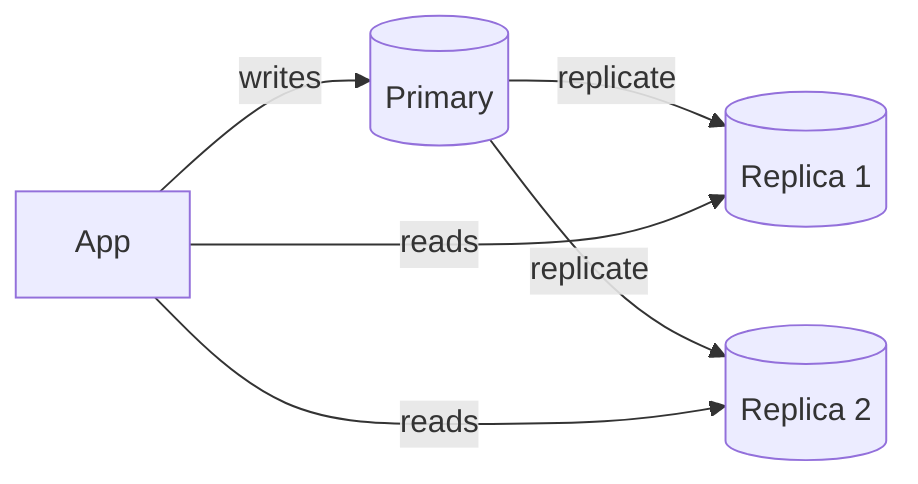
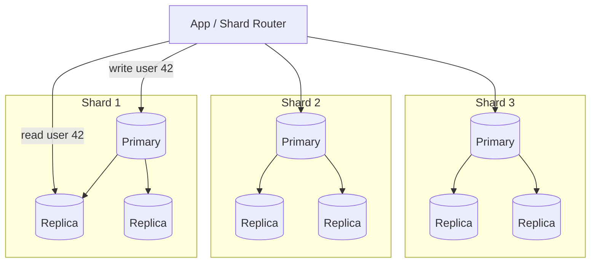

# 🗄️ Sharding, Replication and System Design

> Related: [CAP Theorem](../06-cap-theorem/README.md) · [Consistent Hashing](../07-consistent-hashing/README.md)

## 🧠 1. Why Do We Need This?

A single database server has limits:

- **CPU / memory**: too many queries.
- **Disk**: too much data.
- **Single point of failure**: if it dies, the app is down.

Two tools solve this:

| Technique | What it does | Solves |
| --- | --- | --- |
| **Replication** | **Copies the same data** to several servers | Read scaling, high availability |
| **Sharding** | **Splits the data** across several servers | Write scaling, data size |

> 👉 *"Replication = same data, many copies. Sharding = different data, many pieces."*

---

## 📈 2. Vertical vs Horizontal Scaling

| | **Vertical (scale up)** | **Horizontal (scale out)** |
| --- | --- | --- |
| How | Bigger machine (more CPU, RAM, faster disk) | More machines |
| Code changes | None | Often a lot (routing, consistency) |
| Limit | Hardware ceiling, cost rises steeply | Practically none |
| Failure | Still one machine | Can survive node failures |
| Example | Move DB from 8 to 64 cores | Add read replicas, add shards |

> 💡 **Scale up first.** It's simple and modern machines are huge. Scale out when you hit the ceiling, or when you need **fault tolerance**.

---

## 🔁 3. Replication

**Replication** keeps a copy of the same data on multiple nodes (**replicas**).

Why:

- **High availability**: if one node dies, another takes over.
- **Read scaling**: spread reads across replicas.
- **Lower latency**: put a replica close to users (another region).

### 3.1 Leader-Follower (Primary-Replica)

- One **leader** (primary) takes **all writes**.
- **Followers** copy the leader's change log and serve **reads**.
- Most common setup: PostgreSQL, MySQL, SQL Server Always On, MongoDB replica sets.



### 3.2 Multi-Leader

- **Several leaders** accept writes (often one per data center).
- Leaders replicate to each other.
- ✅ Writes are fast in every region and survive a region outage.
- ❌ Two leaders can change the same row → **write conflicts** to resolve.

### 3.3 Leaderless

- **Any replica** accepts reads and writes (Dynamo-style: Cassandra, Riak, DynamoDB internals).
- Client writes to **W** replicas, reads from **R** replicas. If **`R + W > N`**, reads see the latest write.
- Repairs stale data with **read repair** and background **anti-entropy**.

| Model | Writes go to | Conflicts | Example |
| --- | --- | --- | --- |
| **Leader-follower** | One leader | None (single writer) | PostgreSQL, MySQL |
| **Multi-leader** | Any leader | Yes, must resolve | Multi-region active-active setups |
| **Leaderless** | Any replica (quorum) | Yes, last-write-wins / versions | Cassandra |

### 3.4 Sync vs Async Replication

| | **Synchronous** | **Asynchronous** |
| --- | --- | --- |
| Write returns when | Replica **confirms** it has the data | Leader has it (replicas catch up later) |
| Durability | No data loss if leader dies | **Recent writes can be lost** on failover |
| Latency | Slower (waits for replica) | Faster |
| Availability | Write blocks if replica is down | Unaffected by slow replicas |

> 💡 Common compromise: **semi-synchronous**. Wait for **one** replica, rest are async.

### 3.5 Replication Lag

With async replication, followers are **behind** the leader by milliseconds, sometimes seconds.

Problems it causes:

- User updates their profile, refreshes, and sees the **old** profile (read hit a lagging replica).
- Two reads hit different replicas and data seems to **go back in time**.

Fixes:

- **Read-your-writes**: read from the primary for a short time after the user writes.
- **Sticky reads**: send one user's reads to the same replica.
- **Read critical data from the primary** (balances, order status).

> ⚠️ Read replicas give you **eventual consistency**. See [CAP Theorem](../06-cap-theorem/README.md) for the consistency models.

### 3.6 Failover

When the leader dies:

1. **Detect** it (missed heartbeats / timeout).
2. **Elect** a new leader (usually the most up-to-date follower).
3. **Reconfigure** clients and other followers to use it.

Risks:

- **Lost writes**: async writes that never reached the new leader.
- **Split brain**: the old leader comes back and **both** think they're leader. Fix with **fencing** or consensus (Raft, etcd, ZooKeeper).
- **Timeout tuning**: too short → needless failovers; too long → longer downtime.

---

## ✂️ 4. Sharding (Partitioning)

**Sharding** splits one big dataset into smaller pieces (**shards**), each on a different server.

- Each row lives on **exactly one** shard.
- Both **reads and writes** are spread, so writes scale too.

### 4.1 Sharding Strategies

| Strategy | How | ✅ Good | ❌ Bad |
| --- | --- | --- | --- |
| **Range** | `A–M → shard 1`, `N–Z → shard 2`, or by date | Fast **range queries** | **Hot spots** (e.g. all new data in the latest range) |
| **Hash** | `hash(key) → shard` | **Even** spread | Range queries hit **all** shards |
| **Directory** | A lookup table: `key → shard` | Full control, easy to move tenants | Lookup service is extra infra, must be fast and HA |
| **Geo** | By region: EU users → EU shard | Low latency, data residency (GDPR) | Uneven region sizes |

> 💡 For hash sharding, use **[consistent hashing](../07-consistent-hashing/README.md)** (or fixed hash slots) so adding a shard doesn't move most of the data.

### 4.2 Choosing a Shard Key

The **shard key** decides which shard a row goes to. It's the **most important** decision, and hard to change later.

A good shard key:

- has **high cardinality** (many distinct values),
- spreads **load evenly** (not just data),
- matches the **most common query**, so most queries hit **one shard**.

| App | Good key | Bad key |
| --- | --- | --- |
| SaaS app | `tenant_id` | `country` (too few values) |
| Social app | `user_id` | `created_at` (all writes hit the newest shard) |
| Chat app | `conversation_id` | `message_id` (one chat spread over all shards) |

### 4.3 Hot Spots

A **hot spot** = one shard gets far more traffic than others.

- A celebrity user with millions of followers.
- Range sharding by time: **all** new writes go to the last shard.

Fixes:

- Hash the key instead of using raw ranges.
- **Salt** hot keys: `celebrity_id#0 … #9` spread over 10 shards (reads must combine them).
- Cache hot data in front of the DB.

### 4.4 Resharding

When a shard gets too big, you must **split it** or **add shards** and move data.

- With `hash % N`, changing N moves **most rows**. Avoid.
- Better: **many small logical shards** (e.g. 1,024) mapped onto **fewer physical servers**. Moving a logical shard = moving a small chunk.
- Or consistent hashing / a directory.

> ⚠️ Resharding live data is risky: copy data, keep both in sync, switch traffic, then clean up. Plan for it **early**.

### 4.5 Cross-Shard Queries and Joins

Once data is split, some things get hard:

| Problem | Why | Typical fix |
| --- | --- | --- |
| **Joins across shards** | Data is on different servers | Denormalize; co-locate related data on the same shard key |
| **Queries without the shard key** | Must ask **every** shard (**scatter-gather**) | Secondary index table, or search engine (Elasticsearch) |
| **Transactions across shards** | No single DB to commit | Avoid; or use **sagas**; 2PC as last resort |
| **Global unique IDs** | No single auto-increment | Snowflake-style IDs, UUIDs |
| **Aggregates** (counts, top-N) | Data everywhere | Pre-compute, or analytics store |

> 💡 Design so the **hot path** hits one shard. Accept that rare admin/reporting queries are slower.

---

## 🧩 5. Sharding + Replication Together

Real systems do **both**: data is **sharded**, and **each shard is replicated**.



- **Sharding** → scales **writes and storage**.
- **Replication** → scales **reads** and gives **failover** per shard.

> 💡 MongoDB sharded clusters, Vitess (MySQL), Citus (PostgreSQL) and Cassandra all work this way.

---

## 💻 6. C#: Shard Routing + Read/Write Splitting

- Pick the shard from the **shard key** (`userId`).
- **Writes** → the shard's primary.
- **Reads** → a random replica, unless the caller needs **fresh** data.

```csharp
public sealed record Shard(string PrimaryConn, IReadOnlyList<string> ReplicaConns);

public sealed class ShardRouter(IReadOnlyList<Shard> shards)
{
    // Simple hash routing. In production use consistent hashing or a directory.
    public Shard ShardFor(long userId) =>
        shards[(int)((ulong)userId % (ulong)shards.Count)];

    public string ForWrite(long userId) => ShardFor(userId).PrimaryConn;

    public string ForRead(long userId, bool requireFresh = false)
    {
        var shard = ShardFor(userId);
        if (requireFresh || shard.ReplicaConns.Count == 0)
            return shard.PrimaryConn;                     // read-your-writes
        return shard.ReplicaConns[Random.Shared.Next(shard.ReplicaConns.Count)];
    }
}
```

Usage (with Npgsql, for example):

```csharp
await using (var conn = new NpgsqlConnection(router.ForWrite(userId)))
{
    await conn.OpenAsync();
    // UPDATE users SET name = @name WHERE id = @id
}

// Right after a write, read from the primary to avoid replication lag.
string readConn = router.ForRead(userId, requireFresh: justUpdated);
```

> ⚠️ `userId % N` is fine for a demo, but changing N moves most users. See [Consistent Hashing](../07-consistent-hashing/README.md).

---

## 🚀 7. Worked Example: Scaling a Growing App

An app grows from 1k to 50M users. Each step solves the **current** bottleneck only.


| Step | Trigger | Change | New trade-off |
| --- | --- | --- | --- |
| **1. Single DB** | Launch, ~1k users | One PostgreSQL, app servers in front | Single point of failure |
| **2. Scale up + standby** | CPU high, fear of outage | Bigger machine; one **sync/standby replica** for failover | Cost; still one writer |
| **3. Read replicas** | Reads are ~90% of traffic | Writes → primary, reads → 2–3 replicas | **Replication lag**: need read-your-writes for some pages |
| **4. Caching** | Same hot rows read millions of times | Redis in front of the DB (cache-aside) | **Cache invalidation**, stale data |
| **5. Sharding** | **Writes** or data size exceed one primary | Shard by `user_id`, each shard has its own replicas | Cross-shard queries, resharding, more ops work |

> 💡 Steps 1–4 carry most apps a **very long way**. Shard only when **writes or storage** truly outgrow one primary.

> ⚠️ Sharding is a **one-way door**: it adds complexity forever. Exhaust indexing, query tuning, caching and scaling up first.

---

## 💬 Interview Takeaway

> *"Replication copies the same data to multiple nodes for availability and read scaling. Leader-follower is most common; multi-leader and leaderless allow writes anywhere but need conflict handling. Async replication is fast but causes replication lag, so I'd use read-your-writes for things the user just changed.*
>
> *Sharding splits data across nodes to scale writes and storage. The shard key is the key decision: high cardinality, even load, and matching the main query so most requests hit one shard. I'd use hash or consistent hashing to avoid hot spots, and accept that cross-shard joins are expensive. In practice I scale step by step: bigger DB, read replicas, cache, then shard, with each shard replicated."*

---

## 🔑 Final Takeaway

- **Scale up first**, then **scale out**.
- **Replication** = same data, many copies → reads + availability.
- **Leader-follower** (simple), **multi-leader** (multi-region writes), **leaderless** (quorums).
- **Async** = fast but **lag** and possible lost writes on failover; **sync** = safe but slower.
- **Sharding** = data split across nodes → writes + storage.
- Strategies: **range, hash, directory, geo**. Choose the **shard key** carefully.
- Watch for **hot spots**, **resharding** pain, and **cross-shard** queries.
- Real systems combine both: **sharded, and each shard replicated**.
- Growth path: **single DB → replicas → cache → sharding**.
