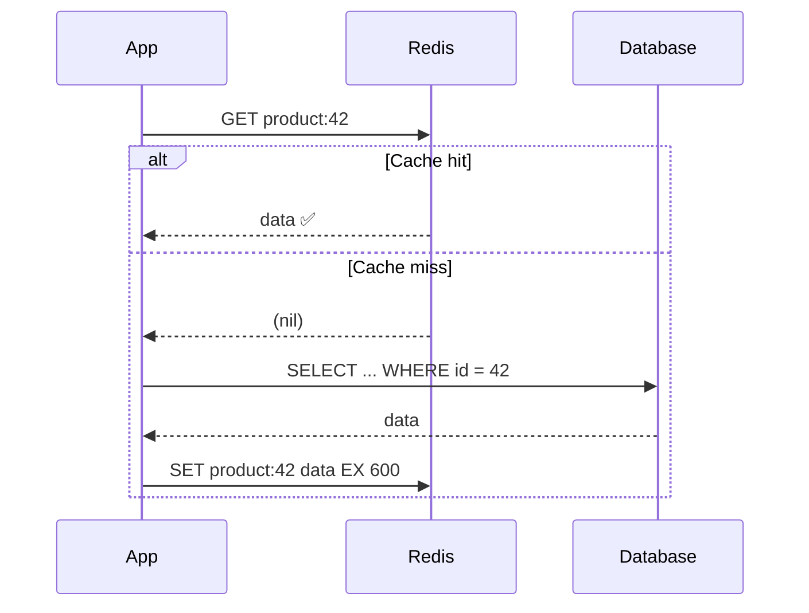
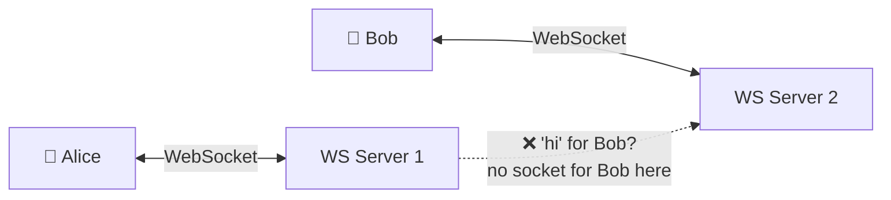
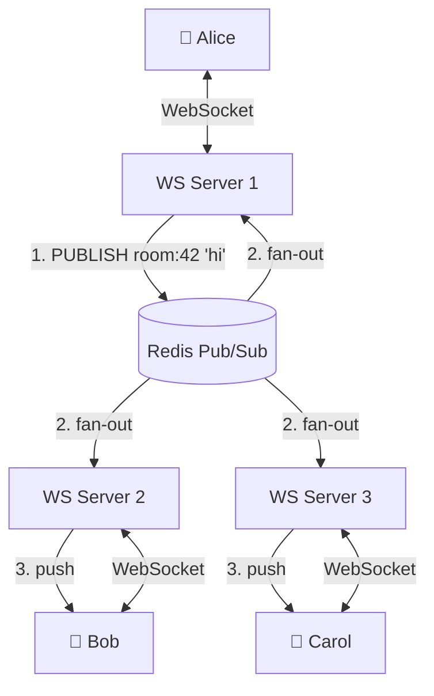
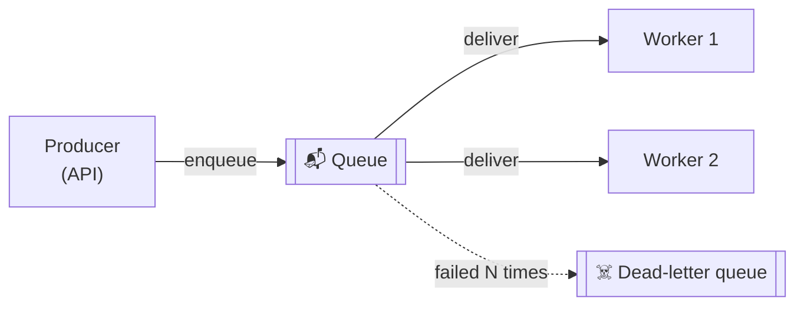
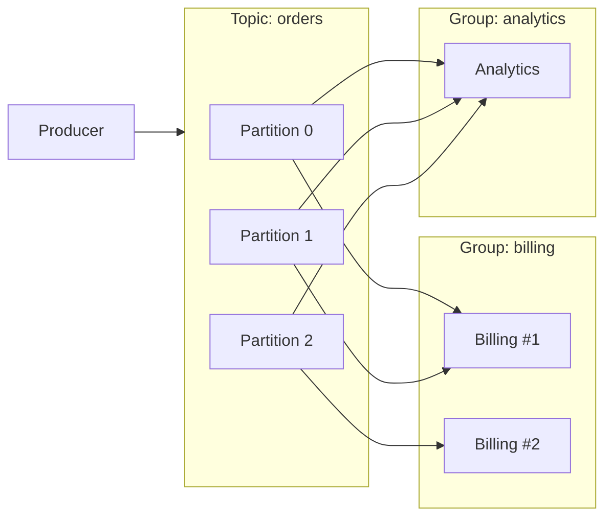
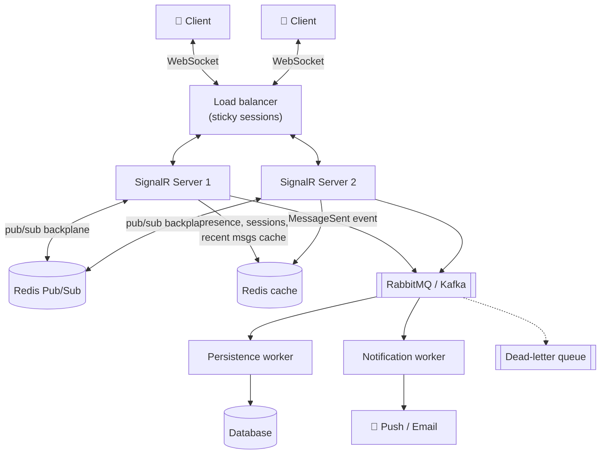

# ⚡ Redis, Websockets, Pub Subs and Message Queues

These four show up together in almost every **real-time backend** (chat, live notifications, dashboards, multiplayer games). Each solves a different problem:

| Piece | Problem it solves |
| --- | --- |
| **Redis** | "I need super-fast shared state / cache." |
| **WebSockets** | "I need to push data to the client instantly." |
| **Pub/Sub** | "I need to broadcast an event to everyone listening, right now." |
| **Message Queues** | "I need work to be done reliably, even if a worker crashes." |

> 👉 *"WebSockets talk to users. Pub/Sub talks between servers. Queues make sure nothing important is lost. Redis is the fast glue in the middle."*

---

## 🧠 1. What is Redis?

**Redis** (REmote DIctionary Server) is an **in-memory key-value data store**.

- Data lives in **RAM**, so reads/writes take **sub-millisecond** time.
- Single-threaded command execution → every command is **atomic**.
- Not just strings. It has real **data structures**.
- Uses its own simple protocol, **RESP**.

### 🧰 Data structures (and what they're good for)

| Type | Example use |
| --- | --- |
| **String** | Cache a JSON blob, counters (`INCR`), feature flags |
| **Hash** | A user profile: `user:42 → {name, email, plan}` |
| **List** | Simple queue, recent activity feed |
| **Set** | Unique visitors, online users, tags |
| **Sorted Set** | **Leaderboards**, rate limiting by timestamp, priority queues |
| **Stream** | Append-only event log with consumer groups (section 9) |
| **Pub/Sub channels** | Real-time broadcast (section 4) |
| Others | Bitmaps, HyperLogLog (approx. counts), Geo (nearby search) |

> 💡 Redis is used as a **cache, session store, rate limiter, leaderboard, distributed lock, pub/sub broker, and lightweight queue**. That's why it's everywhere.

---

## 🗄️ 2. Redis as a Cache

### Cache-aside (lazy loading) — the most common pattern



1. Check Redis first.
2. On a **miss**, read from the DB.
3. Write it to Redis with a **TTL**.
4. On update, **write to DB, then delete the cache key** (next read refills it).

```csharp
using StackExchange.Redis;
using System.Text.Json;

public class ProductService(IConnectionMultiplexer redis, IProductRepository repo)
{
    private readonly IDatabase _cache = redis.GetDatabase();

    public async Task<Product?> GetAsync(int id)
    {
        var key = $"product:{id}";
        var cached = await _cache.StringGetAsync(key);
        if (cached.HasValue)
            return JsonSerializer.Deserialize<Product>(cached.ToString());

        var product = await repo.GetByIdAsync(id);          // cache miss → DB
        if (product is not null)
            await _cache.StringSetAsync(key, JsonSerializer.Serialize(product), TimeSpan.FromMinutes(10));
        return product;
    }

    public async Task UpdateAsync(Product p)
    {
        await repo.UpdateAsync(p);
        await _cache.KeyDeleteAsync($"product:{p.Id}");      // invalidate
    }
}

// Program.cs: one multiplexer for the whole app (it's thread-safe and expensive to create)
// builder.Services.AddSingleton<IConnectionMultiplexer>(ConnectionMultiplexer.Connect("localhost:6379"));
```

### Other caching patterns

| Pattern | How | Trade-off |
| --- | --- | --- |
| **Cache-aside** | App manages cache on reads | Simple; first read is slow; possible stale data |
| **Write-through** | Write to cache and DB together | Cache always fresh; slower writes |
| **Write-behind** | Write to cache, flush to DB later | Fast writes; **risk of data loss** |

### ⏳ TTL and eviction

- **TTL** (`EXPIRE`): key auto-deletes after N seconds. Always set one on cache keys.
- When memory hits `maxmemory`, Redis **evicts** keys based on `maxmemory-policy`:

| Policy | Evicts |
| --- | --- |
| `noeviction` | Nothing. Writes fail with an error (default) |
| `allkeys-lru` | Least recently used key. **Good default for a pure cache** |
| `allkeys-lfu` | Least frequently used key |
| `volatile-lru` / `volatile-ttl` | Only keys that have a TTL |

> ⚠️ **Cache stampede**: a hot key expires and 1,000 requests hit the DB at once. Fixes: add random jitter to TTLs, use a lock so only one request refills, or refresh hot keys early.

### 💾 Persistence (briefly)

Redis is in-memory, but it can save to disk:

| Option | How | Trade-off |
| --- | --- | --- |
| **RDB** | Point-in-time **snapshots** every N minutes | Compact, fast restart; can lose the last few minutes |
| **AOF** | **Logs every write** command, replays on restart | More durable (e.g. `fsync` every second); bigger files |
| **Both** | Common in production | Best of both |

> 💡 For a pure cache, persistence is often turned off. For sessions or queues, turn it on.

---

## 🔌 3. WebSockets (In Brief) and the Multi-Server Problem

> Full details: [WebSockets](../02-networking/chapter-2-advanced/real-time-communication/03-websockets.md)

- A **WebSocket** is a **persistent, full-duplex** connection over TCP.
- Starts as an HTTP request with `Upgrade: websocket`, then stays open.
- The server can **push** messages anytime. Perfect for chat, live scores, notifications.
- In .NET, **SignalR** wraps WebSockets (with fallbacks) and adds groups, reconnection, etc.

### 😬 The scaling problem

One server can hold maybe tens of thousands of connections. So you add more servers behind a load balancer. Now:



- Each server only knows about **its own** connections.
- Alice (Server 1) messages Bob (Server 2) → Server 1 has **no socket for Bob**.

> 💡 The fix: servers need a way to **broadcast to each other**. That's **Pub/Sub**.

---

## 📢 4. Pub/Sub (Publish / Subscribe)

- **Publishers** send messages to a **channel** (topic).
- **Subscribers** listen on channels.
- Publishers don't know who the subscribers are. Fully **decoupled**.
- One message → **fan-out** to every subscriber.

### Redis Pub/Sub

- Super simple and super fast.
- **Fire-and-forget**: if no subscriber is listening at that moment, the message is **gone**.
- No storage, no acks, no replay.

```csharp
var sub = redis.GetSubscriber();
var channel = RedisChannel.Literal("chat:room:42");

// Subscriber
await sub.SubscribeAsync(channel, (ch, message) =>
{
    Console.WriteLine($"[{ch}] {message}");
});

// Publisher (could be a different process / server)
long receivers = await sub.PublishAsync(channel, "Hello, room 42!");
// 'receivers' = how many subscribers got it (0 means it was dropped)
```

> ⚠️ Redis Pub/Sub is **at-most-once**. If a server restarts, it misses everything sent while it was down. Fine for "live" updates; **not** fine for orders or payments.

---

## 🔗 5. Pub/Sub as a WebSocket Backplane

Every WebSocket server **subscribes** to Redis. When any server needs to send a message, it **publishes** to Redis, and every server pushes it to its own local clients.



### SignalR + Redis backplane (one line!)

```csharp
// dotnet add package Microsoft.AspNetCore.SignalR.StackExchangeRedis
builder.Services.AddSignalR()
    .AddStackExchangeRedis("localhost:6379", options =>
    {
        options.Configuration.ChannelPrefix = RedisChannel.Literal("chatapp");
    });

public class ChatHub : Hub
{
    public Task JoinRoom(string room) => Groups.AddToGroupAsync(Context.ConnectionId, room);

    // Reaches users in this group on ALL servers, via Redis
    public Task SendMessage(string room, string user, string text) =>
        Clients.Group(room).SendAsync("ReceiveMessage", user, text);
}
```

> ⚠️ SignalR still needs **sticky sessions** at the load balancer (unless clients use WebSockets only and skip negotiation). The backplane fixes broadcasting, not connection affinity.

> 💡 At very large scale, Microsoft recommends **Azure SignalR Service** instead of a self-managed Redis backplane.

---

## 📬 6. Message Queues

A **message queue** stores messages **until a consumer processes them**. Unlike Redis Pub/Sub, messages **survive** if nobody is listening.



Why use one:

- **Decoupling**: the API doesn't wait for slow work (emails, image resize, PDF generation).
- **Load leveling**: a traffic spike fills the queue; workers drain it at their own pace.
- **Reliability**: if a worker crashes, the message is redelivered.

### Popular options

| Tool | Model | Notes |
| --- | --- | --- |
| **RabbitMQ** | Broker with exchanges + queues | Flexible routing, per-message acks, classic choice |
| **AWS SQS** | Managed queue | Zero ops; Standard (at-least-once) or FIFO |
| **Azure Service Bus** | Managed broker | Queues + topics, sessions, DLQ built in |
| **Kafka** | Distributed **log** | Huge throughput, replay, event streaming |

### 🔀 Point-to-point vs Pub/Sub delivery

| | **Point-to-point (queue)** | **Pub/Sub (topic)** |
| --- | --- | --- |
| Each message goes to | **One** consumer | **Every** subscriber |
| Use for | Jobs / tasks (send this email) | Events (order placed → billing, shipping, analytics) |
| In RabbitMQ | Many workers on one queue | Fanout/topic exchange → one queue per subscriber |

### ✅ Acks, retries and dead letters

- **Ack**: consumer tells the broker "done, delete it". Ack **after** the work, not before.
- **No ack / crash** → broker redelivers to another worker.
- **Retries**: retry a few times (ideally with backoff).
- **Dead-letter queue (DLQ)**: after N failures, park the message aside for humans to inspect. Stops one bad "poison" message from blocking the queue forever.

### 🔁 At-least-once + idempotency

Most queues guarantee **at-least-once** delivery. A message **can arrive twice** (e.g. worker finished but crashed before acking).

| Delivery guarantee | Meaning |
| --- | --- |
| At-most-once | May lose messages, never duplicates (Redis Pub/Sub) |
| **At-least-once** | Never loses, **may duplicate** (most queues) |
| Exactly-once | Very hard; only within limited scopes (e.g. Kafka transactions) |

So consumers must be **idempotent**: processing the same message twice has the same effect as once.

- Store processed `messageId`s and skip duplicates.
- Use upserts / unique constraints instead of blind inserts.

> 💡 *"Exactly-once delivery is a myth; exactly-once **processing** = at-least-once + idempotency."*

---

## 🐰 7. RabbitMQ in C# (Producer + Consumer with Manual Ack)

Using **RabbitMQ.Client 7.x** (fully async API).

### Producer

```csharp
using RabbitMQ.Client;
using System.Text;
using System.Text.Json;

var factory = new ConnectionFactory { HostName = "localhost" };
await using var conn = await factory.CreateConnectionAsync();
await using var channel = await conn.CreateChannelAsync();

// Dead-letter setup: rejected messages go to orders.dlx → orders.dead
await channel.ExchangeDeclareAsync("orders.dlx", ExchangeType.Fanout, durable: true);
await channel.QueueDeclareAsync("orders.dead", durable: true, exclusive: false, autoDelete: false);
await channel.QueueBindAsync("orders.dead", "orders.dlx", routingKey: "");

await channel.QueueDeclareAsync("orders", durable: true, exclusive: false, autoDelete: false,
    arguments: new Dictionary<string, object?> { ["x-dead-letter-exchange"] = "orders.dlx" });

var body = Encoding.UTF8.GetBytes(JsonSerializer.Serialize(new { OrderId = 123, Total = 499 }));
var props = new BasicProperties { Persistent = true, MessageId = Guid.NewGuid().ToString() };

await channel.BasicPublishAsync(exchange: "", routingKey: "orders",
    mandatory: false, basicProperties: props, body: body);
```

### Consumer

```csharp
using RabbitMQ.Client.Events;

await channel.BasicQosAsync(prefetchSize: 0, prefetchCount: 10, global: false); // max 10 unacked at once

var consumer = new AsyncEventingBasicConsumer(channel);
consumer.ReceivedAsync += async (_, ea) =>
{
    try
    {
        var json = Encoding.UTF8.GetString(ea.Body.Span);
        await ProcessOrderAsync(json, ea.BasicProperties.MessageId); // must be idempotent
        await channel.BasicAckAsync(ea.DeliveryTag, multiple: false);          // ✅ done
    }
    catch (Exception)
    {
        // requeue: false → goes to the dead-letter exchange instead of looping forever
        await channel.BasicNackAsync(ea.DeliveryTag, multiple: false, requeue: false);
    }
};

await channel.BasicConsumeAsync("orders", autoAck: false, consumer: consumer);
```

> 💡 In real apps, run the consumer inside a `BackgroundService`, and consider a library like **MassTransit** that handles retries, DLQs and serialization for you.

---

## 📜 8. Kafka — A Log, Not a Queue

Kafka works differently from RabbitMQ:

- A **topic** is split into **partitions**. Each partition is an **append-only log**.
- Messages are **not deleted on read**. They're kept for a retention period (e.g. 7 days).
- Each consumer tracks its own **offset** (position in the log) → you can **replay** history.
- **Consumer groups**: within a group, each partition goes to **one** consumer (load-balanced work). Different groups each get **all** messages (pub/sub).
- Order is guaranteed **only within a partition**, so use a key (e.g. `orderId`) to keep related events together.



| | **RabbitMQ** | **Kafka** |
| --- | --- | --- |
| Model | Smart broker, queues | Dumb broker, smart consumers, log |
| After consume | Message deleted | Message kept (retention) |
| Replay | No | **Yes** |
| Throughput | High | **Very high** (millions/sec) |
| Best for | Task queues, complex routing | Event streaming, analytics, event sourcing |

---

## ⚖️ 9. Pub/Sub vs Message Queue (and Redis Streams)

| | **Redis Pub/Sub** | **Message Queue** (RabbitMQ / SQS) | **Kafka / Redis Streams** |
| --- | --- | --- | --- |
| Storage | ❌ None | ✅ Until consumed | ✅ Retained log |
| Delivery | At-most-once | At-least-once | At-least-once |
| Recipients | All current subscribers | One consumer per message | Each consumer group |
| Offline consumer | Misses messages | Gets them later | Gets them later (from its offset) |
| Acks | No | Yes | Yes (offsets / `XACK`) |
| Latency | Lowest | Low | Low |
| Use for | Live broadcast, WS backplane, cache invalidation | Background jobs, reliable tasks | Event streams, replay, audit |

### 🌊 Redis Streams (briefly)

A **Redis Stream** is a Kafka-like log **inside Redis**:

- `XADD` appends an entry; entries are **stored**.
- **Consumer groups** (`XREADGROUP`) split work across consumers.
- `XACK` acknowledges; unacked entries sit in a **pending list** and can be claimed by another consumer (`XAUTOCLAIM`).

> 💡 Already running Redis and need a **reliable**, lightweight queue? Streams are often enough before you reach for Kafka.

---

## 🏗️ 10. Putting It All Together — A Chat App



The flow when Alice sends "hi":

1. Alice's message arrives over **WebSocket** at Server 1.
2. Server 1 **publishes** it to **Redis Pub/Sub** → every server pushes it to online room members **instantly**.
3. Server 1 also **enqueues** a `MessageSent` event on the **message queue**.
4. **Persistence worker** saves it to the DB (idempotent on `messageId`).
5. **Notification worker** sends push notifications to **offline** users.
6. **Redis cache** holds online presence and the last N messages per room for fast loading.

> 🧠 **Fast path** (Pub/Sub) for live delivery, **safe path** (queue) for anything that must not be lost.

---

## 💬 Interview Takeaway

> *"In a real-time system, clients hold WebSocket connections to a fleet of servers. Since each server only knows its own connections, we use Redis Pub/Sub as a backplane so any server can broadcast to all others. Redis Pub/Sub is fire-and-forget, so for work that must not be lost, like saving messages or sending notifications, we put events on a durable message queue such as RabbitMQ, SQS or Kafka.*
>
> *Queues give at-least-once delivery with acks, retries and dead-letter queues, so consumers must be idempotent. Redis also serves as a cache using cache-aside with TTLs and an LRU eviction policy."*

---

## 🔑 Final Takeaway

- **Redis** = in-memory, sub-millisecond, rich data structures. Cache with **cache-aside + TTL**; pick an **eviction policy**; RDB/AOF for persistence.
- **WebSockets** = persistent push to clients, but **each server only knows its own sockets**.
- **Pub/Sub** = fan-out to everyone listening **right now**. Redis Pub/Sub is the classic **WebSocket backplane** (`AddStackExchangeRedis` in SignalR).
- **Message queues** = durable, **at-least-once** work delivery with **acks, retries, DLQs**. Make consumers **idempotent**.
- **Kafka** = a replayable **log** with **consumer groups**; **Redis Streams** = a lighter version inside Redis.
- Real systems use **both**: pub/sub for **speed**, queues for **safety**.
