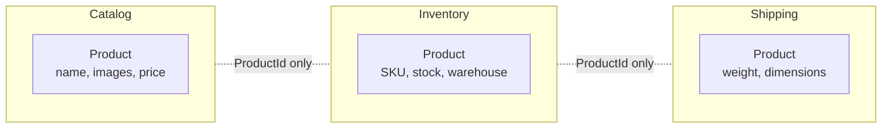
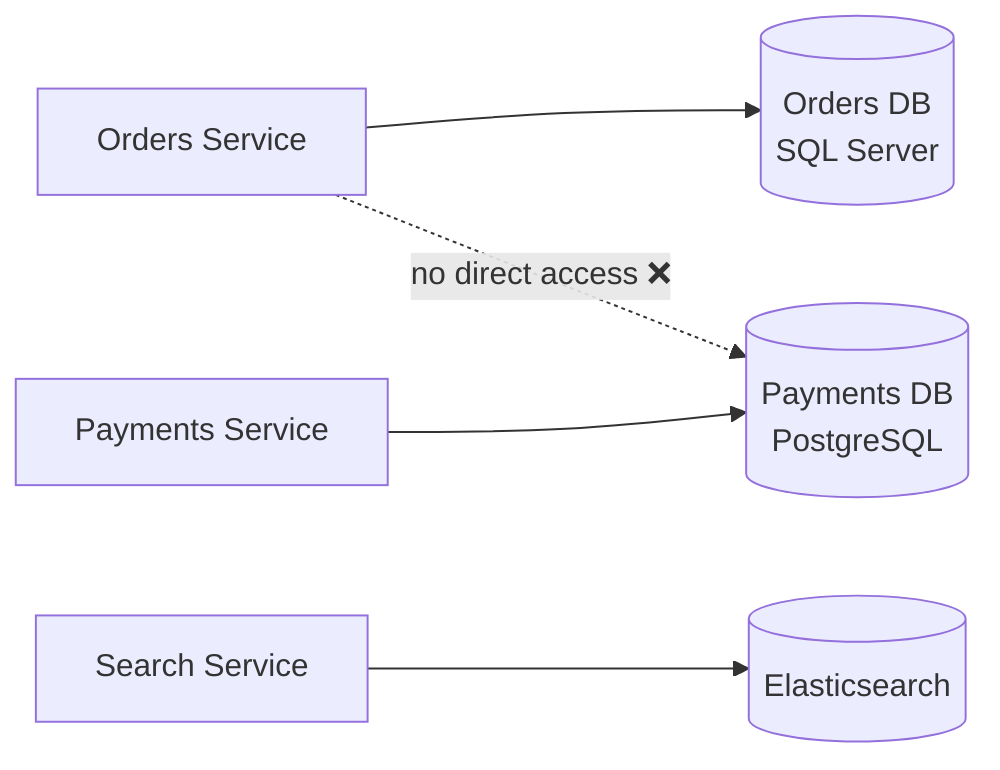
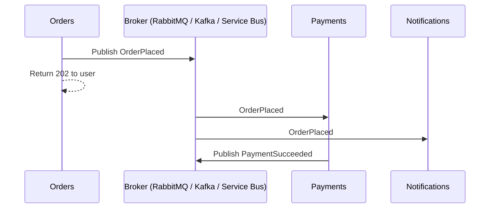
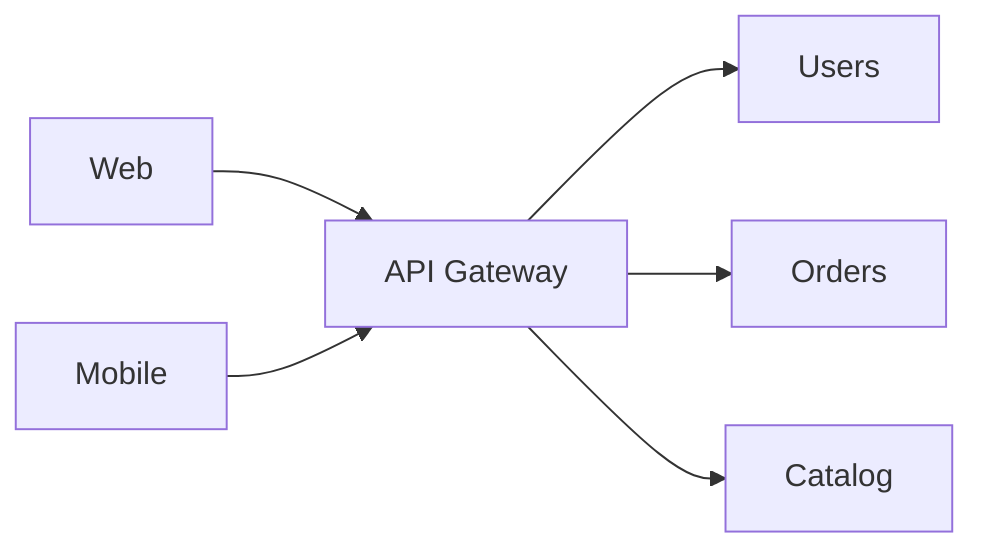
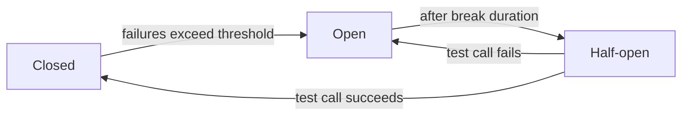
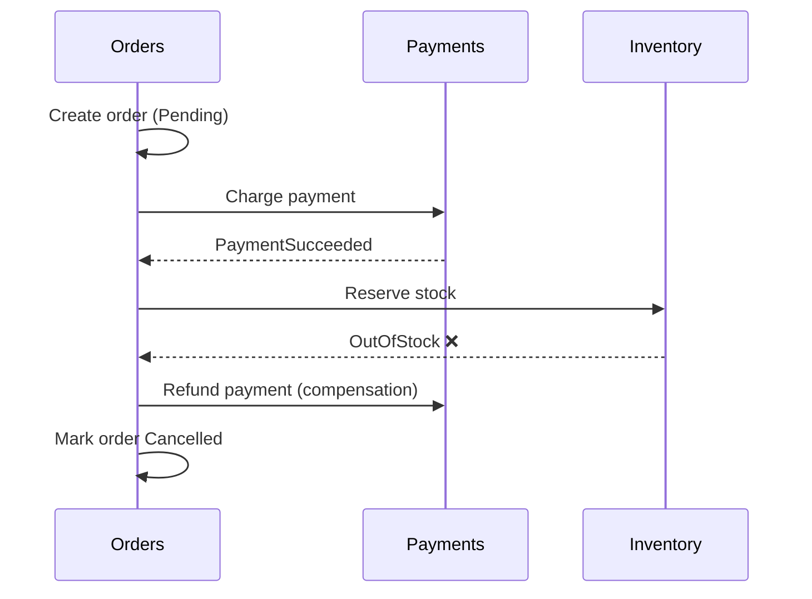
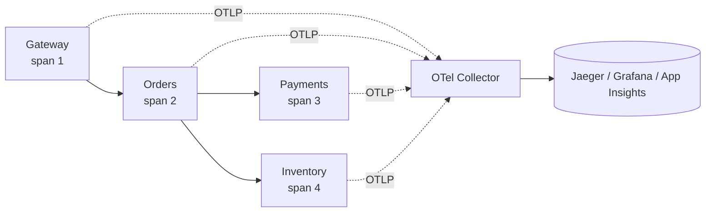

# 🧩 Microservices

> Monolith vs microservices and when to choose which: [Monolith and Microservices](../03-monolith-and-microservices/README.md)
>
> This note is the **practical "learned while building" view**: what you actually have to solve once you split a system.

---

## 🧠 1. What Changes When You Go Microservices?

In a monolith, modules call each other **in-process**. In microservices, every one of those calls becomes a **network call**.

That single change brings a list of new problems:

| Problem | Monolith | Microservices |
| --- | --- | --- |
| Calling another feature | Method call, never "times out" | Network call: slow, fails, times out |
| Transactions | One DB transaction | No shared transaction across services |
| Finding the other side | Same process | Needs **service discovery** |
| Debugging a request | One stack trace | Request hops across 5 services: needs **tracing** |
| Deploying | One artifact | Many artifacts, versions, containers |

> 👉 *"Microservices don't remove complexity. They move it from the code into the network and the infrastructure."*

The rest of this note covers each of these problems.

---

## 🗺️ 2. Service Boundaries (DDD Bounded Contexts)

The hardest decision is **where to cut**. Bad boundaries = services that constantly call each other (a **distributed monolith**).

Use **Domain-Driven Design (DDD)** and its idea of a **bounded context**:

- A bounded context is a part of the business where a word has **one clear meaning**.
- Example: a **"Product"** means different things in **Catalog** (name, images, description), **Inventory** (stock count, warehouse) and **Shipping** (weight, size).
- Each bounded context is a good candidate for **one service**.



### 🏗️ Rules of thumb

- Split by **business capability** (Orders, Payments), not by technical layer ("DataService", "ValidationService").
- A service should be ownable by **one team**.
- If two services **always change together**, they probably belong together.
- If a single user action needs **many synchronous calls** across services, the boundary is likely wrong.
- Services share **IDs**, not entities.

---

## 🗄️ 3. Database per Service

Each service **owns its data**. Nobody else reads or writes its tables directly.



| Why | Cost |
| --- | --- |
| Services deploy and change schema **independently** | No cross-service `JOIN`s |
| Each service picks the **right store** (SQL, document, search) | No cross-service ACID transactions |
| A slow query in one service doesn't hurt others | Data is **duplicated** and **eventually consistent** |

How to get data you don't own:

- **Ask** the owner via its API (sync), or
- **Keep a local copy** updated from the owner's **events** (async). E.g. Orders keeps a small `CustomerName` copy from `CustomerUpdated` events.

> ⚠️ A shared database between services is the #1 sign of a distributed monolith. One schema change breaks several teams.

---

## 📡 4. Communication: Sync vs Async

### Synchronous (request/response): REST or gRPC

The caller **waits** for an answer.

```csharp
// Orders service calling Inventory over REST with a typed HttpClient
public sealed class InventoryClient(HttpClient http)
{
    public async Task<bool> IsInStockAsync(Guid productId, int qty, CancellationToken ct)
    {
        var stock = await http.GetFromJsonAsync<StockDto>($"/api/stock/{productId}", ct);
        return stock is not null && stock.Available >= qty;
    }
}
```

- **REST/JSON**: simple, universal, great for public APIs.
- **gRPC**: binary, fast, strongly typed contracts. Great for **internal** service-to-service calls. See [gRPC](../04-grpc/README.md).

### Asynchronous (events / messages): a message broker

The caller **publishes** a message and moves on. Others react **when they can**.



```csharp
// Consumer in the Payments service (MassTransit style)
public sealed class OrderPlacedConsumer(IPaymentGateway gateway) : IConsumer<OrderPlaced>
{
    public async Task Consume(ConsumeContext<OrderPlaced> ctx)
    {
        await gateway.ChargeAsync(ctx.Message.OrderId, ctx.Message.Total);
        await ctx.Publish(new PaymentSucceeded(ctx.Message.OrderId));
    }
}
```

| | **Sync (REST / gRPC)** | **Async (broker)** |
| --- | --- | --- |
| Coupling | **Temporal coupling**: both must be up | Loose: consumer can be down, messages wait |
| Latency for caller | Sum of all downstream calls | Fast: publish and return |
| Consistency | Immediate answer | Eventual |
| Failure handling | Timeouts, retries, circuit breakers | Retries, dead-letter queues |
| Debugging | Easier | Harder (flow is spread out) |
| Good for | Queries, "I need the answer now" | Commands/events, workflows, fan-out |

> 💡 Practical rule: **queries sync, state changes async**. Avoid long sync chains (A → B → C → D): availability multiplies (99.9%⁴ ≈ 99.6%).

---

## 🚪 5. API Gateway

Clients shouldn't know about 20 internal services. An **API gateway** is the **single entry point**.



What it typically does:

| Responsibility | Example |
| --- | --- |
| **Routing** | `/orders/*` → Orders service |
| **Auth** | Validate JWT once at the edge |
| **Rate limiting** | Per client / API key |
| **TLS termination** | HTTPS outside, plain or mTLS inside |
| **Aggregation** | One client call → several service calls (**BFF**, Backend for Frontend) |

In .NET: **YARP**, or managed options like **Azure API Management**, plus **Ocelot** in older projects.

> ⚠️ Keep business logic **out** of the gateway, or it becomes a new monolith.

---

## 🔍 6. Service Discovery

Service instances come and go (scaling, restarts), so IPs change. **Service discovery** maps a **name** to the **current healthy instances**.

| Approach | How |
| --- | --- |
| **Kubernetes DNS** | `http://orders` resolves to the `orders` Service, which load-balances to pods. Most common today. |
| **Registry** | Consul / Eureka: services register themselves, clients look them up |
| **.NET service discovery** | `Microsoft.Extensions.ServiceDiscovery` resolves logical names from config (used by .NET Aspire) |

```csharp
builder.Services.AddServiceDiscovery();

builder.Services.AddHttpClient<InventoryClient>(c =>
        c.BaseAddress = new Uri("https+http://inventory")) // logical name, resolved at runtime
    .AddServiceDiscovery();
```

> 💡 On Kubernetes, plain DNS names (`http://inventory.default.svc.cluster.local` or just `http://inventory`) are usually enough.

---

## ⚙️ 7. Configuration

Same container image, **different config** per environment (dev, staging, prod).

- Follow **12-factor**: config comes from the **environment**, not the code.
- Non-secret config: `appsettings.json` + environment variables / Kubernetes **ConfigMaps**.
- Secrets: **Key Vault** / Kubernetes **Secrets**, never in the repo.

```csharp
builder.Services
    .AddOptions<PaymentsOptions>()
    .Bind(builder.Configuration.GetSection("Payments"))
    .ValidateDataAnnotations()
    .ValidateOnStart(); // fail fast at startup, not on the first request

// Env var override in a container: Payments__TimeoutSeconds=5
```

---

## 🛡️ 8. Resilience: Timeouts, Retries, Circuit Breakers, Idempotency

The network **will** fail. Design for it.

| Pattern | What it does | Why |
| --- | --- | --- |
| **Timeout** | Give up after N seconds | A hanging call holds threads and connections |
| **Retry** (with backoff + jitter) | Try again on transient errors (503, timeouts) | Many failures are short blips |
| **Circuit breaker** | After many failures, **stop calling** for a while and fail fast | Gives the sick service time to recover; avoids cascading failure |
| **Bulkhead** | Limit concurrent calls per dependency | One slow dependency can't eat all resources |
| **Fallback** | Return cached / default data | Degrade gracefully |

In .NET 8, use **`Microsoft.Extensions.Http.Resilience`** (built on **Polly v8**):

```csharp
builder.Services.AddHttpClient<PaymentsClient>(c => c.BaseAddress = new Uri("http://payments"))
    .AddResilienceHandler("payments", pipeline =>
    {
        pipeline.AddTimeout(TimeSpan.FromSeconds(10));          // total budget
        pipeline.AddRetry(new HttpRetryStrategyOptions
        {
            MaxRetryAttempts = 3,
            BackoffType = DelayBackoffType.Exponential,
            UseJitter = true
        });
        pipeline.AddCircuitBreaker(new HttpCircuitBreakerStrategyOptions
        {
            FailureRatio = 0.5,                                  // open if 50% fail...
            SamplingDuration = TimeSpan.FromSeconds(30),         // ...within 30s
            MinimumThroughput = 10,
            BreakDuration = TimeSpan.FromSeconds(15)
        });
        pipeline.AddTimeout(TimeSpan.FromSeconds(2));           // per attempt
    });

// Or the sensible defaults in one line:
// builder.Services.AddHttpClient<PaymentsClient>().AddStandardResilienceHandler();
```



### 🔁 Idempotency: retries make it mandatory

If you retry a `POST /payments` that **actually succeeded** but timed out, you may **charge twice**.

- Client sends an **`Idempotency-Key`** header (a GUID per logical operation).
- Server stores processed keys and returns the **saved result** for repeats.

```csharp
app.MapPost("/payments", async (PaymentRequest req,
    [FromHeader(Name = "Idempotency-Key")] string key, PaymentsDb db, CancellationToken ct) =>
{
    var existing = await db.Payments.SingleOrDefaultAsync(p => p.IdempotencyKey == key, ct);
    if (existing is not null) return Results.Ok(existing);   // already done, same answer

    var payment = Payment.Create(req, key);                  // unique index on IdempotencyKey
    db.Payments.Add(payment);
    await db.SaveChangesAsync(ct);
    return Results.Created($"/payments/{payment.Id}", payment);
});
```

> ⚠️ Message consumers need the same: brokers deliver **at least once**, so the same message can arrive twice. Track processed message IDs.

---

## 🔄 9. Distributed Transactions: Saga and Outbox

No single DB transaction spans Orders + Payments + Inventory. **Two-phase commit (2PC)** exists but is slow, blocking, and poorly supported by brokers and cloud databases. Instead:

### 🧵 Saga

A saga is a **sequence of local transactions**. If a step fails, earlier steps are undone with **compensating actions**.



| Style | How | Trade-off |
| --- | --- | --- |
| **Choreography** | Services react to each other's **events**, no central brain | Simple for few steps; hard to follow as it grows |
| **Orchestration** | A **saga orchestrator** tells each service what to do | Flow is explicit in one place; orchestrator is extra code |

> 💡 Compensation is **not a rollback**. A refund is a new business action. Some things (an email sent) can't be undone.

### 📤 Transactional Outbox

Classic bug: you save the order **and then** publish `OrderPlaced`. If the app crashes in between, the event is **lost**. Publish first? Then the DB write might fail.

**Outbox fix**: write the event into an **outbox table in the same DB transaction**, and publish it later.

```csharp
// 1) Same transaction: business data + outbox row
db.Orders.Add(order);
db.OutboxMessages.Add(new OutboxMessage
{
    Id = Guid.NewGuid(),
    Type = nameof(OrderPlaced),
    Payload = JsonSerializer.Serialize(new OrderPlaced(order.Id, order.Total)),
    OccurredAt = DateTime.UtcNow
});
await db.SaveChangesAsync(ct); // atomic

// 2) Background publisher
public sealed class OutboxPublisher(IServiceScopeFactory scopes, IMessageBus bus) : BackgroundService
{
    protected override async Task ExecuteAsync(CancellationToken ct)
    {
        while (!ct.IsCancellationRequested)
        {
            using var scope = scopes.CreateScope();
            var db = scope.ServiceProvider.GetRequiredService<OrdersDbContext>();
            var batch = await db.OutboxMessages.Where(m => m.ProcessedAt == null)
                                               .OrderBy(m => m.OccurredAt).Take(50).ToListAsync(ct);
            foreach (var msg in batch)
            {
                await bus.PublishAsync(msg.Type, msg.Payload, msg.Id, ct); // may publish twice on crash
                msg.ProcessedAt = DateTime.UtcNow;
            }
            await db.SaveChangesAsync(ct);
            await Task.Delay(TimeSpan.FromSeconds(1), ct);
        }
    }
}
```

> ⚠️ The outbox gives **at-least-once** publishing, so consumers must be **idempotent** (use the message `Id`). Libraries like **MassTransit** and **NServiceBus** have built-in outbox support.

---

## 🔭 10. Observability: Logs, Metrics, Traces

One user click can touch 6 services. Without observability, you're blind.

| Pillar | Answers | Tools |
| --- | --- | --- |
| **Logs** | *What happened?* (structured, with `TraceId`) | Serilog, Seq, ELK, Loki |
| **Metrics** | *How much / how fast?* (RPS, error rate, latency p95/p99) | Prometheus, Grafana, Azure Monitor |
| **Traces** | *Where did the time go* across services? | Jaeger, Zipkin, Tempo, App Insights |

**OpenTelemetry** is the vendor-neutral standard. It propagates a **trace context** (W3C `traceparent` header) across HTTP/gRPC/messaging so each hop joins the same trace.

```csharp
builder.Services.AddOpenTelemetry()
    .ConfigureResource(r => r.AddService("orders-service"))
    .WithTracing(t => t
        .AddAspNetCoreInstrumentation()
        .AddHttpClientInstrumentation()
        .AddOtlpExporter())                 // send to collector / Jaeger / etc.
    .WithMetrics(m => m
        .AddAspNetCoreInstrumentation()
        .AddHttpClientInstrumentation()
        .AddOtlpExporter());

builder.Logging.AddOpenTelemetry(o => o.AddOtlpExporter());
```



> 💡 Also expose **health checks** (`/health/live`, `/health/ready`) so the platform knows when to restart or stop routing to an instance.

```csharp
builder.Services.AddHealthChecks().AddDbContextCheck<OrdersDbContext>(tags: ["ready"]);
app.MapHealthChecks("/health/live", new() { Predicate = _ => false }); // process is up
app.MapHealthChecks("/health/ready", new() { Predicate = c => c.Tags.Contains("ready") });
```

---

## 🚢 11. Deployment: Containers and Kubernetes

Each service ships as a **container image**: same artifact from dev to prod.

- .NET 8 can build images **without a Dockerfile**: `dotnet publish /t:PublishContainer`.
- **Kubernetes** runs and manages the containers.

| Kubernetes concept | What it does for microservices |
| --- | --- |
| **Deployment** | Runs N replicas, does **rolling updates** |
| **Service** | Stable name + load balancing (service discovery) |
| **Ingress / Gateway** | External HTTP entry point |
| **ConfigMap / Secret** | Configuration and secrets per environment |
| **Probes** | Liveness / readiness → uses your health checks |
| **HPA** | **Autoscales** replicas on CPU / custom metrics |

### 🏗️ Deployment practices

- **One pipeline per service**; independent versions.
- **Backward-compatible** API and message changes (add fields, don't rename/remove). Old and new versions run side by side during rollout.
- **Blue/green** or **canary** releases for risky changes.
- Optional **service mesh** (Istio, Linkerd) for mTLS, retries and traffic shifting at the infra level.

---

## 💬 Interview Takeaway

> *"In microservices, each service owns one bounded context and its own database. Services talk synchronously with REST or gRPC when they need an immediate answer, and asynchronously through a broker for state changes, which reduces coupling. Because every call is a network call, I add timeouts, retries with backoff, circuit breakers and idempotency keys.*
>
> *For cross-service workflows I use sagas with compensating actions instead of distributed transactions, and the outbox pattern so events are never lost. OpenTelemetry gives me distributed tracing, and each service ships as a container on Kubernetes with health checks and independent deployments."*

---

## 🔑 Final Takeaway

- Cut services along **bounded contexts**, not technical layers.
- **Database per service**: share IDs and events, never tables.
- **Sync** (REST/gRPC) for queries, **async** (broker) for state changes. Avoid long sync chains.
- **API gateway** at the edge, **service discovery** inside.
- Network fails: **timeouts + retries + circuit breaker + idempotency**.
- No distributed transactions: **saga** + **outbox**, with idempotent consumers.
- **Observability is not optional**: logs + metrics + traces via OpenTelemetry.
- **Containers + Kubernetes** for independent, repeatable deployments.
- Related: [Monolith and Microservices](../03-monolith-and-microservices/README.md) · [gRPC](../04-grpc/README.md)
